# MoneyBeetle 업무 분석

> 공부할수록 내 집에 가까워지는 금융 학습 플랫폼 · 2030 사회초년생 대상 LMS

이 문서는 요구사항 명세서와 정책 정의서를 기준으로 사용자 흐름과 운영 흐름을 정리합니다. 값(경험치·캐시·레벨·기간 등)은 정책 정의서가 기준이며, 이 문서와 다르면 정책 정의서를 따릅니다. 괄호 안의 ID는 요구사항(USR·HOM·LRN·QST·GRW·INV·SUB·TCH·ADM·NFR)과 정책(SP·DP·EP) 번호입니다.

---

## 0. 개요

### 학습 구조

학습 구조는 **카테고리 → 소주제 → 강의** 순서입니다(LRN-01). 한 강의에는 영상 1~3개와 영상별 요약글, 테스트 퀴즈(OX 5문제), 퀴즈(4지선다 5~15문제)가 들어갑니다(SP-30).

```
카테고리 (관리자 등록, ADM-02)
└─ 소주제
   └─ 강의 (강사가 만들고 관리자가 검수, TCH-01·ADM-03)
      ├─ 테스트 퀴즈: 영상 시청 전 OX 5문제 (불이익 없음)
      ├─ 영상 1~3개 + 영상별 요약글
      └─ 퀴즈: 영상 시청 후 4지선다 5~15문제 → 70점 이상이면 학습 완료
```

카테고리와 소주제는 관리자가 등록하는 데이터입니다. 요구사항 명세서는 자본(월급 관리·예적금·주식·ETF)과 부동산(청약·전월세·대출)을 예로 들고, 현재 시드 데이터(`sample-data.sql`)는 아래처럼 들어 있습니다.

```
돈 굴리기
├─ 월급 쪼개기
├─ 예금·적금
├─ 국내 주식
├─ 미국 주식
└─ ETF·분산 투자
부동산
├─ 청약
├─ 전·월세
└─ 대출
```

트레이닝(모의투자·모의 청약)은 강의와 별개 메뉴이고 레벨로 열립니다(GRW-08). 적금 비교·전월세 비교·계약 체크리스트는 실습 기능이 아니라 강의 내용으로 다룹니다.

### 홈 화면 구성

| 영역 | 내용 | 관련 ID |
| --- | --- | --- |
| 홈 본문 (위에서부터) | 오늘의 경제 용어 5개 → 이어서 볼 강의 → 학습 기록 → 트레이닝(모의투자·모의 청약) 바로가기 | HOM-01, HOM-02 |
| 햄버거 메뉴 (왼쪽 위) | 프로필(닉네임·프로필 이미지·칭호·레벨·경험치 바·보유 캐시) → 연속 출석 → 시청 기록·학습 완료 → 카테고리(강의: 자본·부동산 / 트레이닝: 모의투자·모의 청약 / 내 학습: 오답노트·스크랩) | HOM-03, HOM-04, HOM-05 |
| 프로필 | 시즌별 랭킹 수상 내역 | HOM-06 |
| 상단 | 통합 검색 (DB 키워드 검색) | 화면 설계 UserSearch |

홈은 첫 방문(UserHome-vr1)과 기존 사용자(UserHome-vr2) 두 가지가 있고, 로그인하면 학습 이력에 따라 둘 중 하나로 갑니다.

### 도메인

| 도메인 | 담당하는 일 | 핵심 데이터 |
| --- | --- | --- |
| 회원 | 가입(이메일 인증), 로그인(이메일·구글), 권한, 설정, 탈퇴 | 회원, 이메일 인증 |
| 학습(LMS) | 카테고리, 강의, 영상·요약글, 시청 기록, 학습 완료, 강의 스크랩, 강의 문의 | 카테고리, 강의, 영상, 시청 기록, 학습 완료, 스크랩, 문의 |
| 퀴즈 | 테스트 퀴즈, 퀴즈, 서버 채점, 오답노트 | 퀴즈 문제, 응시, 오답노트 |
| 오늘의 용어 | 매일 경제 용어 5개 | 용어, 날짜별 세트 |
| 성장 | 출석, 경험치, 레벨·칭호, 캐시, 해금 | 출석, 경험치 내역, 캐시 내역, 레벨 정책 |
| 모의투자 | 시즌·턴, 분야·종목·가격·뉴스, 참가, 거래, 정산·랭킹 | 시즌, 턴, 종목, 가격, 뉴스, 참가 계좌, 거래, 랭킹 |
| 모의 청약 | 청약통장 납입, 가점 계산, 가상 단지·공고, 신청, 산정·발표 | 청약통장, 납입, 단지, 청약 신청 |
| 운영(백오피스) | 강의 검수, 카테고리·용어, 회원·강사, 문의 게시판, 캐시 수동 지급, 시즌·청약 운영 | 관리자 작업 기록 |

### 용어 정리

| 용어 | 뜻 |
| --- | --- |
| 테스트 퀴즈 / 퀴즈 | 영상 시청 전 OX 5문제(점수·경험치·오답노트 영향 없음) / 영상 시청 후 4지선다 5~15문제. 70점 이상이면 학습 완료 |
| 학습 완료 | 퀴즈를 통과한 강의. 학습 완료 보상은 같은 강의에 최초 1회만 |
| XP | 강의 학습 완료, 퀴즈 만점, 출석으로 얻는 경험치 |
| 레벨·칭호 | 최대 Lv.20. Lv.1~3 고시원, 4~7 원룸, 8~11 투룸, 12~16 아파트, 17~20 내 집 |
| 캐시 | 출석·학습 완료·레벨업으로 쌓는 가상 재화. 모의투자 투자 가능 금액과 청약통장 납입에 쓴다 |
| 해금 / 블러 | 레벨 조건을 채워 트레이닝이 열리는 것 / 조건 미달일 때 메뉴를 흐리게 가리고 필요한 레벨을 안내하는 표시 |
| 연속 출석 | 그날(KST) 첫 접속으로 기록한 출석이 이어진 일수. 하루라도 빠지면 0 |
| 시즌·턴·휴장 | 모의투자 운영 기간(14일) / 하루 1턴, 총 12턴 / 일요일(턴 없음) |
| 투자 가능 금액·이월금 | 시즌 참가 때 받는 금액 = 모은 캐시 + 이월금 / 지난 시즌 최종 순자산에 이월 비율·상한을 적용한 금액 |
| 청약통장·납입회차 | 가입과 동시에 만들어지는 가상 통장 / 하루 한 번 납입할 때마다 1 늘어나는 횟수. 가점(통장 점수)과 동점 처리에 쓴다 |

### 해금 규칙 (SP-24)

| 열리는 것 | 조건 |
| --- | --- |
| 모의투자 | Lv.8 (운영 설정 `UNLOCK_LEVEL_TRADING`) |
| 모의 청약 | Lv.12 (운영 설정 `UNLOCK_LEVEL_HOUSING`) |

- 레벨이 모자라면 메뉴를 블러 처리하고 필요한 레벨을 보여 주며, 주소를 직접 입력해도 서버에서 막습니다.
- 해금은 레벨 하나로 정하고 시즌 설정에는 두지 않습니다. 시즌은 랭킹 경쟁 단위입니다.
- 청약통장 조회·납입은 레벨 조건이 없어 해금 전에도 할 수 있습니다(역할분담 #28·#70). 가점의 통장 점수를 미리 쌓는 용도입니다.

### 보상 규칙 (SP-12~14, SP-20~23)

| 행동 | XP | 캐시 |
| --- | --- | --- |
| 강의 학습 완료 (같은 강의 최초 1회) | 150 | 30,000 |
| 퀴즈 만점 보너스 (같은 강의 최초 1회) | 30 | — |
| 출석 (하루 1회) | 연속 1~5일째 10, 6~10일째 20, 11~15일째 30, 16~20일째 40, 21일째부터 50 | 연속 5일째부터 매일 10,000 |
| 레벨업 | — | 새 레벨 × 10,000 (여러 레벨이 한꺼번에 오르면 레벨마다 지급) |
| 모의투자 랭킹 상위 3위 (순자산·수익률 각각) | — | 1위 50,000 / 2위 30,000 / 3위 10,000 + 뱃지·칭호 장식 |
| 테스트 퀴즈, 재응시, 오답노트 다시 풀기, 청약통장 납입, 모의투자 참가 | 0 | — |

레벨 하나에 필요한 경험치는 칭호 구간마다 다릅니다: 고시원 150 · 원룸 200 · 투룸 300 · 아파트 400 · 내 집 600. 누적 경험치는 Lv.8 = 1,250, Lv.12 = 2,450, Lv.20 = 6,250입니다.

---

## 1. 이벤트 스토밍

> 💡 사용자가 서비스를 이용할 때 발생하는 모든 '사건(Event)'을 시간 흐름에 따라 나열하여 도메인(비즈니스 영역)을 분석하는 단계입니다. 복잡한 비즈니스 로직을 시각화하여, 백엔드의 도메인 설계와 프론트의 UI 흐름을 도출할 수 있습니다.

### 읽는 법

| 색 | 의미 | 예시 |
| --- | --- | --- |
| 🟨 노랑 | 액터: 행동하는 사람 또는 시스템 | 방문자, 회원, 강사, 관리자, 시스템 |
| 🟦 파랑 | 커맨드: 액터가 요청하는 행동 | 퀴즈 제출 |
| 🟧 주황 | 도메인 이벤트: 이미 일어난 사실 (과거형) | 학습 완료됨 |
| 🟪 보라 | 정책: 이벤트가 일어나면 자동으로 이어지는 규칙 | XP·캐시 지급, 해금 확인 |

### 전체 그림

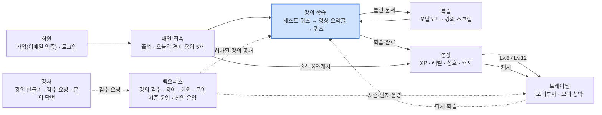

**표로 보기**

| 출발 | 연결 | 도착 |
| --- | --- | --- |
| 회원 | → | 매일 접속 (출석 · 오늘의 경제 용어) |
| 매일 접속 | → | 강의 학습 |
| 매일 접속 | → (출석 XP·캐시) | 성장 |
| 강의 학습 | → (틀린 문제) | 복습 (오답노트 · 강의 스크랩) |
| 복습 | → | 강의 학습 |
| 강의 학습 | → (학습 완료) | 성장 |
| 성장 | → (Lv.8 / Lv.12, 캐시) | 트레이닝 |
| 트레이닝 | ⇢ (다시 학습) | 강의 학습 |
| 강사 | ⇢ (검수 요청) | 백오피스 |
| 백오피스 | ⇢ (허가된 강의 공개) | 강의 학습 |
| 백오피스 | ⇢ (시즌·단지 운영) | 트레이닝 |

### ① 가입 · 로그인

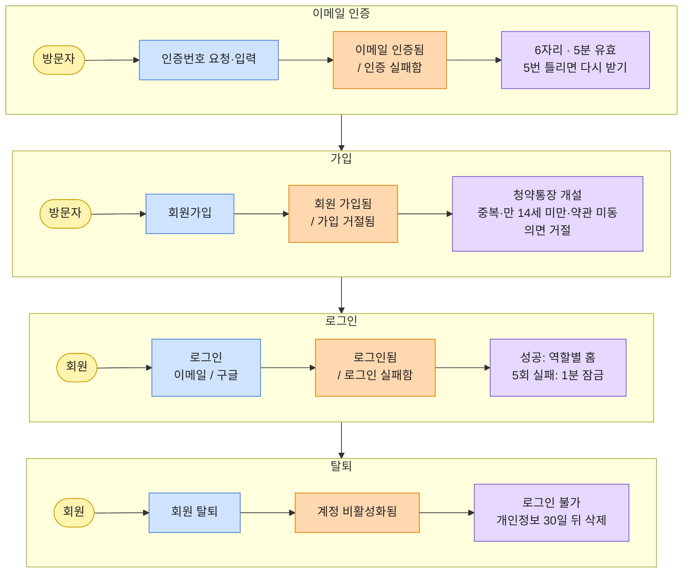

**표로 보기**

| 단계 | 액터 | 커맨드 | 도메인 이벤트 | 정책 (이어서 일어나는 일) |
| --- | --- | --- | --- | --- |
| 이메일 인증 | 방문자 | 인증번호 요청 · 입력 | 이메일 인증됨 / 인증 실패함 | 6자리, 5분 유효, 5번 틀리면 다시 받기, 같은 이메일 60초에 1번 (DP-44) |
| 가입 | 방문자 | 회원가입 (이메일·비밀번호·닉네임·생년월일·성별·약관) | 회원 가입됨 / 가입 거절됨 | 이메일·닉네임 중복, 만 14세 미만, 필수 약관 미동의면 거절 (SP-01~05) |
| 청약통장 개설 | 시스템 | 회원 가입됨 확인 | 청약통장 개설됨 | 가입과 동시에 가상 청약통장 생성 (SP-70) |
| 로그인 | 회원 | 로그인 | 로그인됨 / 로그인 실패함 | 성공: 역할별 홈 / 실패: 이메일 유지 + 안내, 5회 실패 시 1분 잠금 (DP-10) |
| 간편 로그인 | 방문자 | 구글로 로그인 | 간편 로그인됨 | 처음이면 닉네임·생년월일·성별·약관을 이어서 입력. 같은 이메일의 기존 계정과 자동 연결하지 않음 (DP-13) |
| 탈퇴 | 회원 | 회원 탈퇴 | 계정 비활성화됨 | 로그인 불가, 개인정보는 30일 뒤 삭제 (DP-06) |

단계는 위에서 아래로 차례대로 이어집니다 (이메일 인증 → 가입 → 로그인 → 탈퇴). 청약통장 개설과 간편 로그인은 표에만 적었습니다.

### ② 매일 접속 (출석 · 오늘의 경제 용어)

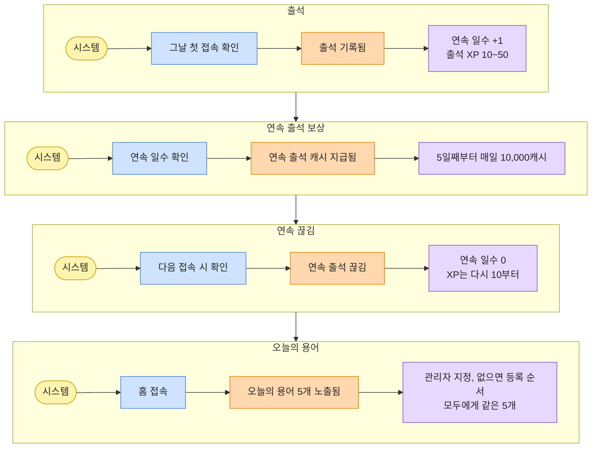

**표로 보기**

| 단계 | 액터 | 커맨드 | 도메인 이벤트 | 정책 |
| --- | --- | --- | --- | --- |
| 출석 | 시스템 | 그날(KST) 첫 접속 확인 | 출석 기록됨 | 하루 1번. 연속 일수 +1, 출석 XP 10~50 (SP-10, 22) |
| 연속 출석 보상 | 시스템 | 연속 일수 확인 | 연속 출석 캐시 지급됨 | 연속 5일째부터 매일 10,000캐시 (SP-12) |
| 연속 끊김 | 시스템 | 다음 접속 시 확인 | 연속 출석 끊김 | 연속 일수 0, 출석 XP는 다시 10부터 (SP-11, 22) |
| 오늘의 용어 | 시스템 | 홈 접속 | 오늘의 용어 5개 노출됨 | 관리자가 지정한 5개, 없으면 등록 순서대로 자동 선정. 모두에게 같은 5개 (SP-45, 46) |

### ③ 강의 학습 · 퀴즈 · 성장

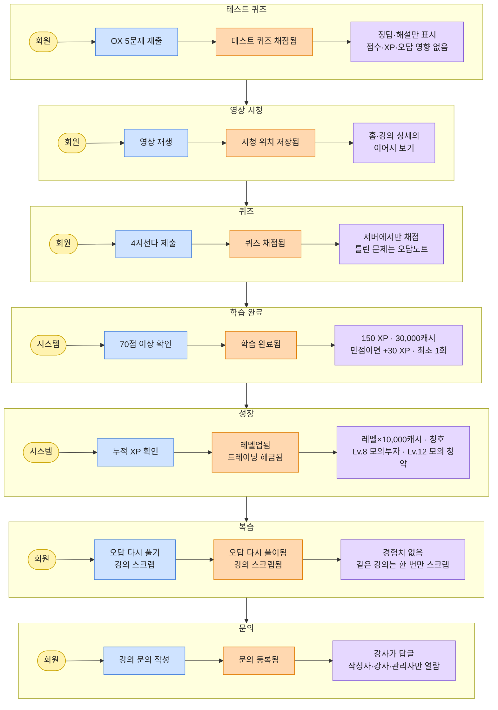

**표로 보기**

| 단계 | 액터 | 커맨드 | 도메인 이벤트 | 정책 |
| --- | --- | --- | --- | --- |
| 강의 찾기 | 회원 | 카테고리 → 소주제 → 강의 선택 / 검색 / 이어서 보기 | 강의 상세 조회됨 | 허가·공개된 강의만 보임 (LRN-01, SP-31) |
| 테스트 퀴즈 | 회원 | OX 5문제 제출 | 테스트 퀴즈 채점됨 | 정답·해설만 표시. 점수·XP·오답노트 영향 없음, 횟수 제한 없음 (SP-33) |
| 영상 시청 | 회원 | 영상 재생 (최대 3개) | 시청 위치 저장됨 | 홈·강의 상세의 이어서 보기에 표시 (SP-38) |
| 퀴즈 | 회원 | 4지선다 5~15문제 제출 | 퀴즈 채점됨 | 서버에서만 채점, 같은 요청은 한 번만 처리 (SP-35, DP-37) |
| 오답 저장 | 시스템 | 채점 결과 확인 | 오답노트에 저장됨 | 틀린 문제만, 같은 문제는 한 번만 (SP-36) |
| 학습 완료 | 시스템 | 70점 이상 확인 | 학습 완료됨 | 150 XP + 30,000캐시, 만점이면 +30 XP. 같은 강의는 최초 1회만 (SP-13, 22, 34) |
| 미통과 | 회원 | 다시 풀기 | 퀴즈 재응시됨 | 횟수 제한 없음, 보상은 최초 통과 때만 (SP-34) |
| 레벨업 | 시스템 | 누적 XP 확인 | 레벨업됨 / 칭호 바뀜 | 새 레벨 × 10,000캐시, 여러 레벨이면 모두 지급 (SP-14, 20, 21, 23) |
| 해금 | 시스템 | 해금 레벨 확인 | 트레이닝 해금됨 | 모의투자 Lv.8, 모의 청약 Lv.12. 미달이면 블러 + 필요 레벨 안내 (SP-24) |
| 복습 | 회원 | 오답노트 다시 풀기 | 오답 다시 풀이됨 | 경험치 없음 (SP-22) |
| 스크랩 | 회원 | 강의 스크랩 / 해제 | 강의 스크랩됨 / 해제됨 | 같은 강의는 한 번만 (SP-39) |
| 문의 | 회원 | 강의 문의 작성 | 문의 등록됨 | 금칙어 검사, 하루 10개. 작성자·강사·관리자만 열람 (SP-40, DP-30) |
| 답변 | 강사 | 문의 답글 작성 | 답변 등록됨 | 학습자가 내 문의에서 확인 (TCH-09) |

### ④ 강사 강의 등록 · 관리자 검수

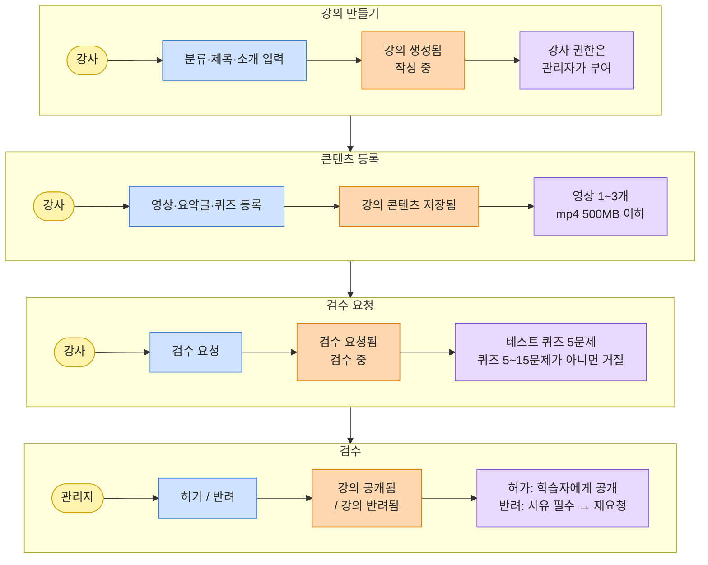

**표로 보기**

| 단계 | 액터 | 커맨드 | 도메인 이벤트 | 정책 |
| --- | --- | --- | --- | --- |
| 강의 만들기 | 강사 | 카테고리·소주제 선택, 제목·소개 입력 | 강의 생성됨 (작성 중) | 강사 권한은 관리자가 부여 (SP-07) |
| 콘텐츠 등록 | 강사 | 영상(1~3개)·요약글·테스트 퀴즈·퀴즈 등록 | 강의 콘텐츠 저장됨 | 영상 4개 이상 불가, mp4 500MB 이하 (SP-30, DP-33) |
| 검수 요청 | 강사 | 검수 요청 | 검수 요청됨 (검수 중) | 테스트 퀴즈 5문제, 퀴즈 5~15문제가 아니면 거절 (DP-34) |
| 허가 | 관리자 | 강의 허가 | 강의 공개됨 | 학습자 강의 목록에 노출, 작업 기록 (SP-31, DP-43) |
| 반려 | 관리자 | 강의 반려 (사유 필수) | 강의 반려됨 | 강사 화면에 사유 표시 → 고쳐서 재요청 (SP-31) |
| 수정 | 강사 | 허가된 강의 수정 | 재검수 요청됨 | 다시 검수 (SP-31) |
| 비공개 | 관리자 | 공개 강의 비공개 / 삭제 | 강의 비공개됨 | 학습 기록이 있으면 삭제 대신 비공개만 (SP-32) |

### ⑤ 모의투자 시즌

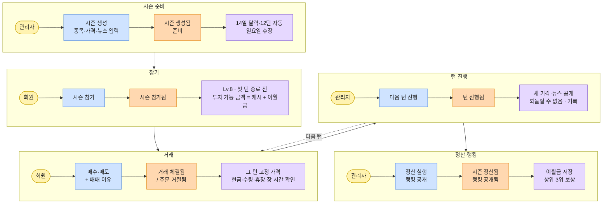

**표로 보기**

| 단계 | 액터 | 커맨드 | 도메인 이벤트 | 정책 |
| --- | --- | --- | --- | --- |
| 시즌 생성 | 관리자 | 시즌 이름·시작일(월요일) 입력 | 시즌 생성됨 (준비) | 14일 달력·12턴 자동 생성, 일요일 휴장·랭킹 공개일. 기간 겹침 불가 (SP-50, 65) |
| 시장 데이터 | 관리자 | 분야(15)·종목(30)·턴별 가격·뉴스 입력 | 가격·뉴스 등록됨 | ±30% 넘는 변동은 경고, 0원 이하 불가, 지난 턴 가격 수정 불가 (SP-60) |
| 시즌 시작 | 관리자 | 시즌 시작 | 시즌 진행 중 | 이전 시즌이 정산·종료돼 있어야 함 (SP-65) |
| 참가 | 회원 | 시즌 참가 | 시즌 참가됨 | Lv.8 이상, 시즌당 1번, 첫 턴 종료 전까지. 투자 가능 금액 = 모은 캐시 + 이월금 (SP-51, 52) |
| 매수·매도 | 회원 | 주문 + 매매 이유 선택 | 거래 체결됨 / 주문 거절됨 | 그 턴 고정 가격. 현금·보유 수량 초과, 휴장일, 장 시간(08~20시) 밖, 이전 턴 가격이면 거절 (SP-53~58) |
| 턴 진행 | 관리자 | 다음 턴 진행 | 턴 진행됨 | 다음 턴 30개 가격·뉴스가 다 있어야 하고 장 마감 뒤에만. 되돌릴 수 없음, 기록 남김 (SP-59) |
| 휴장 | 시스템 | 일요일 | 휴장됨 | 주문·턴 진행 잠금, 월요일에 다시 진행 중 (SP-65) |
| 정산 | 관리자 | 정산 실행 | 시즌 정산됨 | 최종 순자산 확정, 이월 비율·상한 적용해 이월금 저장 (SP-63) |
| 랭킹 공개 | 관리자 | 랭킹 공개 | 랭킹 공개됨 | 순자산·수익률 랭킹. 각 상위 3위에 장식 + 50,000/30,000/10,000캐시, 수상 내역 기록 (SP-62, 64) |

단계는 위에서 아래로 이어지고, 12턴이 끝나기 전에는 "턴 진행" 뒤 "거래" 단계로 돌아갑니다.

### ⑥ 모의 청약

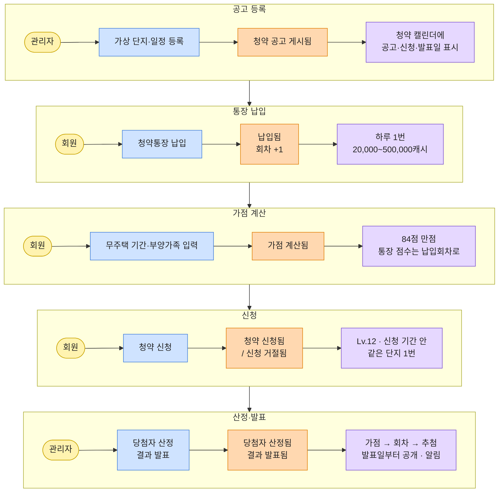

**표로 보기**

| 단계 | 액터 | 커맨드 | 도메인 이벤트 | 정책 |
| --- | --- | --- | --- | --- |
| 공고 등록 | 관리자 | 가상 단지·공고·신청·발표 일정 등록 | 청약 공고 게시됨 | 청약 캘린더에 표시 (SUB-02) |
| 통장 납입 | 회원 | 청약통장 납입 (20,000~500,000캐시) | 납입됨 (납입회차 +1) | 하루 1번, 인정금액은 하루 250,000까지, 캐시 부족이면 거절 (SP-70) |
| 가점 계산 | 회원 | 무주택 기간·부양가족 수 입력 | 가점 계산됨 | 무주택 32 + 부양가족 35 + 통장 17 = 84점, 납입 1회 = 1개월 (SP-71) |
| 신청 | 회원 | 청약 신청 | 청약 신청됨 / 신청 거절됨 | Lv.12 이상, 신청 기간 안, 같은 단지 1번. 취소·수정 불가 (SP-72, 73) |
| 접수 마감 | 시스템 | 신청 기간 끝 | 경쟁률 공개됨 | 경쟁률 = 신청자 수 ÷ 공급 세대 수 (SP-74) |
| 당첨자 산정 | 관리자 | 산정 실행 | 당첨자 산정됨 | 마감 다음 날부터 1번. 가점 → 납입회차 → 추첨 순, 공급 세대 수만큼 당첨. 회원에게는 아직 안 보임 (SP-75) |
| 발표 | 관리자 | 결과 발표 | 당첨 결과 발표됨 | 발표일부터 1번. 결과 공개 + 신청자 전원 알림 (SP-75) |
| 단지 수정 | 관리자 | 단지 정보 수정 | 단지 수정됨 / 거절됨 | 신청자가 있거나 산정한 단지는 일정·공급 세대 수 수정·삭제 불가 (SP-76) |

### ⑦ 관리자 운영

| 단계 | 액터 | 커맨드 | 도메인 이벤트 | 정책 |
| --- | --- | --- | --- | --- |
| 카테고리 | 관리자 | 카테고리·소주제 등록·수정 | 카테고리 변경됨 | (ADM-02) |
| 경제 용어 | 관리자 | 용어 등록, 날짜별 5개 지정 | 오늘의 용어 지정됨 | 5개 미만이면 저장 불가, 지난 날짜 변경 불가 (SP-47) |
| 회원·강사 | 관리자 | 계정 정지·해제, 강사 권한 부여·회수 | 계정 상태 바뀜 / 권한 바뀜 | 정지 계정 로그인 불가, 작업 기록 (SP-06, DP-43) |
| 문의 게시판 | 관리자 | 부적절한 글 숨김·삭제 | 문의 숨김됨 | "관리자에 의해 숨김 처리된 글이에요" 표시 (DP-22) |
| 캐시 | 관리자 | 캐시 수동 지급·회수 (사유 필수) | 캐시 지급됨 / 회수됨 | 잔액 0 미만 불가, 1회 10억 이하, 기록 남김 (SP-17) |

### 이벤트 목록 (애그리거트별)

| 도메인 | 애그리거트 | 관련 이벤트 |
| --- | --- | --- |
| 회원 | 회원, 이메일 인증 | 이메일 인증됨, 회원 가입됨, 로그인됨, 계정 상태 바뀜 |
| 학습 | 카테고리, 강의(영상·요약글), 시청 기록, 학습 완료, 스크랩, 문의 | 강의 공개됨, 시청 위치 저장됨, 학습 완료됨, 문의 등록됨 |
| 퀴즈 | 테스트 퀴즈, 퀴즈, 응시, 오답노트 | 퀴즈 채점됨, 오답노트에 저장됨 |
| 오늘의 용어 | 용어, 날짜별 세트 | 오늘의 용어 지정됨 |
| 성장 | 출석, 경험치, 레벨, 캐시 내역 | 출석 기록됨, 레벨업됨, 캐시 지급됨, 트레이닝 해금됨 |
| 모의투자 | 시즌, 턴, 종목·가격·뉴스, 참가 계좌, 거래, 랭킹 | 시즌 진행 중, 시즌 참가됨, 거래 체결됨, 턴 진행됨, 시즌 정산됨, 랭킹 공개됨 |
| 모의 청약 | 청약통장, 납입, 단지·공고, 청약 신청 | 청약통장 개설됨, 납입됨, 청약 신청됨, 당첨자 산정됨, 결과 발표됨 |
| 운영 | 관리자 작업 기록 | 턴 진행, 정산, 랭킹 공개, 캐시 수동 지급, 강의 허가·반려, 계정 정지 |

### 핫스팟 (팀이 정해야 할 것)

정책 정의서 5장 "팀 확인 필요"와 같은 내용입니다.

- [ ] 시즌 참가 때 캐시를 차감할지, 그대로 둘지 (SP-51)
- [ ] 퀴즈 통과 70점, 해금 레벨 Lv.8 / Lv.12 확정 (SP-24, 34)
- [ ] 청약 신청 후 취소 허용 여부 (SP-73, 현재 불가)
- [ ] 수수료·세금 없음(학습용 단순화) 유지 여부 (SP-56)
- [ ] 성별 필수 여부, 탈퇴 후 개인정보 보관 기간 (DP-06)

---

## 2. 업무 분석 - 사용자

> 💡 사용자가 서비스에 들어와서 목표를 달성하고 나갈 때까지의 핵심 여정(User Flow)을 구체화하는 페이지입니다.

사용자는 학습자(회원)와 강사입니다. 관리자는 3장(백오피스)에 있습니다.

### 메인 프로세스 (학습자)

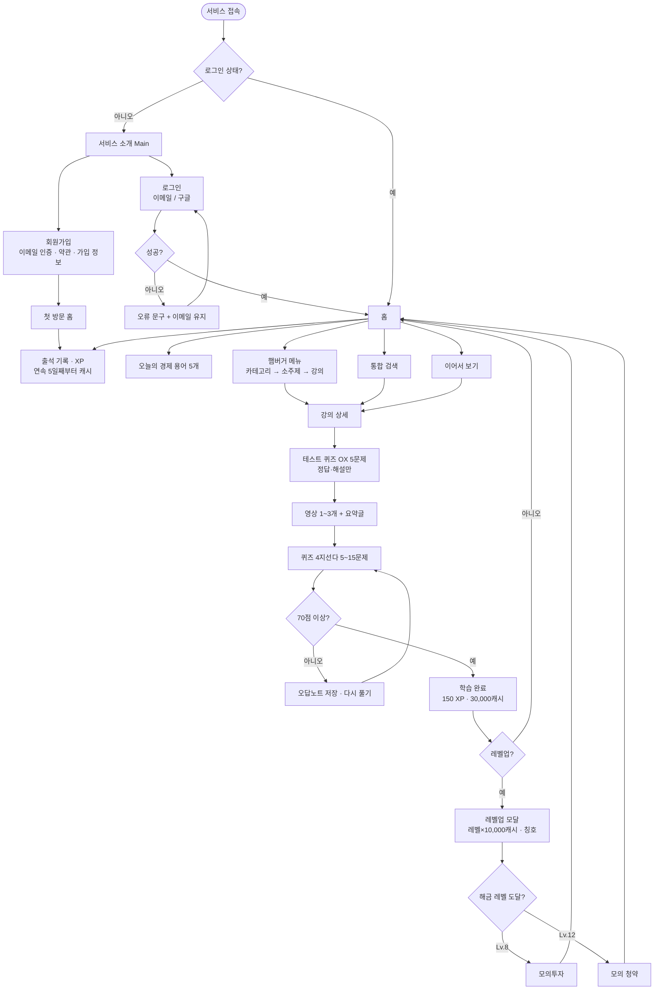

**목록으로 보기**

1. **접속·로그인**
   - 로그인 안 함 → 서비스 소개(Main) → 회원가입 또는 로그인
     - 회원가입: 이메일 인증번호 확인 → 비밀번호·약관·닉네임·생년월일·성별 입력 → 첫 방문 홈 (가입과 동시에 청약통장 개설)
     - 로그인: 이메일 / 구글 간편 로그인 → 실패하면 오류 문구 + 이메일 유지, 5회 실패 시 1분 잠금
   - 로그인 상태 → 홈
2. **홈** (그날 첫 접속이면 출석 기록 · 출석 XP · 연속 5일째부터 10,000캐시)
   - 오늘의 경제 용어 5개 (모두에게 같은 5개)
   - 이어서 보기 · 학습 기록
   - 햄버거 메뉴: 프로필 → 연속 출석 → 카테고리(강의 / 트레이닝 / 내 학습)
   - 상단 통합 검색
3. **강의 학습**
   - 강의 상세 → 테스트 퀴즈(OX 5문제, 불이익 없음) → 영상·요약글 → 퀴즈(4지선다)
   - 70점 미만 → 틀린 문제 오답노트 저장 → 다시 풀기
   - 70점 이상 → 학습 완료: 150 XP + 30,000캐시 (만점이면 +30 XP, 최초 1회)
4. **성장**
   - 레벨업 → 레벨업 모달, 새 레벨 × 10,000캐시, 칭호(고시원 → 원룸 → 투룸 → 아파트 → 내 집)
   - Lv.8 → 모의투자 해금 / Lv.12 → 모의 청약 해금 (미달이면 메뉴 블러 + 필요 레벨 안내)
5. **트레이닝** → 모의투자·모의 청약 흐름 (아래) → 홈으로 돌아와 다시 학습

### 강의 상세 흐름

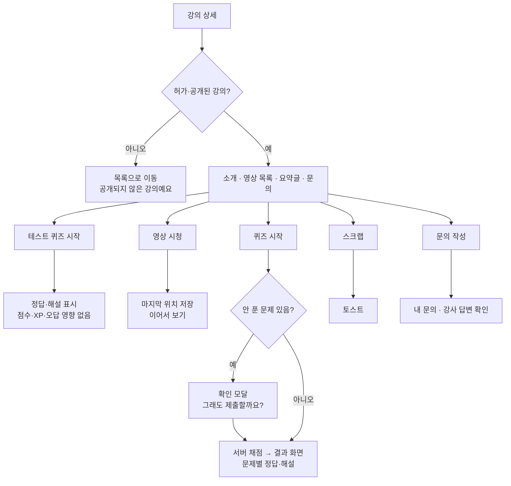

**목록으로 보기**

- 강의 상세 → 허가·공개된 강의인가?
  - 아니오 → 목록으로 이동 ("공개되지 않은 강의예요")
  - 예 → 소개 · 영상 목록 · 요약글 · 문의 탭
    - 테스트 퀴즈 → 정답·해설 표시 (점수·XP·오답노트 영향 없음, 횟수 제한 없음)
    - 영상 시청 → 마지막 위치 저장 → 홈·강의 상세의 이어서 보기
    - 퀴즈 → 안 푼 문제가 있으면 확인 모달 → 서버 채점 → 결과 화면(문제별 정답·해설)
    - 스크랩 → 토스트 (같은 강의는 한 번만)
    - 문의 작성 → 마이페이지·문의 게시판에서 내 문의와 강사 답변 확인

### 모의투자 흐름

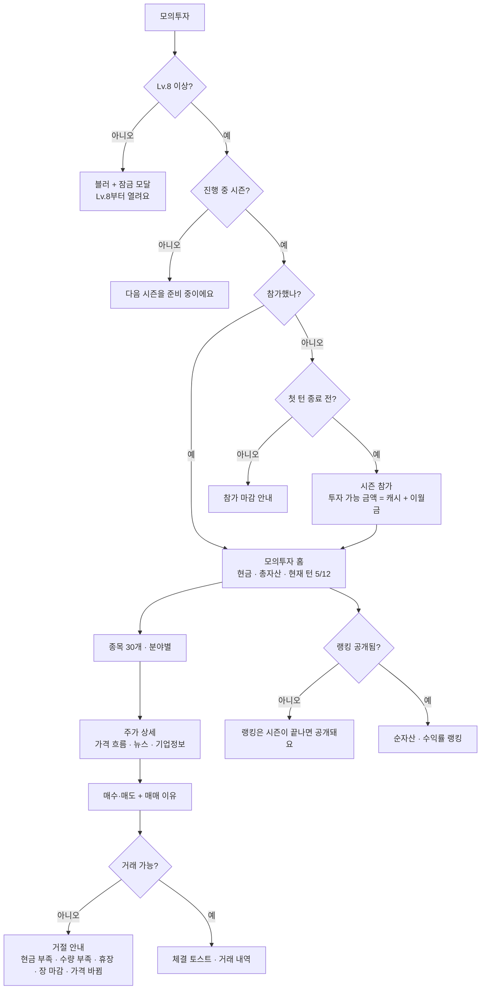

**목록으로 보기**

1. 모의투자 메뉴 → Lv.8 미만이면 잠금 모달
2. 진행 중 시즌이 없으면 "다음 시즌을 준비 중이에요"
3. 참가 전이면 시즌 참가 (첫 턴이 끝나기 전까지, 시즌당 1번) → 투자 가능 금액 확정 (모은 캐시 + 이월금)
4. 모의투자 홈: 나의 주식(종목별 금액·수익률), 현금, 총자산, 현재 턴
5. 종목 목록(15개 분야 × 2개) → 주가 상세(가격 흐름 · 뉴스 탭 · 기업정보 탭)
6. 매수·매도 → 수량 + 매매 이유 선택 → 주문 확인 모달 → 체결 토스트 / 거절 안내
7. 랭킹: 시즌 중에는 비공개 → 관리자가 정산·공개한 뒤 순자산·수익률 랭킹

### 모의 청약 흐름

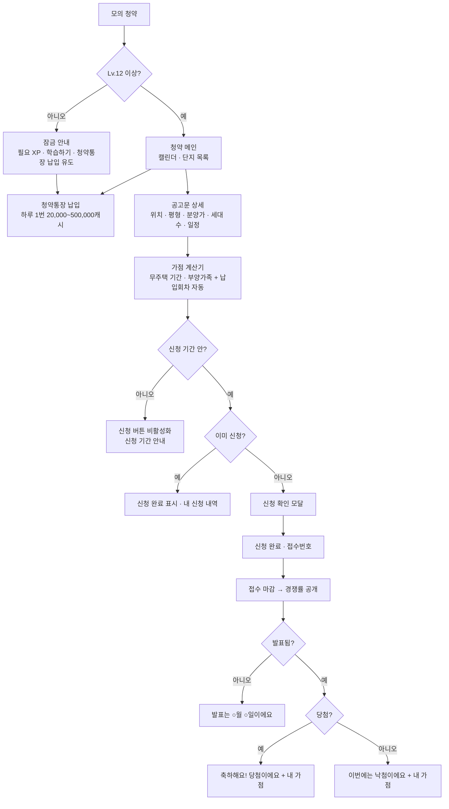

**목록으로 보기**

1. 모의 청약 메뉴 → Lv.12 미만이면 잠금 안내 (청약통장 납입은 미리 할 수 있게 유도)
2. 청약 메인: 공고일·신청 기간·발표일 캘린더, 단지 목록
3. 청약통장 납입: 하루 1번, 1회 20,000~500,000캐시, 납입마다 회차 +1
4. 공고문 상세 → 가점 계산기(무주택 기간 0~50년, 부양가족 0~20명 입력, 통장 점수는 납입회차로 자동, 84점 만점)
5. 신청 기간 안 + 아직 신청 안 함 → 신청 확인 모달 → 신청 완료 (취소·수정 불가)
6. 접수 마감 → 경쟁률 공개 → 관리자가 발표하면 당첨·낙첨 결과와 내 가점 확인

### 강사 흐름

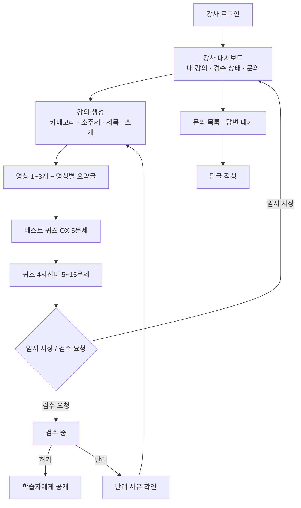

**목록으로 보기**

1. 강사 로그인 → 강사 대시보드 (등록 강의, 검수 상태, 답변 대기 문의)
2. 강의 생성 6단계: 분류 → 강의 정보 → 영상과 요약글 → 테스트 퀴즈 → 퀴즈 → 임시 저장 / 검수 요청
3. 검수 요청 후 관리자 처리 전까지 수정 제한 → 허가되면 공개 / 반려되면 사유 확인 후 고쳐서 재요청
4. 허가된 강의를 고치면 다시 검수
5. 내 강의 문의 목록 → 답글 작성

### 화면별 UI 상호작용

표현 방식은 **페이지 이동**(새 화면), **모달**(확인이 필요한 작업), **드로어**(햄버거 메뉴), **토스트**(잠깐 떴다 사라지는 안내), **인라인**(입력칸 아래 안내)으로 통일합니다.

| 화면 | 사용자가 하는 것 | 결과 | 표현 방식 |
| --- | --- | --- | --- |
| 서비스 소개 | 로그인 / 회원가입 버튼 | 로그인 / 회원가입 화면 | 페이지 이동 |
| 회원가입 | 인증번호 받기 | 이메일로 6자리 발송, 재요청은 60초 뒤 | 같은 화면 + 토스트 |
| 회원가입 | 비밀번호 보기/가리기 | 입력 내용 표시·숨김 | 같은 화면 |
| 회원가입 | 가입 | 첫 방문 홈 | 페이지 이동 |
| 공통 | 왼쪽 위 햄버거 버튼 | 프로필 · 연속 출석 · 카테고리 메뉴 | 드로어 |
| 공통 | 잠긴 메뉴(모의투자·모의 청약) 클릭 | 필요 레벨과 현재 레벨 안내 | 모달 |
| 공통 | 상단 검색 | 검색 결과 | 페이지 이동 |
| 홈 | 오늘의 용어 카드 넘기기 | 카드 전환 | 같은 화면 |
| 홈 | 이어서 보기 · 학습 기록 클릭 | 해당 강의 상세 | 페이지 이동 |
| 강의 목록 | 강의 카드 클릭 | 강의 상세 | 페이지 이동 |
| 강의 상세 | 테스트 퀴즈 제출 | 정답·해설 | 같은 화면 |
| 강의 상세 | 영상 선택 | 영상·요약글 전환, 위치 저장 | 같은 화면 |
| 강의 상세 | 스크랩 | 스크랩 완료 / 이미 스크랩한 강의 | 토스트 |
| 퀴즈 | 제출 (안 푼 문제 있음) | 그래도 제출할까요? | 모달 |
| 퀴즈 | 제출 | 결과 화면 (새로고침해도 기존 결과) | 페이지 이동 |
| 퀴즈 결과 | 학습 완료 · 레벨업 · 해금 발생 | 축하 + 받은 XP·캐시, 새로 열린 기능 | 모달 |
| 마이페이지 | 탭 전환 | 학습 기록 · 스크랩 · 오답노트 · 문의 · 청약통장 · 설정 | 같은 화면(탭) |
| 오답노트 | 다시 풀기 | 오답만 다시 풀이 | 페이지 이동 |
| 문의 | 등록 | 내 문의 목록 | 토스트 + 페이지 이동 |
| 모의투자 | 매수·매도 | 종목·수량·금액·매매 이유 확인 | 모달 → 토스트 |
| 모의투자 | 종목 검색 · 분야 필터 · 거래 내역 · 랭킹 | 목록 전환 | 같은 화면(탭) |
| 모의 청약 | 캘린더 날짜 선택 | 그날의 공고·접수·발표 일정 | 같은 화면 |
| 모의 청약 | 단지 상세보기 | 공고문 상세 | 같은 화면 영역 |
| 모의 청약 | 가점 입력 변경 | 항목별 점수·총점 갱신 | 같은 화면 |
| 모의 청약 | 신청 | 신청 내용 확인 → 접수번호 | 모달 → 토스트 |
| 청약통장 | 납입 | 잔액·납입회차 갱신 | 모달 → 토스트 |
| 강사 강의 생성 | 다음 단계 | 단계별 입력 화면 | 같은 화면(단계) |
| 강사 강의 생성 | 검수 요청 | 강사 대시보드 | 모달 → 페이지 이동 |

### 예외 처리

문구는 정책 정의서 3-2가 기준입니다.

| 상황 | 처리 | 사용자에게 보이는 것 |
| --- | --- | --- |
| 로그인 실패 | 같은 화면, 이메일 입력값 유지 | 이메일 또는 비밀번호를 확인해 주세요 |
| 5회 연속 로그인 실패 | 1분 잠금, 이후 5회 실패마다 5분 | 로그인 시도가 너무 많아요. 잠시 뒤에 다시 시도해 주세요 |
| 정지·탈퇴 계정 | 로그인 막음 | 이용이 제한된 계정이에요 / 탈퇴한 계정이에요 |
| 이메일·닉네임 중복 | 가입 막고 입력값 유지 | 이미 가입된 이메일이에요 / 이미 사용 중인 닉네임이에요 |
| 인증번호 틀림 | 5번 틀리면 다시 받기 | 인증번호가 맞지 않아요. 다시 확인해 주세요 |
| 만 14세 미만 | 가입 막음 | 만 14세 이상부터 가입할 수 있어요 |
| 로그인 안 한 접근 | 로그인 화면 → 로그인 후 원래 화면 | 로그인이 필요해요 |
| 세션 만료 (30분) | 위와 같음 | 로그인 시간이 지났어요. 다시 로그인해 주세요 |
| 권한 없는 주소 직접 입력 | 서버에서 막음, 403 오류 페이지 | 이 페이지를 볼 수 있는 권한이 없어요 |
| 잠긴 트레이닝 주소 직접 입력 | 서버에서 레벨 확인 후 막음 | Lv.8부터 열려요. 지금은 Lv.5예요 (값은 상황에 맞게) |
| 검색 결과 없음 | 검색어 수정 안내 | 결과가 없어요 |
| 강의가 없는 소주제 | 빈 상태 안내 | 아직 등록된 강의가 없어요 |
| 영상 재생 실패 | 다시 시도 버튼, 3번 실패하면 문의 안내 | 영상을 불러오지 못했어요. 다시 시도해 주세요 |
| 퀴즈 중 이탈 | 제출 전에는 기록 안 함 | 다시 들어오면 처음부터 |
| 퀴즈 새로고침·중복 제출 | 결과 화면으로 redirect, 같은 요청은 한 번만 처리 | 기존 결과 그대로 |
| 퀴즈 미통과 | 결과 화면 | N점이에요. 70점 이상이면 통과예요. 다시 도전해 볼까요? |
| 문의 하루 10개 초과 | 등록 막음 | 오늘은 문의를 더 남길 수 없어요 |
| 금칙어 포함 | 등록 막음 | 사용할 수 없는 표현이 들어 있어요 |
| 현금·보유 수량 부족 | 주문 거절 | 현금이 부족해요 / 보유한 수량보다 많이 팔 수 없어요 |
| 이전 턴 가격으로 주문 | 주문 거절 | 가격이 바뀌었어요. 현재 가격을 확인해 주세요 |
| 휴장일 주문 | 주문 막음 | 오늘은 휴장일이에요. 다음 거래일에 다시 거래할 수 있어요 |
| 정산 중 주문 | 주문 막음 | 시즌이 끝났어요. 결과를 기다려 주세요 |
| 청약 신청 기간 밖 | 신청 버튼 비활성화 | 신청 기간은 ○월 ○일 ~ ○월 ○일이에요 |
| 같은 단지 중복 신청 | 신청 막음, 기존 신청 내역으로 이동 | 신청 완료 |
| 오늘 이미 납입 / 캐시 부족 | 납입 막음 | 오늘은 이미 납입했어요 / 캐시가 부족해요 |
| 처리 중 서버 오류 | 변경 내용 모두 되돌림 | 처리하지 못했어요. 내 정보는 바뀌지 않았어요 |
| 시스템 오류 (500) | 공통 오류 페이지 + 홈 버튼 | 잠시 후 다시 시도해 주세요 |
| AI 응답 실패 | 해당 없음. AI 기능이 없고 검색은 DB 키워드 검색 | — |

---

## 3. 업무 분석 - 백오피스

> 💡 일반 사용자가 보는 화면이 아닌, 운영자(관리자)가 서비스를 통제하고 모니터링하는 기능을 정의하는 페이지입니다.

관리자는 강사가 올린 강의를 검수해 공개하고, 경제 용어·회원·강사·문의 게시판을 관리하며, 모의투자 시즌과 모의 청약 단지를 운영합니다. 강의·퀴즈·용어·종목·가격·뉴스·청약 단지는 **코드 수정 없이 강사·관리자 화면에서 바꿀 수 있어야** 합니다 (NFR-13).

### 권한과 기록

- 관리자는 회원 테이블의 역할(role)로 구분하고, `/admin/**` 주소 전체를 서버 필터에서 막습니다. 강사 화면 `/instructor/**`는 강사만 들어갈 수 있습니다. 주소를 직접 입력해도 서버에서 권한을 확인합니다 (DP-14).
- 턴 진행, 정산, 랭킹 공개, 캐시 수동 지급·회수, 강의 허가·반려, 계정 정지는 **누가 언제 했는지** 작업 기록으로 남깁니다 (DP-43).
- 되돌릴 수 없는 작업(턴 진행, 정산, 랭킹 공개, 발표, 탈퇴 처리)은 확인 모달을 거칩니다.

### 메뉴와 기능

**통합 관리자 (AdminDashboard)**

| 메뉴 | 기능 | 요구사항 | 우선순위 |
| --- | --- | --- | --- |
| 대시보드 | 처리할 일(검수 대기·문의 대기·청약 발표), 최근 작업 기록, 주요 메뉴 바로가기 | ADM-01 | 상 |
| 카테고리 관리 | 카테고리와 소주제 등록·수정·삭제 | ADM-02 | 상 |
| 강의 검수 | 영상·요약글·퀴즈 확인 → 허가 / 반려(사유 필수) | ADM-03 | 상 |
| 공개 강의 관리 | 비공개 전환·삭제 (학습 기록이 있으면 비공개만) | ADM-04 | 중 |
| 오늘의 경제 용어 | 용어·뜻 등록·수정·삭제, 날짜별 5개 지정 (미지정 날은 등록 순서대로 자동) | ADM-05 | 상 |
| 레벨·해금 | 레벨 칭호, 모의투자·모의 청약 해금 레벨 (운영 설정) | SP-24 | — |
| 캐시 규칙·지급 | 활동별 지급 캐시 설정, 회원 캐시 수동 지급·회수 (사유 필수) | ADM-29, 30 | 중 / 하 |
| 사용자·강사 | 닉네임·이메일 검색, 계정 정지·해제, 강사 권한 부여·회수 | ADM-06 | 중 |
| 문의 게시판 | 문의글 조회, 부적절한 글 숨김·삭제 | ADM-07 | 중 |
| 작업 기록 | 관리자 작업 이력 조회 | NFR-14 | — |

**모의투자 운영 (AdminTradingManagement)**

| 메뉴 | 기능 | 요구사항 | 우선순위 |
| --- | --- | --- | --- |
| 대시보드 | 진행 시즌, 현재 턴(예: 5/12), 다음 턴 예정 시각, 참가자 수, 오늘 주문 수. 다음 턴 가격·뉴스가 비면 경고 | ADM-08 | 중 |
| 시즌 관리 | 시즌 생성(이름·시작 월요일 → 14일 달력 자동), 상태 관리, 이월 비율·상한 설정, 이전 시즌 복사 | ADM-09~12 | 상 (복사는 하) |
| 턴 관리 | 턴 달력(지난 턴·오늘·남은 턴·휴장일), 다음 턴 진행, 턴 진행 기록 | ADM-13~15 | 상 / 중 |
| 분야·종목 | 15개 분야, 분야별 2개씩 30개 종목(이름·분야·시작 가격), 기업정보 | ADM-16~18 | 상 / 중 |
| 가격 관리 | 종목 × 12턴 표 입력(360칸), 변동률 입력, CSV 업로드·다운로드, 미리보기 차트, 이상값 경고, 지난 턴 잠금 | ADM-19~24 | 상 / 중 / 하 |
| 뉴스 관리 | 턴별 2~3개(제목·본문·관련 분야·종목), 관리자 메모, 지난 턴은 오타만 수정 | ADM-25~27 | 상 / 하 / 중 |
| 참가자 관리 | 닉네임·레벨·투자 가능 금액·순자산·수익률, 보유 종목·거래 내역·매매 이유 | ADM-28 | 중 |
| 랭킹·정산 | 랭킹 미리보기, 정산 실행, 랭킹 공개, 랭킹 보상 지급, 시즌 통계 | ADM-31~35 | 상 / 중 / 하 |

**모의 청약 운영 (AdminHousingManagement)**

| 메뉴 | 기능 | 요구사항 | 우선순위 |
| --- | --- | --- | --- |
| 공고 등록·수정 | 단지명·공공/민간·위치·전용면적·분양가·공급 세대 수, 공고·신청·발표 일정 | ADM-36 | 상 |
| 신청자 목록 | 단지별 신청자, 가점, 납입회차 | ADM-37 | 중 |
| 당첨자 산정 | 산정 버튼 → 가점 → 납입회차 → 추첨 순으로 공급 세대 수만큼 당첨 | ADM-38 | 상 |
| 결과 발표 | 발표일부터 결과 공개 + 신청자 알림 | ADM-39 | 상 |

### 운영 흐름

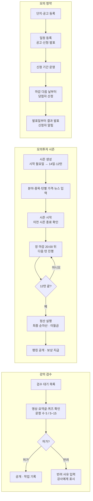

**목록으로 보기**

세 가지 운영 흐름이 나란히 그려져 있습니다.

**강의 검수**
1. 검수 대기 목록에서 강의 선택
2. 영상(1~3개)·요약글·테스트 퀴즈(5문제)·퀴즈(5~15문제) 확인
3. 허가 → 학습자 강의 목록에 공개 / 반려 → 사유 입력(필수) → 강사가 고쳐서 재요청
4. 허가된 강의를 강사가 고치면 다시 검수

**모의투자 시즌**
1. 시즌 생성: 이름 + 시작일(월요일) → 14일 달력 자동 생성 (월~토 진행, 일요일 휴장, 2주차 일요일은 랭킹 공개일)
2. 분야 15개 · 종목 30개 · 턴별 가격(360칸) · 뉴스(턴당 2~3개) 입력
3. 시즌 시작 (준비 → 진행 중). 이전 시즌이 정산·종료돼 있어야 함
4. 매일 장 마감(20:00) 뒤 다음 턴 진행: 다음 턴 가격·뉴스가 모두 있어야 버튼 활성화, "되돌릴 수 없어요" 확인
5. 12턴이 끝나면 정산 실행 → 최종 순자산 확정, 이월 비율·상한 적용해 이월금 저장
6. 랭킹 공개 → 순자산·수익률 각 상위 3위에 장식 + 50,000 / 30,000 / 10,000캐시

**모의 청약**
1. 가상 단지와 공고·신청·발표 일정 등록 → 학습자 청약 캘린더에 표시
2. 신청 기간 운영 (신청자 목록·가점·납입회차 확인)
3. 신청 마감 다음 날부터 단지마다 한 번 당첨자 산정 (회원에게는 아직 안 보임)
4. 발표일부터 한 번 결과 발표 → 회원에게 공개 + 신청자 전원 알림

### 시즌 상태 (SP-65)

| 상태 | 뜻 | 다음 상태 |
| --- | --- | --- |
| 준비 | 시즌을 만들고 데이터를 입력하는 중 | 진행 중 |
| 진행 중 | 월~토, 장 시간 08:00~20:00에 주문 가능 | 휴장 / 정산 |
| 휴장 | 일요일. 주문·턴 진행 잠금 | 진행 중 / 정산 |
| 정산 | 최종 자산 확정, 이월금 계산 중. 주문 불가 | 종료 |
| 종료 | 결과 확정. 거꾸로 돌아가지 않음 | — |

### 백오피스 예외 처리

문구는 정책 정의서 3-2가 기준입니다.

| 상황 | 처리 | 관리자에게 보이는 문구 |
| --- | --- | --- |
| 검수 요청 강의의 문항 수가 맞지 않음 | 강사의 검수 요청 자체가 막힘 | 테스트 퀴즈는 5문제, 퀴즈는 5~15문제여야 해요 |
| 반려 사유 없이 반려 | 막음 | — |
| 학습 기록이 있는 강의 삭제 | 삭제 대신 비공개 | 학습 기록이 있어 삭제할 수 없어요. 비공개로 바꿀까요? |
| 날짜별 용어가 5개 미만 / 지난 날짜 | 저장 막음 | — |
| 다음 턴 가격·뉴스가 비어 있음 | 다음 턴 버튼 비활성화, 비어 있는 항목 목록 | 다음 턴에 가격이 비어 있는 종목이 N개 있어요 |
| 휴장일에 턴 진행 | 버튼 잠금 | 휴장일에는 턴을 넘길 수 없어요 |
| 장 마감(20:00) 전 턴 진행 | 막음 (SP-59) | — |
| 턴 진행 실수 | 되돌리기 없음, 진행 전 확인 모달 | 되돌릴 수 없어요 |
| 지난 턴(현재 턴 포함) 가격 수정 | 막음 | 지난 턴의 가격은 수정할 수 없어요 |
| 지난 턴 뉴스의 턴·분야·종목 변경, 등록·삭제 | 막음 (오타 수정만) | 지난 턴 뉴스는 오타 수정만 할 수 있어요 |
| 한 턴에 ±30%를 넘는 가격 | 경고 후 확인하면 저장 | 한 턴에 ±30%를 넘는 변동이에요. 맞나요? |
| 0원 이하 가격 | 저장 막음 | — |
| CSV 형식 오류 | 올리기 취소, 오류 행 표시 | N행의 형식이 맞지 않아요 |
| 이전 시즌 미종료 상태에서 새 시즌 시작 / 기간 겹침 | 막음 (SP-65) | — |
| 신청 마감 전 산정 / 이미 산정 | 막음 | 신청이 마감된 뒤에 산정할 수 있어요 / 이미 산정한 공고예요 |
| 산정 전 발표 / 발표일 전 발표 / 이미 발표 | 막음 | 당첨자를 먼저 산정해 주세요 / 발표일부터 발표할 수 있어요 / 이미 발표한 공고예요 |
| 신청자가 있거나 산정한 단지의 일정·세대 수 수정, 삭제 | 막음 (이름·위치·면적·분양가·유형은 수정 가능) | — |
| 캐시 수동 지급·회수 사유 없음 / 잔액 부족 | 막음 (1회 1 ~ 10억 캐시) | 사유를 입력해 주세요 / 회수할 캐시가 부족해요 |
