# MoneyBeetle 업무 분석

> 공부할수록 내 집에 가까워지는 금융 학습 플랫폼 · 2030 사회초년생 대상 LMS

---

## 0. 개요

### 카테고리 구조

```
돈 굴리기
├─ 모으기
│  ├─ 월급명세서 읽기
│  ├─ 예산 짜기 ─────────────── 실습: 한 달 예산 챌린지 (선택)
│  ├─ 비상금
│  ├─ 예금과 적금, 단리와 복리
│  ├─ 청년 정책 적금 (소개 수준)
│  └─ 중도해지하면 생기는 일 ── 실습: 적금 비교 + 적금 깨기
└─ 굴리기
   ├─ 주식이란
   ├─ ETF와 펀드, 채권 ───────── 실습: 모의투자
   ├─ 분산 투자, 위험과 수익
   ├─ 코인과 위험 ────────────── 해금: 코인 종목 (Lv.8)
   └─ 투자 사기 유형

부동산
├─ 청약
│  ├─ 청약통장
│  ├─ 자격 조건 (무주택·세대주 등)
│  ├─ 가점 구성 ─────────────── 실습: 청약 점수 계산
│  ├─ 특별공급 (청년·신혼·생애최초)
│  ├─ 청약 일정 ─────────────── 기능: 청약 캘린더
│  ├─ 청약대출
│  ├─ 당첨 후 자금 계획 ──────── 실습: 자금 계획 계산기 (선택)
│  └─ 모의 청약 ─────────────── 실습: 모의 청약
└─ 전세·월세
   ├─ 계약 전 체크리스트, 전세사기 예방 ── 기능: 계약 체크리스트
   ├─ 전세 vs 월세 비용 비교 ──── 실습: 비용 비교 계산기
   ├─ 보증금 보호 개념
   └─ 청년 전월세 지원 (소개 수준)
```

학습 구조는 **카테고리 → 소주제 → 강의 → 단원 → 퀴즈** 순서입니다.

### 홈 화면 구성 (블로그형 레이아웃)

홈은 별도 기능 없이 **블로그처럼 보이도록 배치만** 합니다. 글쓰기·댓글·이웃 기능은 만들지 않고, 이미 있는 학습 데이터를 블로그 형태로 보여줍니다.

| 영역 | 내용 |
| --- | --- |
| 왼쪽 (프로필) | 닉네임, 칭호·레벨 바, 연속 학습 일수, 받은 뱃지, 카테고리 목록 |
| 가운데 (본문) | 오늘의 경제 용어 5개(맨 위 고정), **문제 루프 카드**(맛보기 문제 또는 복습 문제), 이어서 듣기, 최근 학습 기록(단원 완료·퀴즈·실습 결과를 글 목록처럼) |
| 오른쪽 (위젯) | 오늘의 퀘스트, 모의투자 랭킹 TOP 3 + 내 순위, 다가오는 청약 일정 |

### 도메인

| 도메인 | 담당하는 일 | 핵심 데이터 |
| --- | --- | --- |
| 회원 | 가입, 로그인, 성향 고르기, 설정 | 회원, 성향 |
| 학습(LMS) | 카테고리, 강의, 단원, 수강, 진도, 수료 | 카테고리, 강의, 단원, 수강, 진도 |
| 평가 | 단원 퀴즈, 강의 종합 퀴즈, **홈 문제 루프(초급 맛보기 → 학습 → 중·고급 복습)**, 채점, 오답노트, 스크랩 | 퀴즈, 문제(난이도·용도), 응시, 루프 진행, 오답, 스크랩 |
| 오늘의 용어 | 매일 경제 용어 5개, 확인 퀴즈, 내 단어장 | 용어, 날짜별 세트, 학습 기록 |
| 성장(게임) | XP, 레벨·칭호, 연속 학습, 퀘스트, 뱃지, 해금 | XP 기록, 해금 규칙 |
| 실습 | 모의투자(시즌·랭킹), 모의 청약(캘린더·점수·자금 계획), 적금 비교, 전월세 비교, 계약 체크리스트 | 시즌, 시세, 거래, 스냅샷, 청약 단지, 청약 신청 |
| 운영(백오피스) | 콘텐츠, 시즌, 청약 단지, 회원 관리 | 관리자 작업 기록 |

### 용어 정리

| 용어 | 뜻 |
| --- | --- |
| XP | 학습·실습·퀘스트로 얻는 경험치. 모의투자 수익률로는 거의 주지 않음 |
| 레벨·칭호 | 150 XP마다 레벨업. Lv.1~3 텐트, 4~7 원룸, 8~11 투룸, 12~16 아파트, 17~ 내 집 |
| 해금 | 단원 완료나 레벨 조건을 채우면 실습·종목이 열리는 것 |
| 연속 학습 | 오늘의 용어를 매일 완료한 일수 |
| 시즌·턴 | 모의투자 경쟁 기간. 모든 사용자가 같은 시장에서 같은 속도로 턴을 넘김 |
| 극복 | 오답노트 문제를 2번 연속 맞혀 목록에서 졸업하는 것 |
| 문제 루프 | 홈에서 "맛보기 문제 → 학습 → 복습 문제" 순서로 진행되는 학습 흐름 |
| 맛보기 문제 | 아직 배우지 않은 단원의 초급 문제. 실력 평가가 아니라 궁금증을 만드는 용도라 틀려도 불이익 없음 |
| 복습 문제 | 단원을 마친 뒤 홈에 출제되는 같은 주제의 중급·고급 문제 |

### 해금 규칙 (초안)

| 열리는 것 | 조건 |
| --- | --- |
| 적금 비교 | "중도해지하면 생기는 일" 단원 완료 |
| 모의투자 | "ETF와 펀드, 채권" 단원 완료 |
| 모의투자 코인 종목 | "코인과 위험" 단원 완료 + Lv.8 (투룸) |
| 청약 점수 계산 | "가점 구성" 단원 완료 |
| 모의 청약 | 청약 점수 계산 1회 + Lv.8 (투룸) |
| 자금 계획 계산기 | "당첨 후 자금 계획" 단원 완료 |
| 전세 vs 월세 비용 비교 | "전세 vs 월세 비용 비교" 단원 완료 |
| 계약 체크리스트 | 처음부터 열림 |

### XP 규칙 (초안)

| 행동 | XP |
| --- | --- |
| 오늘의 용어 완료 | 20 |
| 단원 완료 | 100 |
| 퀴즈 만점 보너스 | 20 |
| 실습 첫 완료 | 150 |
| 오답 극복 | 문제당 10 |
| 오늘의 퀘스트 3개 모두 완료 | 30 |
| 맛보기 문제 풀기 (정답 여부 무관) | 5 |
| 복습 문제 정답 (중급 / 고급) | 10 / 20 |

---

## 1. 이벤트 스토밍

> 💡 사용자가 서비스를 이용할 때 발생하는 모든 '사건(Event)'을 시간 흐름에 따라 나열하여 도메인(비즈니스 영역)을 분석하는 단계입니다. 복잡한 비즈니스 로직을 시각화하여, 백엔드의 도메인 설계와 프론트의 UI 흐름을 도출할 수 있습니다.

### 읽는 법

| 색 | 의미 | 예시 |
| --- | --- | --- |
| 🟨 노랑 | 액터: 행동하는 사람 또는 시스템 | 회원, 관리자, 시스템 |
| 🟦 파랑 | 커맨드: 액터가 요청하는 행동 | 단원 퀴즈 제출 |
| 🟧 주황 | 도메인 이벤트: 이미 일어난 사실 (과거형) | 단원 완료됨 |
| 🟪 보라 | 정책: 이벤트가 일어나면 자동으로 이어지는 규칙 | XP 지급, 해금 확인 |

### 전체 그림

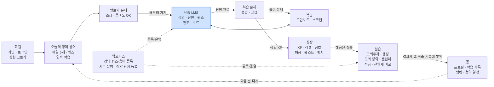

**표로 보기**

| 영역 | 담긴 내용 |
| --- | --- |
| 회원 | 가입 · 로그인 · 성향 고르기 |
| 오늘의 경제 용어 | 매일 5개 · 퀴즈 · 연속 학습 |
| 맛보기 문제 | 초급 · 틀려도 OK |
| 학습 LMS (강조 표시) | 강의 · 단원 · 퀴즈 · 진도 · 수료 |
| 복습 문제 | 중급 · 고급 |
| 복습 | 오답노트 · 스크랩 |
| 성장 | XP · 레벨 · 칭호 · 해금 · 퀘스트 · 뱃지 |
| 실습 | 모의투자 · 랭킹 · 모의 청약 · 캘린더 · 적금 · 전월세 비교 |
| 홈 | 프로필 · 학습 기록 · 랭킹 · 청약 일정 |
| 백오피스 | 강의·퀴즈·용어 등록 · 시즌 운영 · 청약 단지 등록 |

| 출발 | 연결 | 도착 |
| --- | --- | --- |
| 회원 | → | 오늘의 경제 용어 |
| 오늘의 경제 용어 | → | 맛보기 문제 |
| 맛보기 문제 | → (배우러 가기) | 학습 LMS |
| 학습 LMS | → (단원 완료) | 복습 문제 |
| 복습 문제 | → (틀린 문제) | 복습 (오답노트 · 스크랩) |
| 학습 LMS | ↔ | 복습 (오답노트 · 스크랩) |
| 복습 문제 | → (정답 XP) | 성장 |
| 성장 | → (해금된 실습) | 실습 |
| 실습 | → (결과가 홈 학습 기록에 쌓임) | 홈 |
| 홈 | ⇢ (다음 날 다시) | 오늘의 경제 용어 |
| 백오피스 | ⇢ (등록·운영) | 학습 LMS |
| 백오피스 | ⇢ (등록·운영) | 실습 |

### ① 가입 · 매일 학습

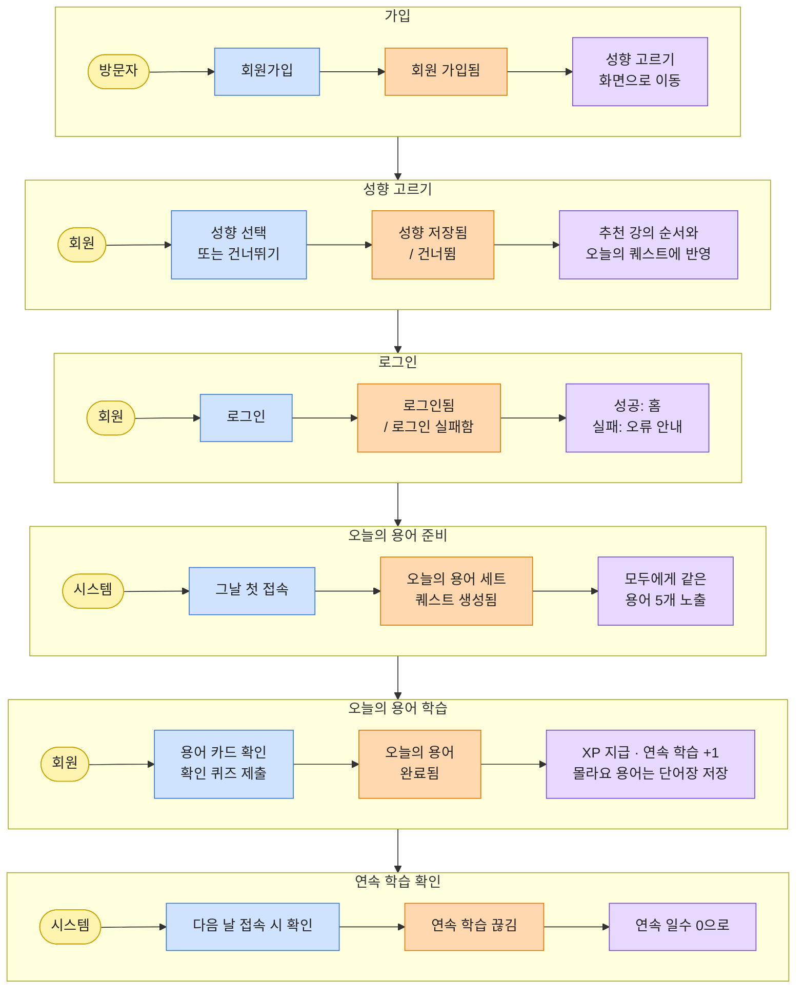

**표로 보기**

| 단계 | 액터 | 커맨드 | 도메인 이벤트 | 정책 (이어서 일어나는 일) |
| --- | --- | --- | --- | --- |
| 가입 | 방문자 | 회원가입 | 회원 가입됨 | 성향 고르기 화면으로 이동 |
| 성향 고르기 | 회원 | 성향 선택 또는 건너뛰기 | 성향 저장됨 / 건너뜀 | 추천 강의 순서와 오늘의 퀘스트에 반영 |
| 로그인 | 회원 | 로그인 | 로그인됨 / 로그인 실패함 | 성공: 홈, 실패: 오류 안내 |
| 오늘의 용어 준비 | 시스템 | 그날 첫 접속 | 오늘의 용어 세트·퀘스트 생성됨 | 모두에게 같은 용어 5개 노출 |
| 오늘의 용어 학습 | 회원 | 용어 카드 확인, 확인 퀴즈 제출 | 오늘의 용어 완료됨 | XP 지급 · 연속 학습 +1, 몰라요 용어는 단어장 저장 |
| 연속 학습 확인 | 시스템 | 다음 날 접속 시 확인 | 연속 학습 끊김 | 연속 일수 0으로 |

단계는 위에서 아래로 차례대로 이어집니다 (가입 → 성향 고르기 → 로그인 → 오늘의 용어 준비 → 오늘의 용어 학습 → 연속 학습 확인).

### ② 홈 문제 루프 (먼저 풀고 배우기)

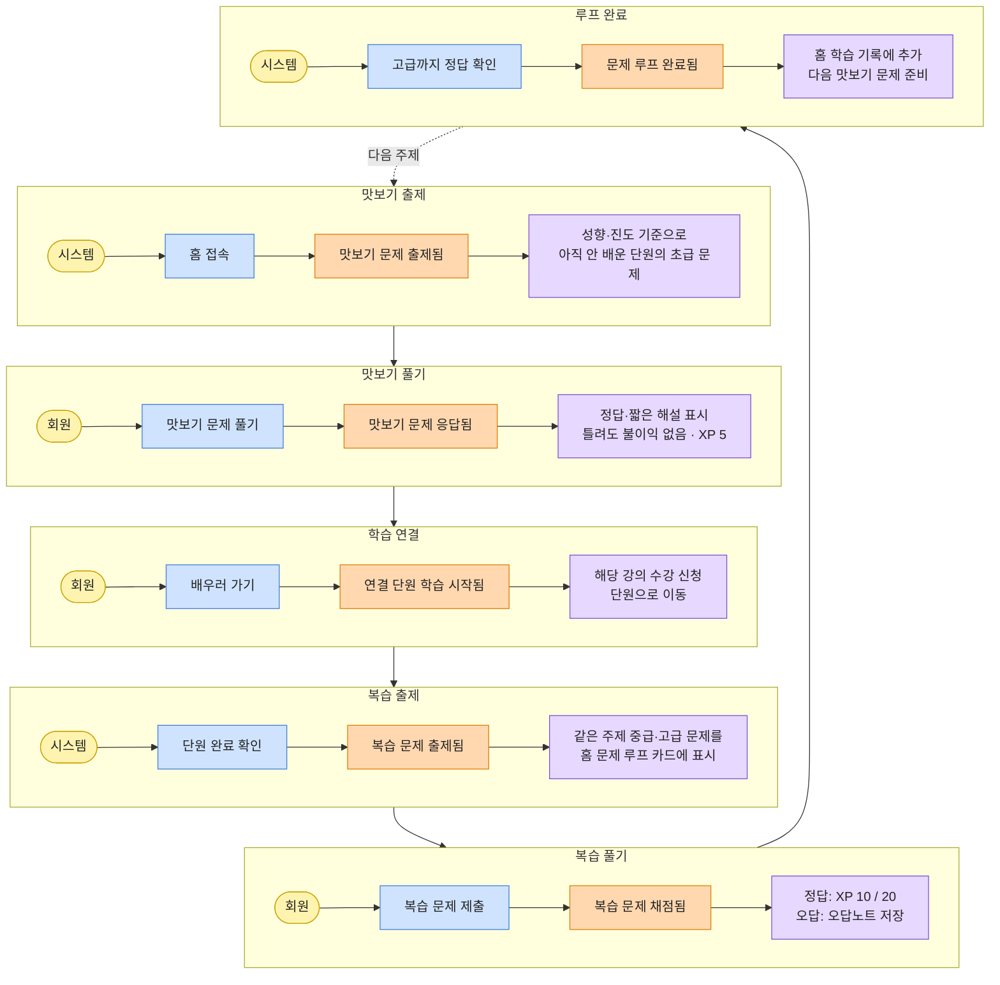

**표로 보기**

| 단계 | 액터 | 커맨드 | 도메인 이벤트 | 정책 (이어서 일어나는 일) |
| --- | --- | --- | --- | --- |
| 맛보기 출제 | 시스템 | 홈 접속 | 맛보기 문제 출제됨 | 성향·진도 기준으로 아직 안 배운 단원의 초급 문제 |
| 맛보기 풀기 | 회원 | 맛보기 문제 풀기 | 맛보기 문제 응답됨 | 정답·짧은 해설 표시, 틀려도 불이익 없음 · XP 5 |
| 학습 연결 | 회원 | 배우러 가기 | 연결 단원 학습 시작됨 | 해당 강의 수강 신청, 단원으로 이동 |
| 복습 출제 | 시스템 | 단원 완료 확인 | 복습 문제 출제됨 | 같은 주제 중급·고급 문제를 홈 문제 루프 카드에 표시 |
| 복습 풀기 | 회원 | 복습 문제 제출 | 복습 문제 채점됨 | 정답: XP 10 / 20, 오답: 오답노트 저장 |
| 루프 완료 | 시스템 | 고급까지 정답 확인 | 문제 루프 완료됨 | 홈 학습 기록에 추가, 다음 맛보기 문제 준비 |

단계는 위에서 아래로 차례대로 이어지고, 마지막 "루프 완료"에서 다음 주제의 "맛보기 출제"로 돌아갑니다.

### ③ 강의 · 평가 · 성장

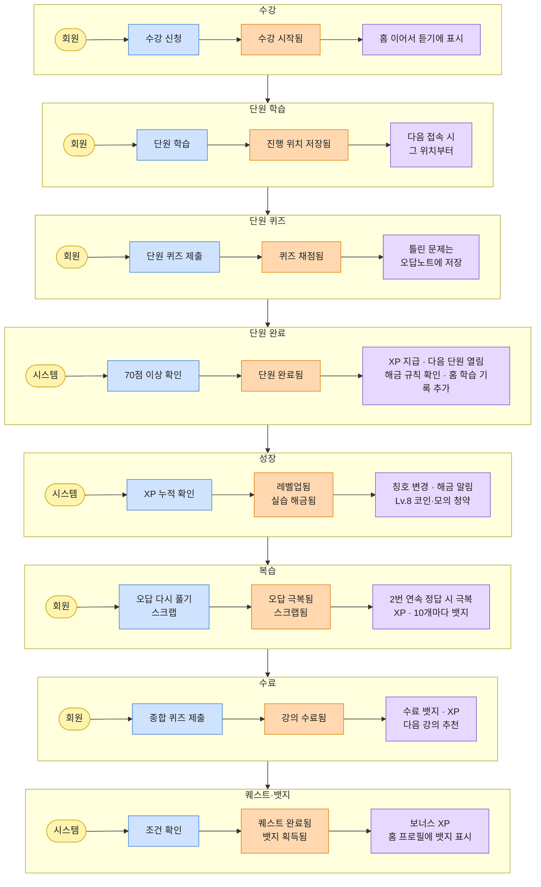

**표로 보기**

| 단계 | 액터 | 커맨드 | 도메인 이벤트 | 정책 (이어서 일어나는 일) |
| --- | --- | --- | --- | --- |
| 수강 | 회원 | 수강 신청 | 수강 시작됨 | 홈 이어서 듣기에 표시 |
| 단원 학습 | 회원 | 단원 학습 | 진행 위치 저장됨 | 다음 접속 시 그 위치부터 |
| 단원 퀴즈 | 회원 | 단원 퀴즈 제출 | 퀴즈 채점됨 | 틀린 문제는 오답노트에 저장 |
| 단원 완료 | 시스템 | 70점 이상 확인 | 단원 완료됨 | XP 지급 · 다음 단원 열림, 해금 규칙 확인 · 홈 학습 기록 추가 |
| 성장 | 시스템 | XP 누적 확인 | 레벨업됨, 실습 해금됨 | 칭호 변경 · 해금 알림, Lv.8 코인·모의 청약 |
| 복습 | 회원 | 오답 다시 풀기, 스크랩 | 오답 극복됨, 스크랩됨 | 2번 연속 정답 시 극복, XP · 10개마다 뱃지 |
| 수료 | 회원 | 종합 퀴즈 제출 | 강의 수료됨 | 수료 뱃지 · XP, 다음 강의 추천 |
| 퀘스트·뱃지 | 시스템 | 조건 확인 | 퀘스트 완료됨, 뱃지 획득됨 | 보너스 XP, 홈 프로필에 뱃지 표시 |

단계는 위에서 아래로 차례대로 이어집니다 (수강 → 단원 학습 → 단원 퀴즈 → 단원 완료 → 성장 → 복습 → 수료 → 퀘스트·뱃지).

### ④ 모의투자 시즌

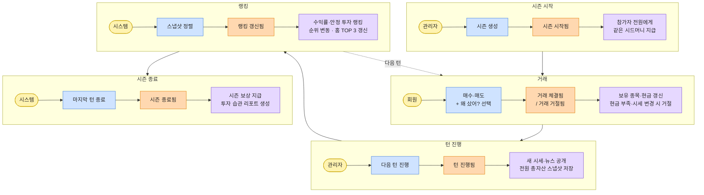

**표로 보기**

| 단계 | 액터 | 커맨드 | 도메인 이벤트 | 정책 (이어서 일어나는 일) |
| --- | --- | --- | --- | --- |
| 시즌 시작 | 관리자 | 시즌 생성 | 시즌 시작됨 | 참가자 전원에게 같은 시드머니 지급 |
| 거래 | 회원 | 매수·매도 + 왜 샀어? 선택 | 거래 체결됨 / 거래 거절됨 | 보유 종목·현금 갱신, 현금 부족·시세 변경 시 거절 |
| 턴 진행 | 관리자 | 다음 턴 진행 | 턴 진행됨 | 새 시세·뉴스 공개, 전원 총자산 스냅샷 저장 |
| 랭킹 | 시스템 | 스냅샷 정렬 | 랭킹 갱신됨 | 수익률·안정 투자 랭킹, 순위 변동 · 홈 TOP 3 갱신 |
| 시즌 종료 | 시스템 | 마지막 턴 종료 | 시즌 종료됨 | 시즌 보상 지급, 투자 습관 리포트 생성 |

단계는 위에서 아래로 차례대로 이어지고, "랭킹" 단계 이후 다음 턴이 남아 있으면 "거래" 단계로 돌아갑니다.

### ⑤ 모의 청약

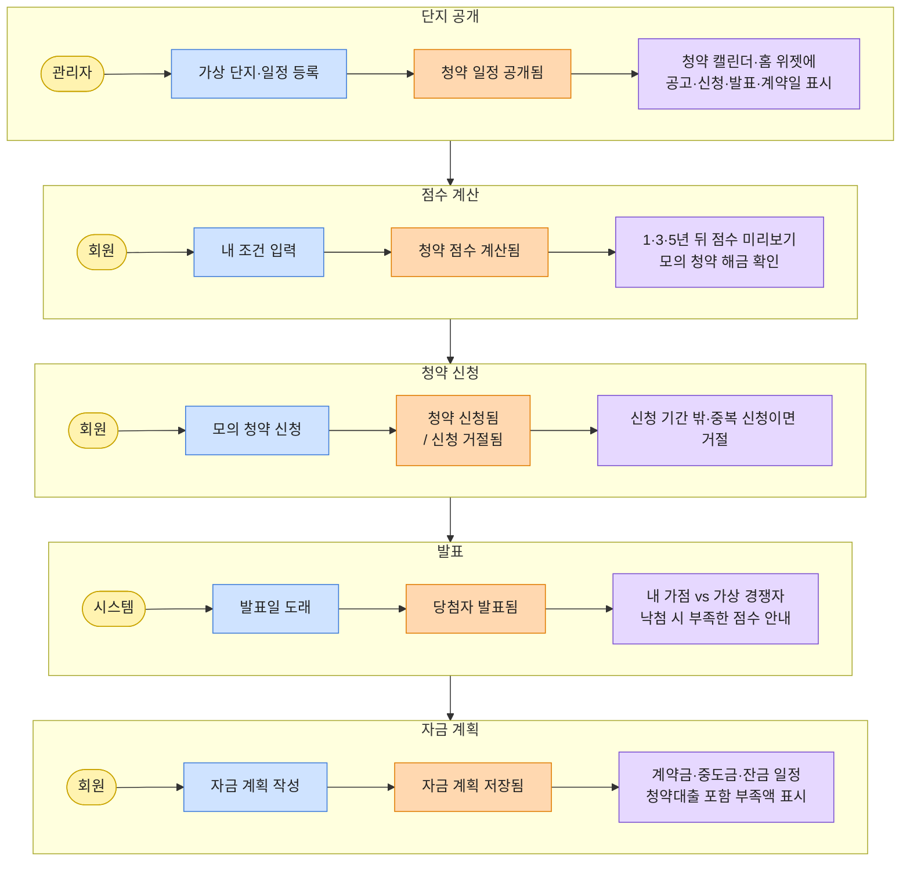

**표로 보기**

| 단계 | 액터 | 커맨드 | 도메인 이벤트 | 정책 (이어서 일어나는 일) |
| --- | --- | --- | --- | --- |
| 단지 공개 | 관리자 | 가상 단지·일정 등록 | 청약 일정 공개됨 | 청약 캘린더·홈 위젯에 공고·신청·발표·계약일 표시 |
| 점수 계산 | 회원 | 내 조건 입력 | 청약 점수 계산됨 | 1·3·5년 뒤 점수 미리보기, 모의 청약 해금 확인 |
| 청약 신청 | 회원 | 모의 청약 신청 | 청약 신청됨 / 신청 거절됨 | 신청 기간 밖·중복 신청이면 거절 |
| 발표 | 시스템 | 발표일 도래 | 당첨자 발표됨 | 내 가점 vs 가상 경쟁자, 낙첨 시 부족한 점수 안내 |
| 자금 계획 | 회원 | 자금 계획 작성 | 자금 계획 저장됨 | 계약금·중도금·잔금 일정, 청약대출 포함 부족액 표시 |

단계는 위에서 아래로 차례대로 이어집니다 (단지 공개 → 점수 계산 → 청약 신청 → 발표 → 자금 계획).

### ⑥ 기타 실습

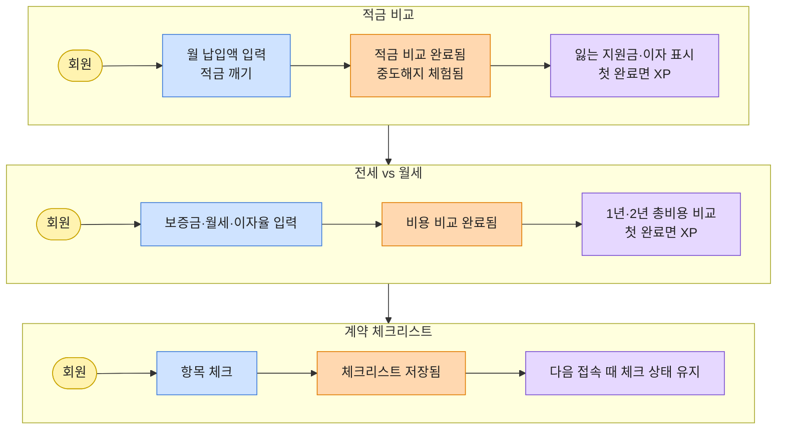

**표로 보기**

| 단계 | 액터 | 커맨드 | 도메인 이벤트 | 정책 (이어서 일어나는 일) |
| --- | --- | --- | --- | --- |
| 적금 비교 | 회원 | 월 납입액 입력, 적금 깨기 | 적금 비교 완료됨, 중도해지 체험됨 | 잃는 지원금·이자 표시, 첫 완료면 XP |
| 전세 vs 월세 | 회원 | 보증금·월세·이자율 입력 | 비용 비교 완료됨 | 1년·2년 총비용 비교, 첫 완료면 XP |
| 계약 체크리스트 | 회원 | 항목 체크 | 체크리스트 저장됨 | 다음 접속 때 체크 상태 유지 |

다이어그램에는 적금 비교 → 전세 vs 월세 → 계약 체크리스트 순으로 그려져 있습니다.

### 이벤트 목록 (표)

| 단계 | 액터 | 커맨드 | 도메인 이벤트 | 정책 (이어서 일어나는 일) | 애그리거트 |
| --- | --- | --- | --- | --- | --- |
| 가입 | 방문자 | 회원가입 | 회원 가입됨 | 성향 고르기 화면으로 이동 | 회원 |
| 가입 | 회원 | 성향 선택 / 건너뛰기 | 성향 저장됨 / 건너뜀 | 추천 강의 순서와 퀘스트에 반영 | 회원 |
| 가입 | 회원 | 로그인 | 로그인됨 / 로그인 실패함 | 성공 시 홈, 실패 시 오류 안내 | 회원 |
| 매일 학습 | 시스템 | 그날 첫 접속 | 오늘의 용어 세트·퀘스트 생성됨 | 모두에게 같은 용어 5개 | 용어 세트, 퀘스트 |
| 매일 학습 | 회원 | 용어 확인 퀴즈 제출 | 오늘의 용어 완료됨 | XP, 연속 학습 +1, 몰라요 용어는 단어장 | 성장 프로필, 단어장 |
| 매일 학습 | 시스템 | 다음 날 접속 시 확인 | 연속 학습 끊김 | 연속 일수 0 | 성장 프로필 |
| 문제 루프 | 시스템 | 홈 접속 | 맛보기 문제 출제됨 | 아직 안 배운 단원의 초급 문제 | 루프 진행 |
| 문제 루프 | 회원 | 맛보기 문제 풀기 | 맛보기 문제 응답됨 | 해설 + 배우러 가기, XP 5 | 루프 진행 |
| 문제 루프 | 회원 | 배우러 가기 | 연결 단원 학습 시작됨 | 강의 수강 신청, 단원 이동 | 수강 |
| 문제 루프 | 시스템 | 단원 완료 확인 | 복습 문제 출제됨 | 중급·고급 문제를 홈 카드에 표시 | 루프 진행 |
| 문제 루프 | 회원 | 복습 문제 제출 | 복습 문제 채점됨 | 정답 XP, 오답은 오답노트 | 루프 진행, 오답노트 |
| 문제 루프 | 시스템 | 고급까지 정답 확인 | 문제 루프 완료됨 | 홈 학습 기록 추가, 다음 맛보기 준비 | 루프 진행 |
| 강의 학습 | 회원 | 수강 신청 | 수강 시작됨 | 홈 이어서 듣기에 표시 | 수강 |
| 강의 학습 | 회원 | 단원 학습 | 진행 위치 저장됨 | 다음 접속 시 그 위치부터 | 수강 |
| 강의 학습 | 회원 | 단원 퀴즈 제출 | 퀴즈 채점됨 | 틀린 문제는 오답노트 | 퀴즈 응시, 오답노트 |
| 강의 학습 | 시스템 | 70점 이상 확인 | 단원 완료됨 | XP, 다음 단원 열림, 해금 확인, 홈 학습 기록 추가 | 수강 |
| 강의 학습 | 회원 | 종합 퀴즈 제출 | 강의 수료됨 | 수료 뱃지, XP | 수강 |
| 성장 | 시스템 | XP 누적 확인 | 레벨업됨 / 칭호 바뀜 | 레벨 해금 확인 | 성장 프로필 |
| 성장 | 시스템 | 해금 규칙 확인 | 실습 해금됨 | 알림, 메뉴 잠금 해제 | 해금 규칙 |
| 성장 | 시스템 | 조건 확인 | 퀘스트 완료됨 / 뱃지 획득됨 | 보너스 XP, 홈 프로필에 뱃지 | 퀘스트, 성장 프로필 |
| 복습 | 회원 | 오답 다시 풀기 | 오답 재채점됨 / 오답 극복됨 | 2번 연속 정답이면 극복, XP | 오답노트 |
| 복습 | 회원 | 스크랩 (문제·단원·용어) | 스크랩됨 | 스크랩함 폴더에 저장 | 스크랩 |
| 모의투자 | 관리자 | 시즌 생성 | 시즌 시작됨 | 같은 시드머니 지급 | 시즌 |
| 모의투자 | 회원 | 매수·매도 (이유 선택) | 거래 체결됨 / 거절됨 | 보유·현금 갱신 | 포트폴리오 |
| 모의투자 | 관리자 | 다음 턴 진행 | 턴 진행됨 | 새 시세·뉴스, 총자산 스냅샷 | 시즌, 포트폴리오 |
| 모의투자 | 시스템 | 스냅샷 정렬 | 랭킹 갱신됨 | 순위 변동, 홈 TOP 3 갱신 | 시즌 |
| 모의투자 | 시스템 | 마지막 턴 종료 | 시즌 종료됨 | 보상, 투자 습관 리포트 | 시즌 |
| 모의 청약 | 관리자 | 가상 단지·일정 등록 | 청약 일정 공개됨 | 캘린더·홈 위젯에 표시 | 청약 단지 |
| 모의 청약 | 회원 | 조건 입력 | 청약 점수 계산됨 | 미래 점수 미리보기, 해금 확인 | 청약 점수 |
| 모의 청약 | 회원 | 모의 청약 신청 | 청약 신청됨 / 거절됨 | 기간 밖·중복이면 거절 | 청약 신청 |
| 모의 청약 | 시스템 | 발표일 도래 | 당첨자 발표됨 | 결과와 부족한 점수 안내 | 청약 신청 |
| 모의 청약 | 회원 | 자금 계획 작성 | 자금 계획 저장됨 | 청약대출 포함 부족액 | 자금 계획 |
| 기타 실습 | 회원 | 적금 비교 / 적금 깨기 | 적금 비교 완료됨 / 중도해지 체험됨 | 첫 완료면 XP | 실습 기록 |
| 기타 실습 | 회원 | 전세 vs 월세 입력 | 비용 비교 완료됨 | 첫 완료면 XP | 실습 기록 |
| 기타 실습 | 회원 | 체크리스트 체크 | 체크리스트 저장됨 | 체크 상태 유지 | 체크리스트 |

### 핫스팟 (팀이 정해야 할 것)

- [ ] 모의투자 턴 진행: 관리자 버튼으로만 할지, 하루 1턴 자동으로 할지 (모듈 2 범위에서는 관리자 버튼 추천)
- [ ] 오늘의 용어·퀘스트 생성: 자정 배치 대신 그날 첫 접속 때 만들지
- [ ] 시즌 도중 가입한 회원도 그 시즌에 참가시킬지
- [ ] 단원 퀴즈에 떨어졌을 때 바로 재응시 가능하게 할지
- [ ] 모의 청약 당첨자 발표를 발표일 첫 접속 때 처리할지, 관리자 버튼으로 처리할지
- [ ] 홈 복습 문제를 단원 완료 직후 낼지, 다음 날 접속 때 낼지 (다음 날이 기억 정착에 더 좋음)
- [ ] 단원 퀴즈와 홈 복습 문제를 하나로 합칠지 (현재: 단원 퀴즈 = 완료 판정, 홈 복습 = 중·고급 복습)

---

## 2. 업무 분석 - 사용자

> 💡 사용자가 서비스에 들어와서 목표를 달성하고 나갈 때까지의 핵심 여정(User Flow)을 구체화하는 페이지입니다.

### 메인 프로세스

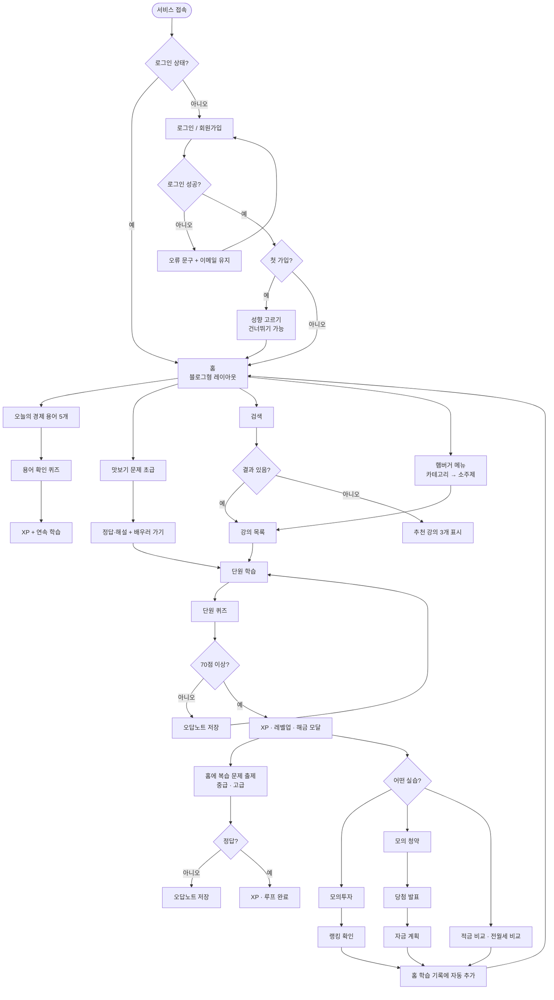

**목록으로 보기**

1. **로그인**
   - 서비스 접속 → 로그인 상태?
     - 예 → 홈 (블로그형 레이아웃)
     - 아니오 → 로그인 / 회원가입 → 로그인 성공?
       - 아니오 → 오류 문구 + 이메일 유지 → 다시 로그인 / 회원가입
       - 예 → 첫 가입?
         - 예 → 성향 고르기 (건너뛰기 가능) → 홈
         - 아니오 → 홈
2. **홈에서 시작하는 흐름**
   - 오늘의 경제 용어 5개 → 용어 확인 퀴즈 → XP + 연속 학습
   - 맛보기 문제 (초급) → 정답·해설 + 배우러 가기 → 단원 학습 (3번으로)
   - 검색 → 결과 있음?
     - 예 → 강의 목록
     - 아니오 → 추천 강의 3개 표시
   - 햄버거 메뉴 (카테고리 → 소주제) → 강의 목록
3. **학습과 복습**
   - 강의 목록 → 단원 학습 → 단원 퀴즈 → 70점 이상?
     - 아니오 → 오답노트 저장 → 단원 학습으로 돌아감
     - 예 → XP · 레벨업 · 해금 모달 → 아래 두 갈래로 나뉨
       - 홈에 복습 문제 출제 (중급 · 고급) → 정답?
         - 아니오 → 오답노트 저장
         - 예 → XP · 루프 완료
       - 어떤 실습? (4번으로)
4. **실습**
   - 모의투자 → 랭킹 확인
   - 모의 청약 → 당첨 발표 → 자금 계획
   - 적금 비교 · 전월세 비교
5. **홈으로 복귀**
   - 랭킹 확인, 자금 계획, 적금 비교·전월세 비교가 끝나면 → 홈 학습 기록에 자동 추가 → 홈

### 홈 문제 루프 흐름

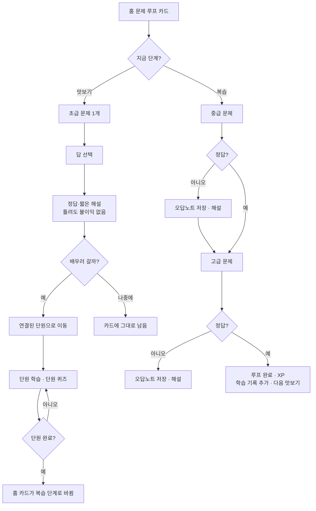

**목록으로 보기**

- 홈 문제 루프 카드 → 지금 단계?
  - **맛보기**
    1. 초급 문제 1개 → 답 선택 → 정답·짧은 해설 (틀려도 불이익 없음)
    2. 배우러 갈까?
       - 예 → 연결된 단원으로 이동 → 단원 학습 · 단원 퀴즈 → 단원 완료?
         - 아니오 → 단원 학습으로 돌아감
         - 예 → 홈 카드가 복습 단계로 바뀜
       - 나중에 → 카드에 그대로 남음
  - **복습**
    1. 중급 문제 → 정답?
       - 아니오 → 오답노트 저장 · 해설 → 고급 문제로 넘어감
       - 예 → 고급 문제
    2. 고급 문제 → 정답?
       - 아니오 → 오답노트 저장 · 해설
       - 예 → 루프 완료 · XP, 학습 기록 추가, 다음 맛보기

### 모의투자 흐름

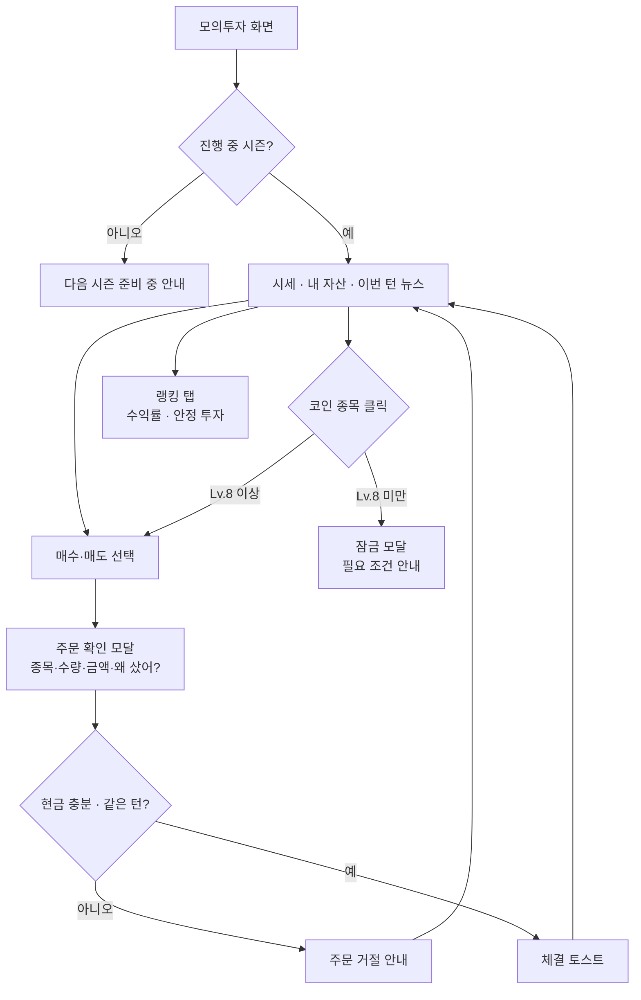

**목록으로 보기**

- 모의투자 화면 → 진행 중 시즌?
  - 아니오 → 다음 시즌 준비 중 안내
  - 예 → 시세 · 내 자산 · 이번 턴 뉴스 (이하 "시세 화면")
- 시세 화면에서 할 수 있는 일
  - **주문**: 매수·매도 선택 → 주문 확인 모달 (종목·수량·금액·왜 샀어?) → 현금 충분 · 같은 턴?
    - 아니오 → 주문 거절 안내 → 시세 화면으로 돌아감
    - 예 → 체결 토스트 → 시세 화면으로 돌아감
  - **코인 종목 클릭**
    - Lv.8 미만 → 잠금 모달 (필요 조건 안내)
    - Lv.8 이상 → 주문 (위의 주문 흐름)
  - **랭킹 탭**: 수익률 · 안정 투자

### 모의 청약 흐름

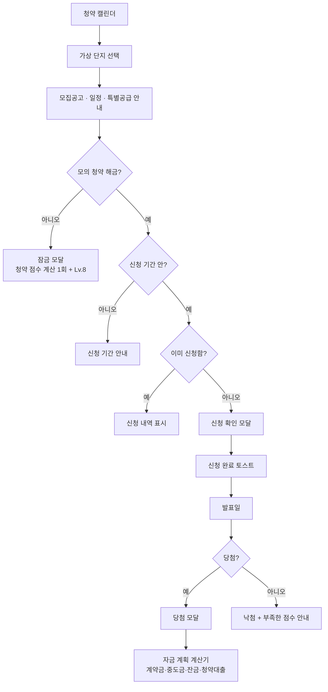

**목록으로 보기**

1. 청약 캘린더 → 가상 단지 선택 → 모집공고 · 일정 · 특별공급 안내
2. 모의 청약 해금?
   - 아니오 → 잠금 모달 (청약 점수 계산 1회 + Lv.8)
   - 예 → 신청 기간 안?
     - 아니오 → 신청 기간 안내
     - 예 → 이미 신청함?
       - 예 → 신청 내역 표시
       - 아니오 → 신청 확인 모달 → 신청 완료 토스트
3. 신청 완료 후 → 발표일 → 당첨?
   - 예 → 당첨 모달 → 자금 계획 계산기 (계약금 · 중도금 · 잔금 · 청약대출)
   - 아니오 → 낙첨 + 부족한 점수 안내

### 화면별 UI 상호작용

표현 방식은 **페이지 이동**(새 화면), **모달**(화면 위에 뜨는 창), **드로어**(옆에서 밀려 나오는 메뉴), **토스트**(잠깐 떴다 사라지는 알림) 네 가지로 통일합니다.

| 화면 | 사용자가 하는 것 | 결과 | 표현 방식 |
| --- | --- | --- | --- |
| 회원가입 | 가입 버튼 | 성향 고르기 화면 | 페이지 이동 |
| 성향 고르기 | 선택 완료 / 건너뛰기 | 홈 | 페이지 이동 |
| 공통 | 왼쪽 위 햄버거 버튼 | 카테고리·소주제·강의 메뉴 | 드로어 |
| 공통 | 잠긴 메뉴·실습 클릭 | 해금 조건 + 필요한 단원 바로가기 | 모달 |
| 홈 | 오늘의 용어 카드 넘기기 | 홈 안에서 카드 전환 | 같은 화면 |
| 홈 | 용어 확인 퀴즈 시작 | 5문제 풀이 | 모달 |
| 홈 | 맛보기 문제 답 선택 | 카드가 뒤집히며 정답·해설 + 배우러 가기 버튼 | 같은 화면 |
| 홈 | 배우러 가기 | 연결된 단원 | 페이지 이동 |
| 홈 | 복습 문제 제출 | 정답·해설, 오답이면 "오답노트에 저장됨" | 같은 화면 + 토스트 |
| 홈 | 학습 기록 항목 클릭 | 해당 단원·실습 결과 | 페이지 이동 |
| 홈 | 랭킹·청약 일정 위젯 클릭 | 모의투자 랭킹 / 청약 캘린더 | 페이지 이동 |
| 홈 | 검색어 입력 | 강의·용어 검색 결과 | 페이지 이동 |
| 강의 상세 | 수강 신청 | 수강 시작 후 첫 단원 | 토스트 + 페이지 이동 |
| 단원 학습 | 다음·이전 단계 | 단계만 바뀜 | 같은 화면 |
| 퀴즈 | 문제의 별 버튼 | 스크랩 폴더 고르기 | 작은 팝업 + 토스트 |
| 퀴즈 | 제출 | 안 푼 문제 확인 | 모달 → 결과 페이지 |
| 퀴즈 결과 | (레벨업·해금 발생 시) | 축하 + 새로 열린 기능 | 모달 |
| 오답노트 | 다시 풀기 | 오답만 섞어서 풀이 | 페이지 이동 |
| 모의투자 | 매수·매도 | 종목·수량·금액·왜 샀어? 확인 | 모달 → 토스트 |
| 모의투자 | 랭킹 탭 | 수익률·안정 투자 랭킹 전환 | 같은 화면(탭) |
| 청약 캘린더 | 날짜의 단지 클릭 | 모집공고·일정 상세 | 페이지 이동 |
| 모의 청약 | 신청 | 신청 확인 | 모달 → 토스트 |
| 모의 청약 | (발표일 접속) | 당첨·낙첨 결과 | 모달 |
| 청약 점수 계산 | 조건 입력 | 점수와 미래 점수 | 같은 화면 |
| 적금·전월세 비교 | 값 입력 / 적금 깨기 | 결과 갱신 | 같은 화면 |

### 예외 처리

| 상황 | 처리 | 사용자에게 보이는 것 |
| --- | --- | --- |
| 로그인 실패 | 같은 화면으로, 입력한 이메일 유지 | "이메일 또는 비밀번호를 확인해 주세요" |
| 로그인 안 한 상태로 접근 | 로그인 필터가 로그인 화면으로 보내고, 로그인 후 원래 화면으로 복귀 | 로그인 화면 |
| 세션 만료 | 위와 동일 | "다시 로그인해 주세요" |
| 검색 결과 없음 | 추천 강의 3개와 오늘의 용어 표시 | "'○○' 결과가 없어요. 이런 강의는 어때요?" |
| 학습 기록이 아직 없음 (신규 회원) | 홈 학습 기록 자리에 첫 강의 추천 | "첫 강의를 시작해 보세요" |
| 낼 맛보기 문제가 없음 (모든 단원 시작함) | 복습 문제만 표시 | "모든 주제를 시작했어요. 복습 문제를 풀어 보세요" |
| 맛보기 문제의 단원이 잠김 | 출제 대상에서 제외 (열린 단원만 출제) | — |
| 복습 문제가 등록 안 된 단원 | 복습 단계를 건너뛰고 다음 맛보기로 | — |
| 잠긴 기능 주소로 직접 접근 | 서버에서 해금 여부 확인 후 차단 | 해금 조건 안내 화면 |
| 퀴즈 풀다가 나감 | 제출 전에는 기록하지 않음 | 다시 들어오면 처음부터 |
| 퀴즈 제출 후 새로고침 | 제출 후 결과 화면으로 redirect해 중복 제출 방지 | 결과 화면 그대로 |
| 모의투자 현금 부족 | 버튼 비활성화 + 서버에서도 거절 | "현금이 부족해요" |
| 턴이 넘어간 뒤 이전 가격으로 주문 | 서버에서 거절 | "시세가 바뀌었어요. 새 가격으로 다시 주문해 주세요" |
| 진행 중인 시즌 없음 | 랭킹·주문 대신 안내 | "다음 시즌을 준비 중이에요" |
| 모의 청약 신청 기간 밖 | 신청 버튼 비활성화 + 서버에서도 거절 | "신청 기간은 ○월 ○일~○일이에요" |
| 같은 단지에 중복 신청 | 서버에서 거절 | 기존 신청 내역 표시 |
| 서버 오류 | 공통 오류 페이지 | "잠시 후 다시 시도해 주세요" + 홈 버튼 |
| AI 응답 실패 | 해당 없음. 검색은 AI 없이 DB에서 키워드로 찾음 | — |

---

## 3. 업무 분석 - 백오피스

> 💡 일반 사용자가 보는 화면이 아닌, 운영자(관리자)가 서비스를 통제하고 모니터링하는 기능을 정의하는 페이지입니다.

관리자는 강의·퀴즈·용어를 직접 등록하고, 모의투자 시즌과 모의 청약 단지를 운영하며, 회원을 관리합니다. 강의 내용 자체보다 **관리자가 콘텐츠를 넣고 바꿀 수 있는 구조**가 이 LMS의 핵심 평가 포인트입니다.

### 권한

- 관리자 계정은 회원 테이블의 역할(role)로 구분하고, `/admin/*` 주소 전체를 관리자 필터로 막습니다.
- 관리자가 한 등록·수정·삭제·턴 진행·발표 처리는 모두 작업 기록(누가, 언제, 무엇을)으로 남깁니다.

### 메뉴와 기능

| 메뉴 | 기능 | 우선순위 |
| --- | --- | --- |
| 대시보드 | 전체 회원 수, 오늘의 용어 완료율, 강의별 수강·수료율, 시즌 참가자 수, 모의 청약 신청 수 | 필수 |
| 강의 관리 | 카테고리·소주제·강의·단원 등록·수정·삭제, 공개/비공개, 순서 변경 | 필수 |
| 퀴즈 관리 | 문제 등록(객관식·OX), 보기·정답·해설·태그, **난이도(초급·중급·고급)**, **용도(단원 퀴즈·종합 퀴즈·맛보기·복습)**, 연결 단원, 문항별 정답률 | 필수 |
| 오늘의 용어 관리 | 용어 등록(뜻·예문), 날짜별 5개 세트 지정. 지정 안 한 날은 자동으로 순서대로 뽑음 | 필수 |
| 모의투자 관리 | 시즌 생성(기간·시드머니·턴 수), 종목 등록, 턴별 가격·뉴스 입력, **다음 턴 진행**, 시즌 종료·보상 | 필수 |
| 모의 청약 관리 | 가상 단지 등록(분양가·공급 유형·가점 커트라인·가상 경쟁자 분포), 일정 등록(공고·신청·발표·계약), 청약대출 가상 조건, 발표 처리 | 필수 |
| 실습 기준값 | 적금 비교용 가상 금리 | 포함 |
| 회원 관리 | 회원 검색, 회원별 레벨·진도·정답률·연속 학습, 이용 정지·해제 | 포함 |
| 성장 규칙 관리 | 행동별 XP, 레벨 구간과 칭호, 해금 규칙 표, 퀘스트 종류, 뱃지 조건 | 포함 |
| 공지 | 홈 상단 공지 등록 | 선택 |

### 운영 흐름

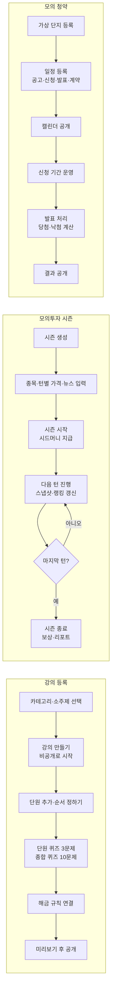

**목록으로 보기**

세 가지 운영 흐름이 나란히 그려져 있습니다.

**강의 등록**
1. 카테고리·소주제 선택
2. 강의 만들기 (비공개로 시작)
3. 단원 추가 · 순서 정하기
4. 단원 퀴즈 3문제, 종합 퀴즈 10문제
5. 해금 규칙 연결
6. 미리보기 후 공개

**모의투자 시즌**
1. 시즌 생성
2. 종목 · 턴별 가격 · 뉴스 입력
3. 시즌 시작 (시드머니 지급)
4. 다음 턴 진행 (스냅샷 · 랭킹 갱신)
5. 마지막 턴?
   - 아니오 → 4번으로 돌아감
   - 예 → 시즌 종료 (보상 · 리포트)

**모의 청약**
1. 가상 단지 등록
2. 일정 등록 (공고 · 신청 · 발표 · 계약)
3. 캘린더 공개
4. 신청 기간 운영
5. 발표 처리 (당첨 · 낙첨 계산)
6. 결과 공개

### 백오피스 예외 처리

| 상황 | 처리 |
| --- | --- |
| 수강생이 있는 강의·단원 삭제 | 삭제 대신 비공개로 바꾸게 함. 기존 진도와 수료 기록 보호 |
| 이미 응시 기록이 있는 문제 수정 | 수정은 허용, 과거 응시 기록은 당시 정오 결과 유지 |
| 다음 턴 진행 실수 | 되돌리기 없음. 진행 전 "되돌릴 수 없어요" 확인 모달 |
| 이미 공개된 턴의 가격 수정 | 막음. 아직 공개 안 된 턴만 수정 가능 |
| 신청자가 있는 청약 단지의 일정·커트라인 수정 | 막음. 신청 시작 전에만 수정 가능 |
| 발표일 전에 발표 처리 | 막음. 발표일부터 가능 |
| 해금 규칙에 없는 단원 연결 | 단원 선택 목록에서만 고르게 함 |
| 날짜별 용어 세트가 5개 미만 | 저장 막고 부족한 개수 안내 |
| 맛보기 문제는 있는데 연결 단원이 없음 | 저장 막고 연결 단원 선택하게 함 |
| 단원에 맛보기·복습 문제가 하나도 없음 | 대시보드에 "문제 루프 미완성 단원"으로 표시 |
