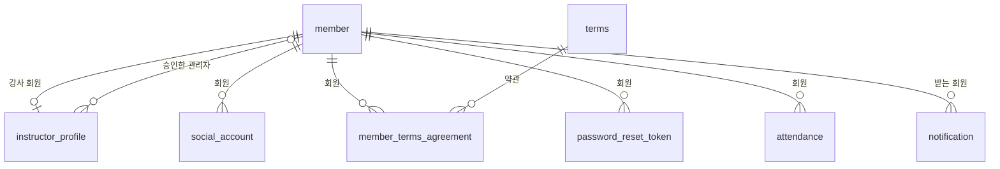
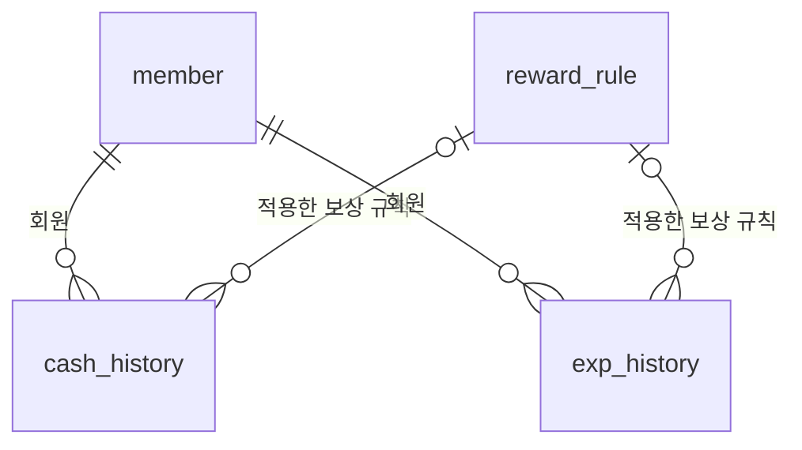
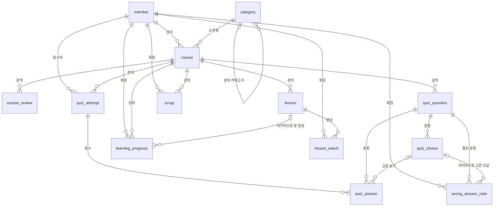
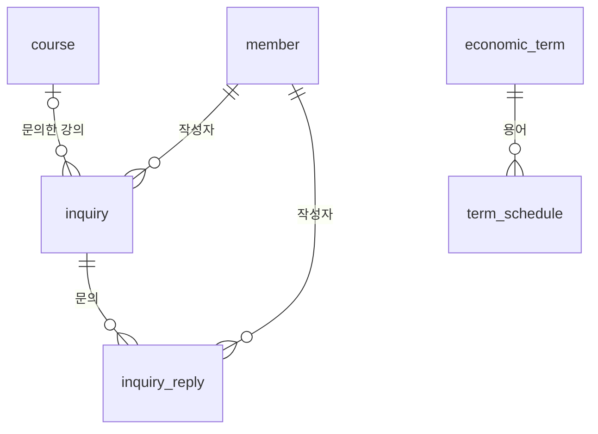
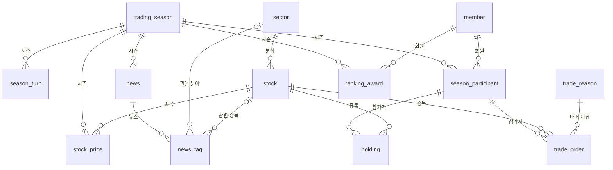
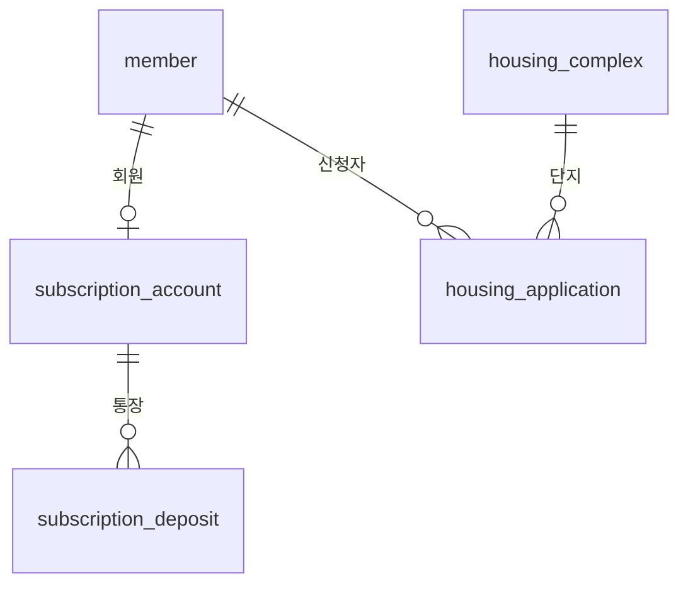

# DB 설계

> 💡 **데이터의 구조와 관계를 정의하는 페이지입니다.** 
>
> - **참고**
>     - **물리/논리 ERD:** 테이블 간의 관계(1:N, N:M), PK/FK, 인덱스 설정 위치 시각화
>     - **테이블 정의서:** 컬럼명, 데이터 타입, Null 여부, 제약 조건(Unique 등), 기본값, 설명 등
>     - **데이터 이력 관리 정책:** 데이터 삭제 시 실제 삭제(Hard Delete)를 할지, 삭제 여부 플래그만 바꿀지(Soft Delete) 정의

**읽는 법**

- 기준 문서: 요구사항 명세서, 정책 정의서, 머니비틀 페이지 구현(Claude Design). 표의 ID는 요구사항·정책 번호입니다.
- DBMS는 **MySQL 8.0 (InnoDB, utf8mb4)** 기준입니다. 시간은 모두 서버의 한국 시간(KST)으로 저장합니다(DP-42).
- **(초안)** 표시는 정책 정의서 5장의 미확정 값입니다. 값이 바뀌어도 테이블 구조는 그대로 쓰도록 설정 테이블로 뺐습니다.

---

## 1. 물리/논리 ERD

### 1-1 설계 원칙

| 항목 | 규칙 |
| --- | --- |
| 테이블 이름 | 영문 소문자 단수형 snake_case (예: `member`, `quiz_attempt`) |
| PK | `테이블명_id` BIGINT AUTO_INCREMENT |
| FK | 참조하는 테이블의 PK 이름을 그대로 사용. 역할이 다르면 역할 이름 사용 (예: `instructor_id`, `admin_id` → member) |
| 공통 컬럼 | `created_at`, `updated_at` (변경이 없는 기록성 테이블은 `created_at`만) |
| 상태값 | ENUM 대신 VARCHAR + 영문 대문자 코드 (예: `ACTIVE`, `REVIEW`) — 값 추가 시 ALTER 불필요 |
| 금액 | 캐시는 정수(BIGINT). 비율·수익률만 DECIMAL |
| 삭제 | 3장 데이터 이력 관리 정책을 따름 (Soft Delete는 `deleted_at`, 숨김은 `is_hidden`, 비공개는 `is_public`) |
| 바뀌는 정책 값 | 해금 레벨, 통과 점수, 보상 금액 등은 `system_setting`, `reward_rule`, `level_policy`에 저장 (NFR-13) |

### 1-2 도메인 구성

총 **47개 테이블**, 관계(FK) **68개**

| 도메인 | 테이블 | 개수 |
| --- | --- | --- |
| 회원·인증 | `member` 회원, `instructor_profile` 강사 정보, `social_account` 간편 로그인 연결, `terms` 약관, `member_terms_agreement` 약관 동의, `password_reset_token` 비밀번호 재설정 인증, `attendance` 출석, `notification` 알림 | 8 |
| 성장·캐시 | `level_policy` 레벨 정책, `reward_rule` 보상 규칙, `cash_history` 캐시 내역, `exp_history` 경험치 내역 | 4 |
| 강의·퀴즈 | `category` 카테고리·소주제, `course` 강의, `course_review` 강의 검수 이력, `lesson` 강의 영상·요약글, `quiz_question` 퀴즈 문항, `quiz_choice` 퀴즈 보기, `quiz_attempt` 퀴즈 응시, `quiz_answer` 퀴즈 답안, `wrong_answer_note` 오답노트, `learning_progress` 학습 진행, `lesson_watch` 영상 시청 기록, `scrap` 강의 스크랩 | 12 |
| 문의·경제 용어 | `inquiry` 문의글, `inquiry_reply` 문의 답글, `economic_term` 경제 용어, `term_schedule` 오늘의 경제 용어 | 4 |
| 모의투자 | `trading_season` 투자 시즌, `season_turn` 시즌 턴, `sector` 분야, `stock` 가상 종목, `stock_price` 턴별 가격, `news` 가상 뉴스, `news_tag` 뉴스 관련 분야·종목, `trade_reason` 매매 이유, `season_participant` 시즌 참가자, `holding` 보유 종목, `trade_order` 거래 내역, `ranking_award` 랭킹 수상 | 12 |
| 모의 청약 | `subscription_account` 청약통장, `subscription_deposit` 청약 납입 내역, `housing_complex` 청약 단지·공고, `housing_application` 청약 신청 | 4 |
| 운영 | `admin_log` 관리자 작업 기록, `system_setting` 서비스 설정, `forbidden_word` 금칙어 | 3 |

### 1-3 물리 ERD

- 전체 물리 ERD (테이블·컬럼·타입·PK/FK·관계선): [머니비틀 ERD](https://claude.ai/artifact/S6CFp4mtUkSj5Cf7GMmNUZ)
    - 테이블에 마우스를 올리면 연결된 관계만 강조됩니다. 실선 = 필수 FK, 점선 = 선택(NULL 허용) FK.
- DDL: `moneybeetle.sql` — ERDCloud의 **가져오기 → SQL**에 붙여 넣으면 같은 ERD가 만들어집니다.

### 1-4 논리 ERD

도메인별로 엔터티와 관계만 표시했습니다. 컬럼은 2장 테이블 정의서를 보세요. (노션에서 코드 블록 언어를 **Mermaid**로 두면 그림으로 보입니다.)

**회원·인증**

**성장·캐시**

**강의·퀴즈**

**문의·경제 용어**

**모의투자**

**모의 청약**

> 관리자 참조(`admin_id`, `created_by` 등)는 논리 ERD에서 생략했습니다. 물리 ERD와 테이블 정의서에는 모두 있습니다.
> 

### 1-5 주요 관계

| 관계 | 테이블 | 설명 |
| --- | --- | --- |
| 1:1 | member — instructor_profile | 강사 회원만 강사 정보를 가진다 |
| 1:1 | member — subscription_account | 가입과 동시에 청약통장 1개 개설 (SP-70) |
| 1:N | category — category | 카테고리 → 소주제 자기 참조 (2단계) |
| 1:N | course — lesson / quiz_question | 강의당 영상 1~3개, 문항 OX 5 + 4지선다 5~15 |
| 1:N | quiz_attempt — quiz_answer | 응시 1회에 문항별 답안 |
| 1:N | trading_season — season_turn / stock_price / news | 시즌마다 12턴, 360개 가격, 턴별 뉴스 |
| 1:N | season_participant — holding / trade_order | 참가자의 보유 종목과 거래 내역 |
| 1:N | member — cash_history / exp_history | 캐시·경험치 원장 |
| N:M | member ↔︎ course | `learning_progress`(학습 진행), `scrap`(스크랩), `quiz_attempt`(응시)로 연결 |
| N:M | member ↔︎ quiz_question | `wrong_answer_note`(오답노트)로 연결 |
| N:M | member ↔︎ lesson | `lesson_watch`(시청 기록)로 연결 |
| N:M | member ↔︎ terms | `member_terms_agreement`(약관 동의)로 연결 |
| N:M | member ↔︎ trading_season | `season_participant`(시즌 참가)로 연결 |
| N:M | member ↔︎ housing_complex | `housing_application`(청약 신청)로 연결 |
| N:M | news ↔︎ sector·stock | `news_tag`로 연결 (뉴스 하나에 관련 분야·종목 여러 개) |
| N:M | economic_term ↔︎ 날짜 | `term_schedule`로 날짜별 5개 지정 |

### 1-6 인덱스 설정 위치

PK, UNIQUE, FK 컬럼은 MySQL이 자동으로 인덱스를 만듭니다. 아래는 화면 조회를 위해 추가하는 인덱스입니다.

| 테이블 | 인덱스 | 컬럼 | 쓰는 곳 |
| --- | --- | --- | --- |
| `notification` | `idx_notification_1` | member_id, is_read, created_at | 안 읽은 알림 조회 |
| `cash_history` | `idx_cash_history_1` | member_id, created_at | 캐시 내역 최신순 |
| `exp_history` | `idx_exp_history_1` | member_id, created_at | 경험치 내역 최신순 |
| `course` | `idx_course_1` | category_id, status, is_public | 카테고리별 공개 강의 목록 |
| `quiz_question` | `idx_quiz_question_1` | course_id, quiz_type, sort_order | 강의별 테스트 퀴즈·퀴즈 문항 조회 |
| `learning_progress` | `idx_learning_progress_1` | member_id, status | 학습 완료 목록 |
| `lesson_watch` | `idx_lesson_watch_1` | member_id, last_watched_at | 시청 기록 최신순 |
| `inquiry` | `idx_inquiry_1` | course_id, created_at | 강의별 문의 목록 |
| `inquiry` | `idx_inquiry_2` | member_id, created_at | 내 문의 목록 |
| `news` | `idx_news_1` | trading_season_id, turn_no | 턴별 뉴스 |
| `season_participant` | `idx_season_participant_1` | trading_season_id, final_net_asset | 순자산 랭킹 정렬 |
| `season_participant` | `idx_season_participant_2` | trading_season_id, return_rate | 수익률 랭킹 정렬 |
| `trade_order` | `idx_trade_order_1` | season_participant_id, turn_no | 참가자 거래 내역 |
| `housing_complex` | `idx_housing_complex_1` | apply_start_date, apply_end_date | 청약 캘린더 기간 조회 |
| `housing_application` | `idx_housing_application_1` | housing_complex_id, total_score | 단지별 가점순 산정 |
| `admin_log` | `idx_admin_log_1` | target_type, target_id | 대상별 작업 기록 |
| `admin_log` | `idx_admin_log_2` | admin_id, created_at | 관리자별 기록 |

**중복 방지 UNIQUE (복합)**

| 테이블 | 컬럼 | 막는 것 |
| --- | --- | --- |
| `social_account` | provider, provider_user_id | 같은 구글·카카오 계정 중복 연결 |
| `member_terms_agreement` | member_id, terms_id | 같은 약관 중복 동의 기록 |
| `attendance` | member_id, attend_date | 하루 2번 출석 (SP-10) |
| `cash_history` | member_id, source_type, source_id | 같은 활동으로 캐시 2번 지급 (SP-18, NFR-06) |
| `exp_history` | member_id, source_type, source_id | 같은 강의로 경험치 2번 지급 (SP-22) |
| `lesson` | course_id, sort_order | 같은 순서의 영상 2개 |
| `quiz_answer` | quiz_attempt_id, quiz_question_id | 한 응시에서 같은 문항 답 2개 |
| `wrong_answer_note` | member_id, quiz_question_id | 같은 문제 오답 중복 저장 (SP-36) |
| `learning_progress` | member_id, course_id | 같은 강의 진행 기록 2개 |
| `lesson_watch` | member_id, lesson_id | 같은 영상 시청 기록 2개 |
| `scrap` | member_id, course_id | 같은 강의 중복 스크랩 (SP-39) |
| `term_schedule` | show_date, sort_order | 하루 같은 순서·같은 용어 중복 (SP-45) |
| `term_schedule` | show_date, economic_term_id | 하루 같은 순서·같은 용어 중복 (SP-45) |
| `season_turn` | trading_season_id, turn_no | 같은 턴 2개 |
| `stock_price` | trading_season_id, stock_id, turn_no | 같은 시즌·종목·턴 가격 2개 |
| `season_participant` | trading_season_id, member_id | 시즌당 1회 참가 (SP-51) |
| `holding` | season_participant_id, stock_id | 같은 종목 보유 행 2개 |
| `ranking_award` | trading_season_id, member_id, ranking_type | 같은 시즌·랭킹 종류 중복 수상 |
| `subscription_deposit` | subscription_account_id, paid_date | 하루 2번 납입 (SP-70, DP-35) |
| `housing_application` | member_id, housing_complex_id | 같은 단지 중복 신청 (SP-73) |

---

## 2. 테이블 정의서

Null 여부: **N** = NOT NULL, **Y** = NULL 허용

### 회원·인증

#### 1. `member` 회원

학습자·강사·관리자 계정. 권한은 role로 구분한다.

관련: USR-01~14, HOM-04, GRW-01~07

| 컬럼명 | 데이터 타입 | Null | 제약 조건 | 기본값 | 설명 |
| --- | --- | --- | --- | --- | --- |
| `member_id` | BIGINT | N | PK, AUTO_INCREMENT | - | 회원 ID |
| `email` | VARCHAR(100) | Y | UNIQUE | - | 로그인 아이디. 소문자로 저장. 탈퇴 30일 후 NULL |
| `password_hash` | VARCHAR(255) | Y | - | - | 비밀번호 해시. 간편 로그인만 쓰면 NULL |
| `nickname` | VARCHAR(30) | N | UNIQUE | - | 닉네임 2~12자, 한글·영문·숫자 (탈퇴 시 “탈퇴한 사용자#ID”가 들어가도록 여유 길이) |
| `profile_image_url` | VARCHAR(500) | Y | - | - | 프로필 이미지 경로 (2MB, jpg·png) |
| `birth_date` | DATE | Y | - | - | 생년월일. 만 14세 이상 확인용. 탈퇴 30일 후 NULL |
| `gender` | VARCHAR(10) | Y | - | - | MALE / FEMALE (필수 여부 미정) |
| `is_identity_verified` | BOOLEAN | N | - | FALSE | 본인인증 완료 여부 (결과값만 저장) |
| `role` | VARCHAR(20) | N | - | MEMBER | MEMBER / INSTRUCTOR / ADMIN |
| `status` | VARCHAR(20) | N | - | ACTIVE | ACTIVE / SUSPENDED / WITHDRAWN |
| `suspended_reason` | VARCHAR(200) | Y | - | - | 정지 사유 |
| `level` | TINYINT | N | CHECK BETWEEN 1 AND 20 | 1 | 레벨 1~20. 내려가지 않음 |
| `exp` | INT | N | CHECK >= 0 | 0 | 누적 경험치 |
| `cash` | BIGINT | N | CHECK >= 0 | 0 | 보유 캐시. 0 미만 불가 |
| `attendance_streak` | INT | N | - | 0 | 현재 연속 출석 일수 |
| `last_attended_date` | DATE | Y | - | - | 마지막 출석일 (KST) |
| `failed_login_count` | TINYINT | N | - | 0 | 연속 로그인 실패 횟수 |
| `locked_until` | DATETIME | Y | - | - | 로그인 잠금 해제 시각 (5회 실패 시 +10분) |
| `last_login_at` | DATETIME | Y | - | - | 마지막 로그인 |
| `withdrawn_at` | DATETIME | Y | - | - | 탈퇴 일시 |
| `created_at` | DATETIME | N | - | 현재 시각 | 생성 일시 |
| `updated_at` | DATETIME | N | - | 현재 시각 (수정 시 갱신) | 수정 일시 |

#### 2. `instructor_profile` 강사 정보

강사에게만 있는 정보와 권한 승인 상태.

관련: USR-10, ADM-06, TCH-01

| 컬럼명 | 데이터 타입 | Null | 제약 조건 | 기본값 | 설명 |
| --- | --- | --- | --- | --- | --- |
| `instructor_profile_id` | BIGINT | N | PK, AUTO_INCREMENT | - | 강사 정보 ID |
| `member_id` | BIGINT | N | FK → member.member_id, UNIQUE | - | 강사 회원 (1:1) |
| `display_name` | VARCHAR(30) | N | - | - | 강의에 표시할 이름 |
| `field` | VARCHAR(100) | Y | - | - | 전문 분야 (예: 청약, ETF) |
| `approval_status` | VARCHAR(20) | N | - | PENDING | PENDING / APPROVED / REVOKED |
| `approved_by` | BIGINT | Y | FK → member.member_id | - | 승인한 관리자 |
| `approved_at` | DATETIME | Y | - | - | 승인 일시 |
| `created_at` | DATETIME | N | - | 현재 시각 | 생성 일시 |
| `updated_at` | DATETIME | N | - | 현재 시각 (수정 시 갱신) | 수정 일시 |

#### 3. `social_account` 간편 로그인 연결

구글·카카오 계정 연결 정보.

관련: USR-07, DP-13

| 컬럼명 | 데이터 타입 | Null | 제약 조건 | 기본값 | 설명 |
| --- | --- | --- | --- | --- | --- |
| `social_account_id` | BIGINT | N | PK, AUTO_INCREMENT | - | 연결 ID |
| `member_id` | BIGINT | N | FK → member.member_id | - | 회원 |
| `provider` | VARCHAR(20) | N | UNIQUE(provider, provider_user_id) | - | GOOGLE / KAKAO |
| `provider_user_id` | VARCHAR(100) | N | UNIQUE(provider, provider_user_id) | - | 제공자 쪽 사용자 ID |
| `created_at` | DATETIME | N | - | 현재 시각 | 생성 일시 |

#### 4. `terms` 약관

필수·선택 약관 원문과 버전.

관련: USR-03, SP-05

| 컬럼명 | 데이터 타입 | Null | 제약 조건 | 기본값 | 설명 |
| --- | --- | --- | --- | --- | --- |
| `terms_id` | BIGINT | N | PK, AUTO_INCREMENT | - | 약관 ID |
| `title` | VARCHAR(100) | N | - | - | 약관 이름 |
| `content` | TEXT | N | - | - | 약관 본문 |
| `is_required` | BOOLEAN | N | - | - | 필수 약관 여부 |
| `version` | VARCHAR(20) | N | - | - | 버전 (예: 1.0) |
| `effective_at` | DATETIME | N | - | - | 시행 일시 |
| `created_at` | DATETIME | N | - | 현재 시각 | 생성 일시 |

#### 5. `member_terms_agreement` 약관 동의

회원별 약관 동의 기록.

관련: USR-03

| 컬럼명 | 데이터 타입 | Null | 제약 조건 | 기본값 | 설명 |
| --- | --- | --- | --- | --- | --- |
| `member_terms_agreement_id` | BIGINT | N | PK, AUTO_INCREMENT | - | 동의 ID |
| `member_id` | BIGINT | N | FK → member.member_id, UNIQUE(member_id, terms_id) | - | 회원 |
| `terms_id` | BIGINT | N | FK → terms.terms_id, UNIQUE(member_id, terms_id) | - | 약관 |
| `is_agreed` | BOOLEAN | N | - | - | 동의 여부 |
| `agreed_at` | DATETIME | N | - | 현재 시각 | 동의 일시 |

#### 6. `password_reset_token` 비밀번호 재설정 인증

비밀번호 찾기 인증. 10분 유효, 1회용.

관련: USR-09, DP-12

| 컬럼명 | 데이터 타입 | Null | 제약 조건 | 기본값 | 설명 |
| --- | --- | --- | --- | --- | --- |
| `password_reset_token_id` | BIGINT | N | PK, AUTO_INCREMENT | - | 토큰 ID |
| `member_id` | BIGINT | N | FK → member.member_id | - | 회원 |
| `token_hash` | VARCHAR(255) | N | UNIQUE | - | 인증 토큰 해시 |
| `expires_at` | DATETIME | N | - | - | 만료 시각 (발급 + 10분) |
| `used_at` | DATETIME | Y | - | - | 사용 시각. 사용하면 재사용 불가 |
| `created_at` | DATETIME | N | - | 현재 시각 | 생성 일시 |

#### 7. `attendance` 출석

하루 1회 출석 기록 (KST).

관련: GRW-01, GRW-02, SP-10~12

| 컬럼명 | 데이터 타입 | Null | 제약 조건 | 기본값 | 설명 |
| --- | --- | --- | --- | --- | --- |
| `attendance_id` | BIGINT | N | PK, AUTO_INCREMENT | - | 출석 ID |
| `member_id` | BIGINT | N | FK → member.member_id, UNIQUE(member_id, attend_date) | - | 회원 |
| `attend_date` | DATE | N | UNIQUE(member_id, attend_date) | - | 출석일 (KST) |
| `streak_count` | INT | N | - | - | 이날 기준 연속 출석 일수 |
| `created_at` | DATETIME | N | - | 현재 시각 | 생성 일시 |

#### 8. `notification` 알림

해금, 문의 답변, 청약 발표 등 회원 알림.

관련: GRW-08, LRN-09

| 컬럼명 | 데이터 타입 | Null | 제약 조건 | 기본값 | 설명 |
| --- | --- | --- | --- | --- | --- |
| `notification_id` | BIGINT | N | PK, AUTO_INCREMENT | - | 알림 ID |
| `member_id` | BIGINT | N | FK → member.member_id | - | 받는 회원 |
| `type` | VARCHAR(30) | N | - | - | UNLOCK / INQUIRY_REPLY / HOUSING_RESULT / RANKING 등 |
| `title` | VARCHAR(100) | N | - | - | 제목 |
| `content` | VARCHAR(500) | Y | - | - | 내용 |
| `link_url` | VARCHAR(500) | Y | - | - | 눌렀을 때 이동할 화면 |
| `is_read` | BOOLEAN | N | - | FALSE | 읽음 여부 |
| `created_at` | DATETIME | N | - | 현재 시각 | 생성 일시 |

### 성장·캐시

#### 9. `level_policy` 레벨 정책

레벨별 필요 경험치, 칭호, 레벨업 캐시.

관련: GRW-04~06, SP-20~21

| 컬럼명 | 데이터 타입 | Null | 제약 조건 | 기본값 | 설명 |
| --- | --- | --- | --- | --- | --- |
| `level_policy_id` | BIGINT | N | PK, AUTO_INCREMENT | - | 레벨 정책 ID |
| `level` | TINYINT | N | UNIQUE | - | 레벨 1~20 |
| `required_exp` | INT | N | - | - | 이 레벨이 되기 위한 누적 경험치 (150 XP 간격, 초안) |
| `title` | VARCHAR(20) | N | - | - | 칭호: 텐트 / 원룸 / 투룸 / 아파트 / 내 집 |
| `levelup_cash` | INT | N | - | 0 | 레벨업 캐시 (레벨 × 1,000, 초안) |
| `created_at` | DATETIME | N | - | 현재 시각 | 생성 일시 |
| `updated_at` | DATETIME | N | - | 현재 시각 (수정 시 갱신) | 수정 일시 |

#### 10. `reward_rule` 보상 규칙

활동별 지급 캐시·경험치. 관리자가 바꿀 수 있다.

관련: ADM-29, SP-12~14, SP-22

| 컬럼명 | 데이터 타입 | Null | 제약 조건 | 기본값 | 설명 |
| --- | --- | --- | --- | --- | --- |
| `reward_rule_id` | BIGINT | N | PK, AUTO_INCREMENT | - | 규칙 ID |
| `code` | VARCHAR(30) | N | UNIQUE | - | COURSE_COMPLETE / QUIZ_PERFECT / ATTENDANCE_STREAK |
| `name` | VARCHAR(50) | N | - | - | 규칙 이름 |
| `cash_amount` | INT | N | - | 0 | 지급 캐시 |
| `exp_amount` | INT | N | - | 0 | 지급 경험치 |
| `description` | VARCHAR(200) | Y | - | - | 지급 조건 설명 |
| `is_active` | BOOLEAN | N | - | TRUE | 사용 여부 |
| `created_at` | DATETIME | N | - | 현재 시각 | 생성 일시 |
| `updated_at` | DATETIME | N | - | 현재 시각 (수정 시 갱신) | 수정 일시 |

#### 11. `cash_history` 캐시 내역

캐시 적립·사용·수동 지급·회수 원장. 추가만 하고 수정·삭제하지 않는다.

관련: GRW-07, ADM-30, SP-15~18, NFR-06

| 컬럼명 | 데이터 타입 | Null | 제약 조건 | 기본값 | 설명 |
| --- | --- | --- | --- | --- | --- |
| `cash_history_id` | BIGINT | N | PK, AUTO_INCREMENT | - | 내역 ID |
| `member_id` | BIGINT | N | FK → member.member_id, UNIQUE(member_id, source_type, source_id) | - | 회원 |
| `history_type` | VARCHAR(20) | N | - | - | EARN / USE / ADMIN_GIVE / ADMIN_TAKE |
| `source_type` | VARCHAR(30) | N | UNIQUE(member_id, source_type, source_id) | - | ATTENDANCE / COURSE_COMPLETE / LEVEL_UP / SEASON_JOIN / SUBSCRIPTION_DEPOSIT / ADMIN |
| `source_id` | BIGINT | Y | UNIQUE(member_id, source_type, source_id) | - | 원인 데이터 ID (출석 ID, 강의 ID, 레벨 등) |
| `reward_rule_id` | BIGINT | Y | FK → reward_rule.reward_rule_id | - | 적용한 보상 규칙 |
| `amount` | BIGINT | N | - | - | 변동 금액 (사용·회수는 음수) |
| `balance_after` | BIGINT | N | - | - | 변동 후 잔액 |
| `reason` | VARCHAR(200) | Y | - | - | 관리자 지급·회수 사유 (필수) |
| `admin_id` | BIGINT | Y | FK → member.member_id | - | 처리한 관리자 |
| `created_at` | DATETIME | N | - | 현재 시각 | 생성 일시 |

#### 12. `exp_history` 경험치 내역

경험치 지급 원장. 같은 활동으로 두 번 지급하지 않는다.

관련: GRW-03, SP-22~23, NFR-06

| 컬럼명 | 데이터 타입 | Null | 제약 조건 | 기본값 | 설명 |
| --- | --- | --- | --- | --- | --- |
| `exp_history_id` | BIGINT | N | PK, AUTO_INCREMENT | - | 내역 ID |
| `member_id` | BIGINT | N | FK → member.member_id, UNIQUE(member_id, source_type, source_id) | - | 회원 |
| `source_type` | VARCHAR(30) | N | UNIQUE(member_id, source_type, source_id) | - | COURSE_COMPLETE / QUIZ_PERFECT |
| `source_id` | BIGINT | N | UNIQUE(member_id, source_type, source_id) | - | 원인 강의 ID |
| `reward_rule_id` | BIGINT | Y | FK → reward_rule.reward_rule_id | - | 적용한 보상 규칙 |
| `amount` | INT | N | - | - | 지급 경험치 |
| `exp_after` | INT | N | - | - | 지급 후 누적 경험치 |
| `level_after` | TINYINT | N | - | - | 지급 후 레벨 |
| `created_at` | DATETIME | N | - | 현재 시각 | 생성 일시 |

### 강의·퀴즈

#### 13. `category` 카테고리·소주제

카테고리(자본·부동산) → 소주제(청약·ETF) 2단계. 자기 참조.

관련: LRN-01, ADM-02

| 컬럼명 | 데이터 타입 | Null | 제약 조건 | 기본값 | 설명 |
| --- | --- | --- | --- | --- | --- |
| `category_id` | BIGINT | N | PK, AUTO_INCREMENT | - | 카테고리 ID |
| `parent_id` | BIGINT | Y | FK → category.category_id | - | 상위 카테고리. NULL이면 최상위 |
| `name` | VARCHAR(30) | N | - | - | 이름 |
| `depth` | TINYINT | N | - | 1 | 1 카테고리 / 2 소주제 |
| `sort_order` | INT | N | - | 0 | 정렬 순서 |
| `is_active` | BOOLEAN | N | - | TRUE | 사용 여부 |
| `created_at` | DATETIME | N | - | 현재 시각 | 생성 일시 |
| `updated_at` | DATETIME | N | - | 현재 시각 (수정 시 갱신) | 수정 일시 |

#### 14. `course` 강의

강사가 만든 강의. 허가 + 공개일 때만 사용자에게 보인다.

관련: TCH-01, TCH-06~07, ADM-03~04, SP-31~32

| 컬럼명 | 데이터 타입 | Null | 제약 조건 | 기본값 | 설명 |
| --- | --- | --- | --- | --- | --- |
| `course_id` | BIGINT | N | PK, AUTO_INCREMENT | - | 강의 ID |
| `instructor_id` | BIGINT | N | FK → member.member_id | - | 강사 |
| `category_id` | BIGINT | N | FK → category.category_id | - | 소주제 |
| `title` | VARCHAR(100) | N | - | - | 강의 제목 |
| `description` | TEXT | Y | - | - | 강의 소개 |
| `thumbnail_url` | VARCHAR(500) | Y | - | - | 썸네일 |
| `status` | VARCHAR(20) | N | - | DRAFT | DRAFT 작성 중 / REVIEW 검수 중 / APPROVED 허가 / REJECTED 반려 |
| `is_public` | BOOLEAN | N | - | FALSE | 공개 여부 (허가 후에도 비공개 가능) |
| `info_base_date` | DATE | Y | - | - | 제도 정보 기준일 (NFR-15) |
| `info_source` | VARCHAR(200) | Y | - | - | 제도 정보 출처 |
| `submitted_at` | DATETIME | Y | - | - | 검수 요청 일시 |
| `approved_at` | DATETIME | Y | - | - | 허가 일시 |
| `created_at` | DATETIME | N | - | 현재 시각 | 생성 일시 |
| `updated_at` | DATETIME | N | - | 현재 시각 (수정 시 갱신) | 수정 일시 |
| `deleted_at` | DATETIME | Y | - | - | 삭제 일시 (Soft Delete) |

#### 15. `course_review` 강의 검수 이력

허가·반려 기록. 반려 사유를 쌓아 둔다.

관련: ADM-03, TCH-07, DP-43

| 컬럼명 | 데이터 타입 | Null | 제약 조건 | 기본값 | 설명 |
| --- | --- | --- | --- | --- | --- |
| `course_review_id` | BIGINT | N | PK, AUTO_INCREMENT | - | 검수 ID |
| `course_id` | BIGINT | N | FK → course.course_id | - | 강의 |
| `admin_id` | BIGINT | N | FK → member.member_id | - | 검수한 관리자 |
| `result` | VARCHAR(20) | N | - | - | APPROVED / REJECTED |
| `reason` | VARCHAR(500) | Y | - | - | 반려 사유 (반려 시 필수) |
| `created_at` | DATETIME | N | - | 현재 시각 | 생성 일시 |

#### 16. `lesson` 강의 영상·요약글

강의당 영상 1~3개. 영상마다 요약글을 붙인다.

관련: LRN-03~04, TCH-02~03, SP-30

| 컬럼명 | 데이터 타입 | Null | 제약 조건 | 기본값 | 설명 |
| --- | --- | --- | --- | --- | --- |
| `lesson_id` | BIGINT | N | PK, AUTO_INCREMENT | - | 영상 ID |
| `course_id` | BIGINT | N | FK → course.course_id, UNIQUE(course_id, sort_order) | - | 강의 |
| `sort_order` | TINYINT | N | UNIQUE(course_id, sort_order), CHECK BETWEEN 1 AND 3 | - | 영상 순서 1~3 |
| `title` | VARCHAR(100) | N | - | - | 영상 제목 |
| `video_url` | VARCHAR(500) | N | - | - | 영상 주소 (업로드/외부 링크 미정) |
| `duration_seconds` | INT | N | - | 0 | 재생 시간(초) |
| `summary` | TEXT | Y | - | - | 영상 요약글 (2,000자 이내) |
| `created_at` | DATETIME | N | - | 현재 시각 | 생성 일시 |
| `updated_at` | DATETIME | N | - | 현재 시각 (수정 시 갱신) | 수정 일시 |

#### 17. `quiz_question` 퀴즈 문항

테스트 퀴즈(OX 5문제)와 퀴즈(4지선다 5~15문제)를 quiz_type으로 구분.

관련: QST-01~02, TCH-04~05, SP-30

| 컬럼명 | 데이터 타입 | Null | 제약 조건 | 기본값 | 설명 |
| --- | --- | --- | --- | --- | --- |
| `quiz_question_id` | BIGINT | N | PK, AUTO_INCREMENT | - | 문항 ID |
| `course_id` | BIGINT | N | FK → course.course_id | - | 강의 |
| `quiz_type` | VARCHAR(10) | N | - | - | TEST 테스트 퀴즈 / MAIN 퀴즈 |
| `question_type` | VARCHAR(10) | N | - | - | OX / CHOICE |
| `content` | VARCHAR(500) | N | - | - | 문제 |
| `explanation` | TEXT | N | - | - | 해설 |
| `sort_order` | TINYINT | N | - | - | 문항 순서 |
| `created_at` | DATETIME | N | - | 현재 시각 | 생성 일시 |
| `updated_at` | DATETIME | N | - | 현재 시각 (수정 시 갱신) | 수정 일시 |

#### 18. `quiz_choice` 퀴즈 보기

문항별 보기와 정답 표시. OX는 보기 2개.

관련: TCH-04~05, SP-35

| 컬럼명 | 데이터 타입 | Null | 제약 조건 | 기본값 | 설명 |
| --- | --- | --- | --- | --- | --- |
| `quiz_choice_id` | BIGINT | N | PK, AUTO_INCREMENT | - | 보기 ID |
| `quiz_question_id` | BIGINT | N | FK → quiz_question.quiz_question_id | - | 문항 |
| `content` | VARCHAR(200) | N | - | - | 보기 내용 |
| `is_correct` | BOOLEAN | N | - | FALSE | 정답 여부 (제출 전에는 화면으로 보내지 않음) |
| `sort_order` | TINYINT | N | - | - | 보기 순서 |

#### 19. `quiz_attempt` 퀴즈 응시

퀴즈(MAIN) 제출 기록. 테스트 퀴즈와 제출 전 이탈은 저장하지 않는다.

관련: QST-02~04, LRN-07, SP-34, SP-37

| 컬럼명 | 데이터 타입 | Null | 제약 조건 | 기본값 | 설명 |
| --- | --- | --- | --- | --- | --- |
| `quiz_attempt_id` | BIGINT | N | PK, AUTO_INCREMENT | - | 응시 ID |
| `member_id` | BIGINT | N | FK → member.member_id | - | 응시자 |
| `course_id` | BIGINT | N | FK → course.course_id | - | 강의 |
| `question_count` | TINYINT | N | - | - | 문항 수 |
| `correct_count` | TINYINT | N | - | - | 맞힌 수 |
| `score` | TINYINT | N | CHECK BETWEEN 0 AND 100 | - | 점수 0~100 |
| `is_passed` | BOOLEAN | N | - | - | 통과 여부 (70점 이상, 초안) |
| `submitted_at` | DATETIME | N | - | 현재 시각 | 제출 일시 |

#### 20. `quiz_answer` 퀴즈 답안

응시별 문항 답안과 채점 결과.

관련: QST-03

| 컬럼명 | 데이터 타입 | Null | 제약 조건 | 기본값 | 설명 |
| --- | --- | --- | --- | --- | --- |
| `quiz_answer_id` | BIGINT | N | PK, AUTO_INCREMENT | - | 답안 ID |
| `quiz_attempt_id` | BIGINT | N | FK → quiz_attempt.quiz_attempt_id, UNIQUE(quiz_attempt_id, quiz_question_id) | - | 응시 |
| `quiz_question_id` | BIGINT | N | FK → quiz_question.quiz_question_id, UNIQUE(quiz_attempt_id, quiz_question_id) | - | 문항 |
| `selected_choice_id` | BIGINT | Y | FK → quiz_choice.quiz_choice_id | - | 고른 보기. 안 풀었으면 NULL |
| `is_correct` | BOOLEAN | N | - | - | 정답 여부 |

#### 21. `wrong_answer_note` 오답노트

틀린 문제만 한 번씩 저장. 사용자가 지울 때까지 유지.

관련: QST-05~06, SP-36

| 컬럼명 | 데이터 타입 | Null | 제약 조건 | 기본값 | 설명 |
| --- | --- | --- | --- | --- | --- |
| `wrong_answer_note_id` | BIGINT | N | PK, AUTO_INCREMENT | - | 오답 ID |
| `member_id` | BIGINT | N | FK → member.member_id, UNIQUE(member_id, quiz_question_id) | - | 회원 |
| `quiz_question_id` | BIGINT | N | FK → quiz_question.quiz_question_id, UNIQUE(member_id, quiz_question_id) | - | 틀린 문항 |
| `last_choice_id` | BIGINT | Y | FK → quiz_choice.quiz_choice_id | - | 마지막으로 고른 오답 |
| `created_at` | DATETIME | N | - | 현재 시각 | 생성 일시 |

#### 22. `learning_progress` 학습 진행

회원별 강의 진행 상태, 이어보기 위치, 학습 완료.

관련: LRN-05~07, SP-38

| 컬럼명 | 데이터 타입 | Null | 제약 조건 | 기본값 | 설명 |
| --- | --- | --- | --- | --- | --- |
| `learning_progress_id` | BIGINT | N | PK, AUTO_INCREMENT | - | 진행 ID |
| `member_id` | BIGINT | N | FK → member.member_id, UNIQUE(member_id, course_id) | - | 회원 |
| `course_id` | BIGINT | N | FK → course.course_id, UNIQUE(member_id, course_id) | - | 강의 |
| `status` | VARCHAR(20) | N | - | IN_PROGRESS | IN_PROGRESS / COMPLETED |
| `last_lesson_id` | BIGINT | Y | FK → lesson.lesson_id | - | 마지막으로 본 영상 |
| `last_position_seconds` | INT | N | - | 0 | 마지막 재생 위치(초) |
| `completed_at` | DATETIME | Y | - | - | 학습 완료 일시 (퀴즈 최초 통과) |
| `created_at` | DATETIME | N | - | 현재 시각 | 생성 일시 |
| `updated_at` | DATETIME | N | - | 현재 시각 (수정 시 갱신) | 수정 일시 |

#### 23. `lesson_watch` 영상 시청 기록

영상별 시청 여부. 시청 기록 목록에 쓴다.

관련: LRN-03, LRN-06

| 컬럼명 | 데이터 타입 | Null | 제약 조건 | 기본값 | 설명 |
| --- | --- | --- | --- | --- | --- |
| `lesson_watch_id` | BIGINT | N | PK, AUTO_INCREMENT | - | 시청 ID |
| `member_id` | BIGINT | N | FK → member.member_id, UNIQUE(member_id, lesson_id) | - | 회원 |
| `lesson_id` | BIGINT | N | FK → lesson.lesson_id, UNIQUE(member_id, lesson_id) | - | 영상 |
| `watched_seconds` | INT | N | - | 0 | 본 시간(초) |
| `is_completed` | BOOLEAN | N | - | FALSE | 끝까지 시청 여부 |
| `last_watched_at` | DATETIME | N | - | 현재 시각 | 마지막 시청 일시 |

#### 24. `scrap` 강의 스크랩

같은 강의는 한 번만 스크랩. 해제하면 삭제.

관련: LRN-08, SP-39

| 컬럼명 | 데이터 타입 | Null | 제약 조건 | 기본값 | 설명 |
| --- | --- | --- | --- | --- | --- |
| `scrap_id` | BIGINT | N | PK, AUTO_INCREMENT | - | 스크랩 ID |
| `member_id` | BIGINT | N | FK → member.member_id, UNIQUE(member_id, course_id) | - | 회원 |
| `course_id` | BIGINT | N | FK → course.course_id, UNIQUE(member_id, course_id) | - | 강의 |
| `created_at` | DATETIME | N | - | 현재 시각 | 생성 일시 |

### 문의·경제 용어

#### 25. `inquiry` 문의글

강의 문의(강사에게). course_id가 NULL이면 사이트 문의(운영자에게).

관련: LRN-09, TCH-08, ADM-07, SP-40, DP-30

| 컬럼명 | 데이터 타입 | Null | 제약 조건 | 기본값 | 설명 |
| --- | --- | --- | --- | --- | --- |
| `inquiry_id` | BIGINT | N | PK, AUTO_INCREMENT | - | 문의 ID |
| `member_id` | BIGINT | N | FK → member.member_id | - | 작성자 |
| `course_id` | BIGINT | Y | FK → course.course_id | - | 문의한 강의. NULL이면 사이트 문의 |
| `category` | VARCHAR(30) | Y | - | - | 사이트 문의 분류 (계정·캐시, 모의 청약 등) |
| `title` | VARCHAR(50) | N | - | - | 제목 50자 |
| `content` | VARCHAR(1000) | N | - | - | 내용 1,000자 |
| `status` | VARCHAR(20) | N | - | WAITING | WAITING 답변 대기 / ANSWERED 답변 완료 |
| `is_hidden` | BOOLEAN | N | - | FALSE | 관리자 숨김 여부 |
| `hidden_by` | BIGINT | Y | FK → member.member_id | - | 숨김 처리한 관리자 |
| `created_at` | DATETIME | N | - | 현재 시각 | 생성 일시 |
| `updated_at` | DATETIME | N | - | 현재 시각 (수정 시 갱신) | 수정 일시 |
| `deleted_at` | DATETIME | Y | - | - | 삭제 일시 (Soft Delete) |

#### 26. `inquiry_reply` 문의 답글

강사·관리자 답글과 작성자의 추가 댓글.

관련: TCH-09, LRN-09

| 컬럼명 | 데이터 타입 | Null | 제약 조건 | 기본값 | 설명 |
| --- | --- | --- | --- | --- | --- |
| `inquiry_reply_id` | BIGINT | N | PK, AUTO_INCREMENT | - | 답글 ID |
| `inquiry_id` | BIGINT | N | FK → inquiry.inquiry_id | - | 문의 |
| `writer_id` | BIGINT | N | FK → member.member_id | - | 작성자 (강사·관리자·질문자) |
| `content` | VARCHAR(1000) | N | - | - | 내용 |
| `is_hidden` | BOOLEAN | N | - | FALSE | 관리자 숨김 여부 |
| `created_at` | DATETIME | N | - | 현재 시각 | 생성 일시 |
| `updated_at` | DATETIME | N | - | 현재 시각 (수정 시 갱신) | 수정 일시 |
| `deleted_at` | DATETIME | Y | - | - | 삭제 일시 (Soft Delete) |

#### 27. `economic_term` 경제 용어

관리자가 등록하는 경제 용어.

관련: HOM-02, ADM-05

| 컬럼명 | 데이터 타입 | Null | 제약 조건 | 기본값 | 설명 |
| --- | --- | --- | --- | --- | --- |
| `economic_term_id` | BIGINT | N | PK, AUTO_INCREMENT | - | 용어 ID |
| `term` | VARCHAR(50) | N | UNIQUE | - | 용어 |
| `description` | VARCHAR(500) | N | - | - | 뜻 |
| `is_active` | BOOLEAN | N | - | TRUE | 사용 여부 |
| `created_at` | DATETIME | N | - | 현재 시각 | 생성 일시 |
| `updated_at` | DATETIME | N | - | 현재 시각 (수정 시 갱신) | 수정 일시 |

#### 28. `term_schedule` 오늘의 경제 용어

날짜별 노출 용어 5개. 모든 사용자에게 같다.

관련: HOM-02, ADM-05, SP-45~47

| 컬럼명 | 데이터 타입 | Null | 제약 조건 | 기본값 | 설명 |
| --- | --- | --- | --- | --- | --- |
| `term_schedule_id` | BIGINT | N | PK, AUTO_INCREMENT | - | 일정 ID |
| `show_date` | DATE | N | UNIQUE(show_date, sort_order), UNIQUE(show_date, economic_term_id) | - | 노출일 (KST) |
| `economic_term_id` | BIGINT | N | FK → economic_term.economic_term_id, UNIQUE(show_date, economic_term_id) | - | 용어 |
| `sort_order` | TINYINT | N | UNIQUE(show_date, sort_order), CHECK BETWEEN 1 AND 5 | - | 순서 1~5 |
| `is_auto` | BOOLEAN | N | - | FALSE | 자동 선정 여부 (관리자 미지정일) |
| `created_at` | DATETIME | N | - | 현재 시각 | 생성 일시 |

### 모의투자

#### 29. `trading_season` 투자 시즌

14일·12턴 시즌. 상태는 정해진 순서로만 바뀐다.

관련: INV-02, ADM-09~11, SP-50, SP-65

| 컬럼명 | 데이터 타입 | Null | 제약 조건 | 기본값 | 설명 |
| --- | --- | --- | --- | --- | --- |
| `trading_season_id` | BIGINT | N | PK, AUTO_INCREMENT | - | 시즌 ID |
| `name` | VARCHAR(50) | N | - | - | 시즌 이름 (예: 시즌 7) |
| `start_date` | DATE | N | - | - | 시작일 (월요일) |
| `end_date` | DATE | N | - | - | 종료일 (시작 + 13일, 랭킹 공개일) |
| `status` | VARCHAR(20) | N | - | READY | READY / RUNNING / HOLIDAY / SETTLING / ENDED |
| `current_turn` | TINYINT | N | - | 0 | 현재 턴 0~12 |
| `total_turns` | TINYINT | N | - | 12 | 전체 턴 |
| `unlock_level` | TINYINT | N | - | 8 | 참가 해금 레벨 |
| `carryover_rate` | DECIMAL(5,2) | N | - | 30.00 | 이월 비율(%) |
| `carryover_cap` | BIGINT | Y | - | - | 이월 상한 (미정) |
| `settled_at` | DATETIME | Y | - | - | 정산 일시 |
| `ranking_published_at` | DATETIME | Y | - | - | 랭킹 공개 일시 |
| `created_by` | BIGINT | N | FK → member.member_id | - | 만든 관리자 |
| `created_at` | DATETIME | N | - | 현재 시각 | 생성 일시 |
| `updated_at` | DATETIME | N | - | 현재 시각 (수정 시 갱신) | 수정 일시 |

#### 30. `season_turn` 시즌 턴

턴별 거래일과 진행 기록(누가 언제 넘겼는지).

관련: INV-05, ADM-13~15, SP-59

| 컬럼명 | 데이터 타입 | Null | 제약 조건 | 기본값 | 설명 |
| --- | --- | --- | --- | --- | --- |
| `season_turn_id` | BIGINT | N | PK, AUTO_INCREMENT | - | 턴 ID |
| `trading_season_id` | BIGINT | N | FK → trading_season.trading_season_id, UNIQUE(trading_season_id, turn_no) | - | 시즌 |
| `turn_no` | TINYINT | N | UNIQUE(trading_season_id, turn_no), CHECK BETWEEN 1 AND 12 | - | 턴 번호 1~12 |
| `trade_date` | DATE | N | - | - | 거래일 (일요일 제외) |
| `progressed_at` | DATETIME | Y | - | - | 이 턴으로 넘긴 시각 |
| `progressed_by` | BIGINT | Y | FK → member.member_id | - | 넘긴 관리자 |

#### 31. `sector` 분야

종목 분야 15개.

관련: INV-06, ADM-16

| 컬럼명 | 데이터 타입 | Null | 제약 조건 | 기본값 | 설명 |
| --- | --- | --- | --- | --- | --- |
| `sector_id` | BIGINT | N | PK, AUTO_INCREMENT | - | 분야 ID |
| `name` | VARCHAR(30) | N | UNIQUE | - | 분야 이름 (반도체, 바이오 등) |
| `sort_order` | INT | N | - | 0 | 정렬 순서 |
| `is_active` | BOOLEAN | N | - | TRUE | 사용 여부 |
| `created_at` | DATETIME | N | - | 현재 시각 | 생성 일시 |
| `updated_at` | DATETIME | N | - | 현재 시각 (수정 시 갱신) | 수정 일시 |

#### 32. `stock` 가상 종목

분야별 2개, 총 30개 가상 종목과 기업정보.

관련: INV-06~07, ADM-17~18

| 컬럼명 | 데이터 타입 | Null | 제약 조건 | 기본값 | 설명 |
| --- | --- | --- | --- | --- | --- |
| `stock_id` | BIGINT | N | PK, AUTO_INCREMENT | - | 종목 ID |
| `sector_id` | BIGINT | N | FK → sector.sector_id | - | 분야 |
| `name` | VARCHAR(50) | N | UNIQUE | - | 종목 이름 |
| `start_price` | INT | N | - | - | 시작 가격 |
| `intro` | TEXT | Y | - | - | 회사 소개 |
| `business` | VARCHAR(300) | Y | - | - | 주요 사업 |
| `revenue` | VARCHAR(50) | Y | - | - | 가상 매출 |
| `operating_profit` | VARCHAR(50) | Y | - | - | 가상 영업이익 |
| `is_active` | BOOLEAN | N | - | TRUE | 사용 여부 |
| `created_at` | DATETIME | N | - | 현재 시각 | 생성 일시 |
| `updated_at` | DATETIME | N | - | 현재 시각 (수정 시 갱신) | 수정 일시 |

#### 33. `stock_price` 턴별 가격

시즌 × 종목 × 턴 가격 (30 × 12 = 360개).

관련: ADM-19~24, INV-10, SP-53, SP-60

| 컬럼명 | 데이터 타입 | Null | 제약 조건 | 기본값 | 설명 |
| --- | --- | --- | --- | --- | --- |
| `stock_price_id` | BIGINT | N | PK, AUTO_INCREMENT | - | 가격 ID |
| `trading_season_id` | BIGINT | N | FK → trading_season.trading_season_id, UNIQUE(trading_season_id, stock_id, turn_no) | - | 시즌 |
| `stock_id` | BIGINT | N | FK → stock.stock_id, UNIQUE(trading_season_id, stock_id, turn_no) | - | 종목 |
| `turn_no` | TINYINT | N | UNIQUE(trading_season_id, stock_id, turn_no), CHECK BETWEEN 1 AND 12 | - | 턴 1~12 |
| `price` | INT | N | CHECK > 0 | - | 이 턴의 고정 가격 (1 이상) |
| `change_rate` | DECIMAL(6,2) | Y | - | - | 지난 턴 대비 변동률(%) |
| `created_at` | DATETIME | N | - | 현재 시각 | 생성 일시 |
| `updated_at` | DATETIME | N | - | 현재 시각 (수정 시 갱신) | 수정 일시 |

#### 34. `news` 가상 뉴스

턴별 뉴스 2~3개. 관리자 메모는 사용자에게 안 보인다.

관련: INV-08, ADM-25~27

| 컬럼명 | 데이터 타입 | Null | 제약 조건 | 기본값 | 설명 |
| --- | --- | --- | --- | --- | --- |
| `news_id` | BIGINT | N | PK, AUTO_INCREMENT | - | 뉴스 ID |
| `trading_season_id` | BIGINT | N | FK → trading_season.trading_season_id | - | 시즌 |
| `turn_no` | TINYINT | N | - | - | 공개 턴 |
| `title` | VARCHAR(100) | N | - | - | 제목 |
| `content` | TEXT | N | - | - | 본문 |
| `admin_memo` | VARCHAR(500) | Y | - | - | 설계 의도 메모 (관리자 전용) |
| `created_at` | DATETIME | N | - | 현재 시각 | 생성 일시 |
| `updated_at` | DATETIME | N | - | 현재 시각 (수정 시 갱신) | 수정 일시 |

#### 35. `news_tag` 뉴스 관련 분야·종목

뉴스 ↔︎ 분야·종목 N:M 연결.

관련: INV-08, ADM-25

| 컬럼명 | 데이터 타입 | Null | 제약 조건 | 기본값 | 설명 |
| --- | --- | --- | --- | --- | --- |
| `news_tag_id` | BIGINT | N | PK, AUTO_INCREMENT | - | 연결 ID |
| `news_id` | BIGINT | N | FK → news.news_id | - | 뉴스 |
| `sector_id` | BIGINT | Y | FK → sector.sector_id | - | 관련 분야 |
| `stock_id` | BIGINT | Y | FK → stock.stock_id | - | 관련 종목 |

#### 36. `trade_reason` 매매 이유

주문 때 고르는 매매 이유 선택지.

관련: INV-11, SP-57

| 컬럼명 | 데이터 타입 | Null | 제약 조건 | 기본값 | 설명 |
| --- | --- | --- | --- | --- | --- |
| `trade_reason_id` | BIGINT | N | PK, AUTO_INCREMENT | - | 이유 ID |
| `label` | VARCHAR(50) | N | - | - | 선택지 문구 (예: 나눠 담으려고) |
| `sort_order` | INT | N | - | 0 | 정렬 순서 |
| `is_active` | BOOLEAN | N | - | TRUE | 사용 여부 |

#### 37. `season_participant` 시즌 참가자

시즌별 참가 정보, 현금, 정산 결과, 이월금.

관련: INV-03~04, INV-14, INV-16~17, ADM-28, ADM-32, SP-51~52, SP-61~63

| 컬럼명 | 데이터 타입 | Null | 제약 조건 | 기본값 | 설명 |
| --- | --- | --- | --- | --- | --- |
| `season_participant_id` | BIGINT | N | PK, AUTO_INCREMENT | - | 참가 ID |
| `trading_season_id` | BIGINT | N | FK → trading_season.trading_season_id, UNIQUE(trading_season_id, member_id) | - | 시즌 |
| `member_id` | BIGINT | N | FK → member.member_id, UNIQUE(trading_season_id, member_id) | - | 회원 |
| `saved_cash` | BIGINT | N | - | - | 참가 때 가져온 캐시 |
| `carryover_in` | BIGINT | N | - | 0 | 지난 시즌 이월금 |
| `invest_amount` | BIGINT | N | - | - | 투자 가능 금액 = 캐시 + 이월금 (변경 불가) |
| `cash` | BIGINT | N | CHECK >= 0 | - | 현재 보유 현금 |
| `final_net_asset` | BIGINT | Y | - | - | 정산 순자산 |
| `return_rate` | DECIMAL(7,2) | Y | - | - | 정산 수익률(%) |
| `asset_rank` | INT | Y | - | - | 순자산 순위 |
| `return_rank` | INT | Y | - | - | 수익률 순위 |
| `carryover_out` | BIGINT | N | - | 0 | 다음 시즌 이월금 |
| `joined_at` | DATETIME | N | - | 현재 시각 | 참가 일시 |
| `updated_at` | DATETIME | N | - | 현재 시각 (수정 시 갱신) | 수정 일시 |

#### 38. `holding` 보유 종목

참가자별 보유 수량과 평균 단가.

관련: INV-09, INV-14, SP-54~55

| 컬럼명 | 데이터 타입 | Null | 제약 조건 | 기본값 | 설명 |
| --- | --- | --- | --- | --- | --- |
| `holding_id` | BIGINT | N | PK, AUTO_INCREMENT | - | 보유 ID |
| `season_participant_id` | BIGINT | N | FK → season_participant.season_participant_id, UNIQUE(season_participant_id, stock_id) | - | 참가자 |
| `stock_id` | BIGINT | N | FK → stock.stock_id, UNIQUE(season_participant_id, stock_id) | - | 종목 |
| `quantity` | INT | N | CHECK >= 0 | 0 | 보유 수량 (0 이상) |
| `avg_price` | INT | N | - | 0 | 평균 매수 단가 |
| `updated_at` | DATETIME | N | - | 현재 시각 (수정 시 갱신) | 수정 일시 |

#### 39. `trade_order` 거래 내역

체결된 주문. 체결 후 수정·삭제하지 않는다.

관련: INV-09~13, INV-15, ADM-28, DP-41

| 컬럼명 | 데이터 타입 | Null | 제약 조건 | 기본값 | 설명 |
| --- | --- | --- | --- | --- | --- |
| `trade_order_id` | BIGINT | N | PK, AUTO_INCREMENT | - | 주문 ID |
| `season_participant_id` | BIGINT | N | FK → season_participant.season_participant_id | - | 참가자 |
| `stock_id` | BIGINT | N | FK → stock.stock_id | - | 종목 |
| `turn_no` | TINYINT | N | - | - | 체결 턴 |
| `order_type` | VARCHAR(10) | N | - | - | BUY / SELL |
| `quantity` | INT | N | CHECK > 0 | - | 수량 (1 이상 정수) |
| `price` | INT | N | CHECK > 0 | - | 체결가 (그 턴의 고정 가격) |
| `amount` | BIGINT | N | - | - | 체결 금액 = 수량 × 가격 |
| `trade_reason_id` | BIGINT | N | FK → trade_reason.trade_reason_id | - | 매매 이유 |
| `created_at` | DATETIME | N | - | 현재 시각 | 생성 일시 |

#### 40. `ranking_award` 랭킹 수상

시즌별 상위 3위 수상과 뱃지·칭호 장식.

관련: HOM-06, INV-18, ADM-34, SP-64

| 컬럼명 | 데이터 타입 | Null | 제약 조건 | 기본값 | 설명 |
| --- | --- | --- | --- | --- | --- |
| `ranking_award_id` | BIGINT | N | PK, AUTO_INCREMENT | - | 수상 ID |
| `trading_season_id` | BIGINT | N | FK → trading_season.trading_season_id, UNIQUE(trading_season_id, member_id, ranking_type) | - | 시즌 |
| `member_id` | BIGINT | N | FK → member.member_id, UNIQUE(trading_season_id, member_id, ranking_type) | - | 회원 |
| `ranking_type` | VARCHAR(10) | N | UNIQUE(trading_season_id, member_id, ranking_type) | - | ASSET 순자산 / RETURN 수익률 |
| `rank_no` | TINYINT | N | CHECK BETWEEN 1 AND 3 | - | 순위 1~3 |
| `badge_name` | VARCHAR(50) | Y | - | - | 뱃지·칭호 장식 이름 |
| `awarded_at` | DATETIME | N | - | 현재 시각 | 지급 일시 |

### 모의 청약

#### 41. `subscription_account` 청약통장

가입과 동시에 1인 1개 개설.

관련: SUB-04~05, SP-70

| 컬럼명 | 데이터 타입 | Null | 제약 조건 | 기본값 | 설명 |
| --- | --- | --- | --- | --- | --- |
| `subscription_account_id` | BIGINT | N | PK, AUTO_INCREMENT | - | 통장 ID |
| `member_id` | BIGINT | N | FK → member.member_id, UNIQUE | - | 회원 (1:1) |
| `balance` | BIGINT | N | - | 0 | 통장 잔액 |
| `paid_count` | INT | N | - | 0 | 납입회차 |
| `last_paid_date` | DATE | Y | - | - | 마지막 납입일 (KST) |
| `created_at` | DATETIME | N | - | 현재 시각 | 생성 일시 |
| `updated_at` | DATETIME | N | - | 현재 시각 (수정 시 갱신) | 수정 일시 |

#### 42. `subscription_deposit` 청약 납입 내역

하루 1회 납입 기록.

관련: SUB-05, SP-70, DP-35

| 컬럼명 | 데이터 타입 | Null | 제약 조건 | 기본값 | 설명 |
| --- | --- | --- | --- | --- | --- |
| `subscription_deposit_id` | BIGINT | N | PK, AUTO_INCREMENT | - | 납입 ID |
| `subscription_account_id` | BIGINT | N | FK → subscription_account.subscription_account_id, UNIQUE(subscription_account_id, paid_date) | - | 통장 |
| `paid_date` | DATE | N | UNIQUE(subscription_account_id, paid_date) | - | 납입일 (KST) |
| `amount` | INT | N | - | - | 납입 캐시 (1회 1,000, 초안) |
| `paid_count_after` | INT | N | - | - | 납입 후 회차 |
| `created_at` | DATETIME | N | - | 현재 시각 | 생성 일시 |

#### 43. `housing_complex` 청약 단지·공고

가상 단지 정보와 공고·신청·발표 일정.

관련: SUB-02~03, ADM-36, SP-76

| 컬럼명 | 데이터 타입 | Null | 제약 조건 | 기본값 | 설명 |
| --- | --- | --- | --- | --- | --- |
| `housing_complex_id` | BIGINT | N | PK, AUTO_INCREMENT | - | 단지 ID |
| `name` | VARCHAR(100) | N | - | - | 단지 이름 |
| `location` | VARCHAR(100) | N | - | - | 위치 (가상) |
| `area_type` | VARCHAR(30) | N | - | - | 평형 (예: 84㎡) |
| `sale_price` | BIGINT | N | - | - | 분양가 |
| `supply_units` | INT | N | - | - | 공급 세대 수 |
| `supply_type` | VARCHAR(30) | N | - | - | 공급 유형 (일반·특별공급 등) |
| `notice_date` | DATE | N | - | - | 공고일 |
| `apply_start_date` | DATE | N | - | - | 신청 시작일 |
| `apply_end_date` | DATE | N | - | - | 신청 마감일 |
| `announce_date` | DATE | N | - | - | 발표일 |
| `status` | VARCHAR(20) | N | - | UPCOMING | UPCOMING / OPEN / CLOSED / ANNOUNCED |
| `computed_at` | DATETIME | Y | - | - | 당첨 산정 일시 |
| `announced_at` | DATETIME | Y | - | - | 결과 발표 일시 |
| `created_by` | BIGINT | N | FK → member.member_id | - | 등록한 관리자 |
| `created_at` | DATETIME | N | - | 현재 시각 | 생성 일시 |
| `updated_at` | DATETIME | N | - | 현재 시각 (수정 시 갱신) | 수정 일시 |
| `deleted_at` | DATETIME | Y | - | - | 삭제 일시 (Soft Delete) |

#### 44. `housing_application` 청약 신청

같은 단지 1회, 신청 후 취소·수정 불가. 가점은 신청 시점 값으로 저장.

관련: SUB-06~11, ADM-37~39, SP-71~75

| 컬럼명 | 데이터 타입 | Null | 제약 조건 | 기본값 | 설명 |
| --- | --- | --- | --- | --- | --- |
| `housing_application_id` | BIGINT | N | PK, AUTO_INCREMENT | - | 신청 ID |
| `member_id` | BIGINT | N | FK → member.member_id, UNIQUE(member_id, housing_complex_id) | - | 신청자 |
| `housing_complex_id` | BIGINT | N | FK → housing_complex.housing_complex_id, UNIQUE(member_id, housing_complex_id) | - | 단지 |
| `receipt_no` | VARCHAR(20) | N | UNIQUE | - | 접수번호 |
| `homeless_years` | TINYINT | N | - | - | 입력한 무주택 기간(년) |
| `dependents` | TINYINT | N | - | - | 입력한 부양가족 수 |
| `paid_count_snapshot` | INT | N | - | - | 신청 시점 납입회차 |
| `homeless_score` | TINYINT | N | - | - | 무주택 점수 (만점 32) |
| `dependent_score` | TINYINT | N | - | - | 부양가족 점수 (만점 35) |
| `account_score` | TINYINT | N | - | - | 통장 점수 (만점 17) |
| `total_score` | TINYINT | N | - | - | 총 가점 (만점 84) |
| `result` | VARCHAR(10) | Y | - | - | WIN 당첨 / LOSE 낙첨. 발표 전 NULL |
| `result_rank` | INT | Y | - | - | 산정 순위 |
| `applied_at` | DATETIME | N | - | 현재 시각 | 신청 일시 |

### 운영

#### 45. `admin_log` 관리자 작업 기록

턴 진행, 정산, 랭킹 공개, 캐시 지급·회수, 강의 허가·반려, 계정 정지 기록.

관련: NFR-14, DP-43, ADM-15

| 컬럼명 | 데이터 타입 | Null | 제약 조건 | 기본값 | 설명 |
| --- | --- | --- | --- | --- | --- |
| `admin_log_id` | BIGINT | N | PK, AUTO_INCREMENT | - | 기록 ID |
| `admin_id` | BIGINT | N | FK → member.member_id | - | 작업한 관리자 |
| `action` | VARCHAR(50) | N | - | - | TURN_ADVANCE / SETTLE / RANKING_PUBLISH / CASH_GIVE 등 |
| `target_type` | VARCHAR(30) | N | - | - | 대상 종류 (SEASON, MEMBER, COURSE …) |
| `target_id` | BIGINT | Y | - | - | 대상 ID |
| `detail` | JSON | Y | - | - | 변경 전·후 값 |
| `created_at` | DATETIME | N | - | 현재 시각 | 생성 일시 |

#### 46. `system_setting` 서비스 설정

해금 레벨, 퀴즈 통과 점수 등 코드 수정 없이 바꾸는 값.

관련: ADM-11, SP-24, SP-34, NFR-13

| 컬럼명 | 데이터 타입 | Null | 제약 조건 | 기본값 | 설명 |
| --- | --- | --- | --- | --- | --- |
| `system_setting_id` | BIGINT | N | PK, AUTO_INCREMENT | - | 설정 ID |
| `setting_key` | VARCHAR(50) | N | UNIQUE | - | 키 (UNLOCK_LEVEL_TRADING, QUIZ_PASS_SCORE …) |
| `setting_value` | VARCHAR(200) | N | - | - | 값 |
| `description` | VARCHAR(200) | Y | - | - | 설명 |
| `updated_by` | BIGINT | Y | FK → member.member_id | - | 마지막으로 바꾼 관리자 |
| `updated_at` | DATETIME | N | - | 현재 시각 (수정 시 갱신) | 수정 일시 |

#### 47. `forbidden_word` 금칙어

닉네임·문의글·강의 제목 등에 쓸 수 없는 단어.

관련: DP-20~23

| 컬럼명 | 데이터 타입 | Null | 제약 조건 | 기본값 | 설명 |
| --- | --- | --- | --- | --- | --- |
| `forbidden_word_id` | BIGINT | N | PK, AUTO_INCREMENT | - | 금칙어 ID |
| `word` | VARCHAR(50) | N | UNIQUE | - | 단어 |
| `created_at` | DATETIME | N | - | 현재 시각 | 생성 일시 |

---

## 3. 데이터 이력 관리 정책

### 3-1 기본 원칙

| 번호 | 원칙 | 내용 |
| --- | --- | --- |
| DH-01 | 기본은 Soft Delete | 다른 데이터가 참조하거나 통계·감사에 필요한 데이터는 실제로 지우지 않고 `deleted_at`(삭제), `is_hidden`(관리자 숨김), `is_public`/`is_active`(비공개·미사용), `status`(탈퇴·정지)로 표시한다. 조회 쿼리는 이 값을 항상 거른다 |
| DH-02 | 원장은 추가만 | 캐시·경험치 내역, 거래 내역, 관리자 작업 기록은 INSERT만 한다. 잘못된 값은 고치지 않고 반대 기록(관리자 지급·회수)을 새로 쌓는다 (SP-15, SP-17) |
| DH-03 | 지난 데이터 불변 | 지난 턴 가격, 체결된 거래, 신청한 청약은 바꾸지 않는다. 지난 턴 뉴스는 오타 수정만 허용하고 `admin_log`에 남긴다 (DP-41, SP-73) |
| DH-04 | 본인 소유 가벼운 데이터는 Hard Delete | 다른 데이터가 참조하지 않고 사용자가 직접 지우는 것(스크랩 해제, 오답노트 삭제, 읽은 알림 정리)은 실제로 지운다 |
| DH-05 | 개인정보는 기간 후 파기 | 탈퇴 회원의 개인정보는 기간이 지나면 값을 지운다(NULL). 행 자체는 학습·거래 기록 보존을 위해 남긴다 (DP-06) |
| DH-06 | 중요 변경은 기록 | 턴 진행, 정산, 랭킹 공개, 캐시 수동 지급·회수, 강의 허가·반려, 계정 정지, 강사 권한 변경은 `admin_log`에 누가·언제·무엇을 남긴다 (DP-43) |

### 3-2 테이블별 삭제 방식

| 테이블 | 삭제 방식 | 처리 방법 | 근거 |
| --- | --- | --- | --- |
| `member` | **Soft Delete** | 탈퇴: `status=WITHDRAWN`, `withdrawn_at` 기록 → 30일 뒤 email·birth_date·gender·profile_image_url NULL, 닉네임 “탈퇴한 사용자#ID”로 변경. 정지: `status=SUSPENDED` + 사유 | SP-06, DP-06 |
| `instructor_profile` | **Soft Delete** | 권한 회수 시 `approval_status=REVOKED`, member.role을 MEMBER로. 강의는 그대로 남음 | SP-07, ADM-06 |
| `social_account, member_terms_agreement` | **보존** | 탈퇴 후에도 동의 기록은 증빙용으로 보존. 소셜 연결은 탈퇴 30일 뒤 Hard Delete | USR-03, DP-06 |
| `password_reset_token` | **Hard Delete** | 사용했거나 만료된 토큰은 배치로 삭제 (예: 하루 1회) | DP-12 |
| `attendance` | **보존 (삭제 없음)** | 연속 출석·캐시 지급 근거라서 지우지 않음 | SP-10~12 |
| `notification` | **Hard Delete** | 사용자 삭제 또는 90일 지난 알림 배치 삭제 (초안) | - |
| `cash_history, exp_history` | **삭제 불가 (원장)** | INSERT만. 정정은 ADMIN_GIVE/ADMIN_TAKE 새 행으로 | SP-15, SP-17, NFR-06 |
| `level_policy, reward_rule, system_setting` | **수정만** | 행을 지우지 않고 값만 바꿈. 미사용 규칙은 `is_active=FALSE`. 변경은 admin_log 기록 | ADM-29, NFR-13 |
| `category` | **Soft Delete** | 강의가 연결된 카테고리는 `is_active=FALSE`. 연결이 없으면 Hard Delete 가능 | ADM-02 |
| `course` | **Soft Delete / 비공개** | 학습 기록(learning_progress·quiz_attempt)이 있으면 삭제 불가 → `is_public=FALSE`. 기록이 없으면 `deleted_at` 기록 | SP-32, ADM-04 |
| `course_review` | **보존** | 검수 이력은 지우지 않음 | DP-43 |
| `lesson, quiz_question, quiz_choice` | **조건부** | 검수 전(DRAFT·REJECTED)에는 Hard Delete 가능. 허가 후에는 수정 시 재검수, 응시 기록이 있는 문항은 삭제하지 않음 | SP-31 |
| `quiz_attempt, quiz_answer` | **삭제 불가** | 채점 결과와 보상 근거라서 지우지 않음 | SP-34 |
| `wrong_answer_note` | **Hard Delete** | 사용자가 지우면 실제 삭제. 같은 문제를 다시 틀리면 새로 저장 | SP-36 |
| `learning_progress, lesson_watch` | **보존** | 학습 완료·시청 기록. 탈퇴 후에도 통계용으로 남김 | DP-06 |
| `scrap` | **Hard Delete** | 스크랩 해제 시 실제 삭제 | SP-39 |
| `inquiry, inquiry_reply` | **Soft Delete + 숨김** | 작성자 삭제 → `deleted_at`. 관리자 숨김 → `is_hidden=TRUE` (“관리자에 의해 숨김 처리된 글이에요” 표시). 관리자 삭제도 `deleted_at` | DP-22, ADM-07 |
| `economic_term` | **Soft Delete** | 지난 날짜에 노출된 용어는 `is_active=FALSE`. 노출 이력이 없으면 Hard Delete 가능 | ADM-05 |
| `term_schedule` | **조건부** | 오늘 이후 날짜만 수정·삭제 가능, 지난 날짜는 변경 불가 | SP-47 |
| `trading_season, season_turn` | **삭제 불가 (시작 후)** | READY 상태에서만 Hard Delete. 시작 후에는 상태만 정해진 순서로 변경 | SP-65 |
| `sector, stock, trade_reason` | **Soft Delete** | 거래에 쓰인 적이 있으면 `is_active=FALSE` | ADM-16~17 |
| `stock_price` | **조건부** | 지난 턴(turn_no ≤ current_turn) 가격은 수정·삭제 불가 | SP-60, ADM-24 |
| `news, news_tag` | **조건부** | 다음 턴 이후 뉴스는 수정·삭제 가능. 지난 턴 뉴스는 오타 수정만, admin_log 기록 | ADM-27 |
| `season_participant, holding` | **보존** | 정산·랭킹·이월금 근거. holding은 수량 0이 되어도 행 유지(시즌 종료 후 일괄 정리 가능) | SP-61~63 |
| `trade_order` | **삭제 불가** | 체결된 거래는 불변 | DP-41 |
| `ranking_award` | **보존** | 프로필 수상 내역으로 계속 표시 | SP-64 |
| `subscription_account, subscription_deposit` | **보존** | 납입 기록은 지우지 않음. 탈퇴 회원 통장은 그대로 비활성 | SP-70 |
| `housing_complex` | **Soft Delete** | 신청자가 있으면 삭제 불가, 일정·세대 수 수정 불가. 신청자가 없으면 `deleted_at` | SP-76, ADM-36 |
| `housing_application` | **삭제 불가** | 신청 후 취소·수정 불가. 산정 시 result·result_rank만 갱신 | SP-73, SP-75 |
| `admin_log` | **삭제 불가 (원장)** | INSERT만 | DP-43, NFR-14 |
| `forbidden_word` | **Hard Delete** | 관리 데이터라 바로 삭제 | DP-23 |

### 3-3 회원 탈퇴 처리 순서

1. `member.status = WITHDRAWN`, `withdrawn_at = 현재 시각` — 즉시 로그인 불가 (SP-06)
2. 진행 중인 모의투자 참가, 미발표 청약 신청은 그대로 두고 결과만 반영 (기록 보존)
3. **30일 뒤 배치(초안)**: `email`, `birth_date`, `gender`, `profile_image_url`, `password_hash` → NULL, `nickname` → “탈퇴한 사용자#회원ID”, `social_account` 삭제
4. 학습·퀴즈·거래·캐시 기록은 닉네임만 바뀐 채 통계용으로 남김 (DP-06)
5. 같은 이메일로 다시 가입은 3번 처리(이메일 NULL) 이후 가능 — 30일 안에는 “탈퇴한 계정이에요” 안내

### 3-4 보관 기간 (초안)

| 데이터 | 보관 기간 | 처리 |
| --- | --- | --- |
| 탈퇴 회원 개인정보 | 탈퇴 후 30일 | NULL 처리 |
| 비밀번호 재설정 토큰 | 만료(10분) 또는 사용 즉시 무효, 1일 후 삭제 | Hard Delete |
| 알림 | 90일 | Hard Delete |
| 캐시·경험치·거래·관리자 기록 | 서비스 운영 기간 동안 | 삭제하지 않음 |
| 숨김·삭제된 문의글 | 운영 기간 동안 (분쟁 대응) | Soft Delete 유지 |

---

## 4. 팀 확인 필요

| 항목 | 지금 설계 | 정할 것 |
| --- | --- | --- |
| 사이트 문의 게시판 | `inquiry.course_id`가 NULL이면 사이트 문의로 처리 (페이지의 문의하기 게시판) | 강의 문의와 사이트 문의를 한 테이블로 둘지 나눌지 |
| 강사 가입 방식 | `instructor_profile.approval_status` PENDING → 관리자 승인 (페이지의 강사 회원가입 반영) | 직접 가입 신청 허용 여부 |
| 청약통장 납입액 | `subscription_deposit.amount` 1회 1,000캐시 (정책 초안). 페이지 목업은 2만~50만 캐시 | 금액 고정 여부 |
| 청약 결과 | `result` WIN/LOSE (정책 SP-75). 페이지 목업에는 예비(RESERVE) 있음 | 예비 당첨 여부 |
| 시즌 참가 캐시 차감 | `season_participant.saved_cash` 기록, 차감 시 `cash_history`에 SEASON_JOIN | 참가 때 캐시 차감 여부 |
| 이월 상한 | `trading_season.carryover_cap` NULL 허용 | 상한 금액 |
| 영상 등록 방식 | `lesson.video_url` 문자열 | 파일 업로드면 파일 메타 테이블 추가 |
| 성별·본인인증 | 둘 다 NULL 허용 | 필수 여부 |
| 알림 보관 기간 | 90일 (설계 초안) | 확정 |
