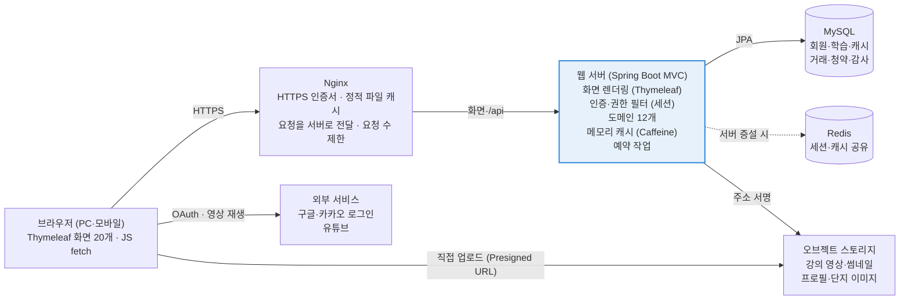
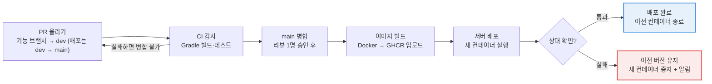

# 시스템 설계

> 💡 개별 상세 데이터보다 **전체적인 흐름을 다루는 내용**들을 포함해보세요. 
>
> - **참고**
>     - **서비스 구조도:** 클라이언트, 서버, DB, 스토리지, 캐시 등이 어떻게 배치되는지
>     - **인증 및 보안 전략:** 인증방식, 토큰관리, 보안정책 등
>     - **인프라 및 배포환경:** 배포 파이프라인, 파일 업로드 방식, 환경설정 등
>     - 등등

# MoneyBeetle 시스템 설계

## 개요

MoneyBeetle은 **Spring Boot MVC + Thymeleaf(서버가 화면을 만들어 응답) + MySQL** 구조로 설계합니다. 부트캠프에서 학습한 구조(Spring Web MVC · JPA · Spring Security 세션 로그인)를 그대로 따르고, 화면 안의 일부 동작(중복 확인, 알림 등)만 `/api/v1` JSON을 `fetch`로 호출합니다. 지금 페이지 구현본은 20개 화면이 각자 브라우저 localStorage에 목업 데이터를 저장하는 프로토타입이라, 이 저장과 판정을 모두 서버로 옮기고 화면은 Thymeleaf 템플릿으로 옮기는 것이 설계의 중심입니다.

**기준 자료**: 페이지 구현본(사용자 12·강사 4·관리자 4개 화면과 ROUTES.md의 향후 URL)을 기준으로 하고, 규칙은 요구사항 명세서와 정책 정의서를 따릅니다. 구현본과 문서가 다른 부분은 마지막 절에 모았습니다.

**기술 스택**: 서버·화면 방식은 팀 프로젝트 골격(`moneybeetle/build.gradle`)과 학습 내용으로 **확정**된 것이고, 캐시·파일·배포는 가정입니다.

| 영역 | 기술 | 근거 |
| --- | --- | --- |
| 화면 | Thymeleaf(서버 렌더링) + HTML·CSS·JavaScript(`static/`) | 확정. 학습 구조(Spring Web MVC + Thymeleaf). 페이지 구현본(`.dc.html`)을 템플릿으로 옮김 |
| 서버 | Java 21 + Spring Boot 3.5, Spring Web MVC, Spring Security, Spring Data JPA, Gradle | 확정 (`build.gradle`). 권한 필터·트랜잭션을 기본 제공 |
| DB | MySQL 8 | 확정. 캐시·거래·청약처럼 정합성이 중요한 데이터 |
| 캐시 | 서버 메모리(Caffeine) → 서버 2대 이상이면 Redis | 가정 |
| 파일 | S3 호환 오브젝트 스토리지 | 구현본에 강의 영상·썸네일·단지 이미지 업로드가 있음 (확인) |
| 배포 | GitHub Actions → Docker → 클라우드 서버 + Nginx | 가정. 학생 팀 규모에 맞는 단순한 구성 |

**설계 원칙**

1. **화면은 보여 주기만, 판정은 서버가**: 구현본은 레벨 해금·출석·가점·당첨을 브라우저에서 계산합니다. 실제 서비스에서는 모두 서버가 계산하고, 화면은 서버가 Model로 넘겨 준 결과만 보여 줍니다 (SP-24, SP-35, DP-14).
2. **돈은 한 번에 함께 바뀜**: 캐시·경험치·자산이 바뀌는 작업은 하나의 트랜잭션으로 묶고, 같은 활동으로 두 번 지급하지 않습니다 (DP-40, SP-18).
3. **설정값은 서버 한 곳에**: 구현본의 `mb-config.js`(레벨·칭호·해금·출석·청약 납입 값)는 서버 설정 테이블로 옮기고, 서버가 화면을 만들 때 Model로 넘겨 줍니다. 관리자가 바꾸면 배포 없이 반영됩니다 (NFR-13).
4. **지난 것은 바뀜지 않음**: 지난 턴 가격, 체결된 거래, 지급 내역은 수정하지 않고 새 기록을 더하는 방식으로만 바꿉니다 (DP-41).

## 서비스 구조도



강조 색: 판정을 내리는 유일한 곳 · 점선: 서버를 2대 이상으로 늘릴 때 추가

브라우저의 모든 요청(화면 요청과 `/api` 요청)은 Nginx를 거쳐 Spring Boot 서버로 가고, 캐시·가점·당첨을 바꾸는 것은 이 서버뿐입니다. 서버가 화면(HTML)까지 만들어 응답합니다. 영상·이미지처럼 큰 파일만 예외로, 서버가 서명해 준 주소로 브라우저가 스토리지에 직접 올립니다.

| 구성 요소 | 배치 | 역할 |
| --- | --- | --- |
| 클라이언트 | 사용자 브라우저 | 서버가 만든 HTML을 보여 줌. 일부 동작만 `/api`를 `fetch`로 호출하고 브라우저에는 화면 편의 설정만 저장 |
| 리버스 프록시 | 클라우드 서버 (Nginx 컨테이너) | HTTPS, 정적 파일(`static/`) 캐시, 요청을 Spring Boot 서버로 전달, 요청 수 제한 |
| 웹 서버 | 같은 서버 (Spring Boot 컨테이너) | 화면 렌더링(Thymeleaf), 인증·권한, 모든 업무 규칙, 메모리 캐시, 예약 작업(탈퇴 정보 정리, 만료 토큰 삭제) |
| DB | 관리형 MySQL (또는 같은 서버의 컨테이너) | 모든 업무 데이터와 감사 기록. 매일 자동 백업 |
| 스토리지 | S3 호환 오브젝트 스토리지 | 영상·썸네일·프로필·단지 이미지. 비공개 버킷에 두고 서명 주소로만 접근 |
| 캐시 | 서버 메모리 → 서버 증설 시 Redis | 오늘의 용어, 강의 목록, 현재 턴 시세, 설정값 (파일 업로드와 캐시 전략 절) |
| 외부 서비스 | 구글·카카오, 유튜브 | 간편 로그인(우선순위 하), URL로 등록한 강의 영상 재생 |

## 애플리케이션 모듈 구성

서버는 **도메인(기능 영역)별 패키지**로 나눕니다. 패키지 이름과 담당은 팀 프로젝트 골격(`moneybeetle/README.md`)을 따르고, 모든 도메인 안은 `controller` / `model/dao` / `model/dto` / `model/entity` / `model/service` / `exception`으로 같은 모양입니다. 화면은 역할별 주소(`/user`, `/instructor`, `/admin`)로 나뉘고, 관리자·강사용 Controller·Service도 해당 도메인 안에 둡니다(`AdminCourseController` 등). 코드 작성 규칙은 코딩 컨벤션 문서를 따릅니다.

| 서버 패키지 | 맡는 일 | 쓰는 화면 | 담당 | 호출하는 모듈 |
| --- | --- | --- | --- | --- |
| `auth` | 로그인·로그아웃, 간편 로그인(OAuth2), 비밀번호 재설정 | UserLogin, Instructor·Admin Login | SCM | member |
| `member` | 가입, 강사 가입·승인, 약관, 마이페이지, 탈퇴 | UserSignup, InstructorSignup, UserMyPage | SCM | growth(가입 시 청약통장 생성) |
| `inquiry` | 사이트 문의 게시판(비공개 글 포함), 강의 Q&A, 관리자 답변·숨김 | UserInquiry, AdminDashboard(?view=board) | SCM | notification |
| `operation` | 서비스 설정값, 관리자 작업 기록, 금칙어 | AdminDashboard(작업 기록) | SCM | — |
| `course` | 카테고리·소주제·강의 조회, 영상 이어보기, 스크랩, 강사의 강의 생성·검수 요청, 관리자 검수 | UserLectureCategory·Detail, InstructorDashboard·CourseCreate, AdminDashboard | DBA ① | global.file |
| `quiz` | 테스트 퀴즈·퀴즈 채점, 오답노트 | UserLectureDetail, UserMyPage | DBA ① | course, growth |
| `growth` | 출석, 경험치, 레벨·칭호, 캐시 원장, 해금 판정 | 모든 사용자 화면 사이드바 | PM | — |
| `home` | 홈 조립(수강 이력 유무로 두 가지), 통합 검색·자동완성 | UserHome-vr1·vr2, UserSearch | PM | course, growth, inquiry |
| `term` | 오늘의 경제 용어, 용어 사전·날짜별 지정 | 홈의 경제단어 팝업, AdminDashboard(?view=terms) | PM | — |
| `notification` | 알림 생성·읽음 처리·알림 끄기 | 모든 화면의 종 버튼 | PM | — |
| `housing` | 청약통장 납입, 가점, 공고·신청·당첨 산정·발표 | UserDemoHousingSubscription, AdminHousingManagement | PM | growth, global.file |
| `trading` | 모의투자 시즌·턴·주문·랭킹·정산 | UserDemoTrading, AdminTradingManagement | DBA ② | growth |
| `global` | 설정(`config`), 공통 응답·예외(`common`, `exception`), 레벨 해금·중복 요청 방지(`security`), 파일 저장(`file`), KST 시계 | — | SCM | (모든 모듈이 사용) |

핵심은 `growth`입니다. 캐시·경험치를 바꾸는 코드는 `growth`(`RewardService`)에만 두고, 퀴즈·모의투자·청약은 그 지급·차감 메서드를 불러서만 값을 바꿉니다. 다른 도메인의 Repository는 직접 쓰지 않고 그 도메인의 Service 메서드를 부릅니다. 알림은 `notification.NotificationService`, 관리자 작업 기록은 `operation.AdminLogService`가 맡아서 각 모듈이 알림·기록 코드를 직접 만들지 않습니다.

**프로토타입 저장소 → 서버 전환**

구현본은 localStorage 키 약 25개에 데이터를 나눠 담고 있습니다. 같은 데이터를 여러 화면이 따로 갖고 있어 역할 간에 공유되지 않습니다(ROUTES.md의 “문의 데이터는 역할 간 공유되지 않음”). 서버로 옮기면 아래처럼 한 모듈이 한 데이터를 맡습니다.

| 지금 브라우저에 있는 것 | 옮길 곳 | 비고 |
| --- | --- | --- |
| `mb-role`, `mb-admin-session`, `mb-admin-login` | `auth` (서버 세션) | 브라우저에 역할을 저장하면 누구나 바꿀 수 있어 반드시 제거 |
| `mb-instructor-pending`, `mb-blocked-users` | `member` | 강사 승인 대기, 계정 정지 |
| `mb-attendance`, `mb-attend-date`, `mb-admin-badges` | `growth` | 출석 판정은 서버 KST 기준 |
| `mb-lecture-progress`, `mb-lecture-view`, `mb-my-qna` | `course`, `inquiry` | 이어보기 위치, 홈 분기(수강 이력 유무) |
| `mb-course-draft` | `course` | 강의 작성 중 임시 저장 |
| `mb-housing-v1` | `housing` | 통장·공고·신청·결과. `housing/store.js`의 “API” 함수 안만 서버 호출로 바꾸면 됨 |
| `mb-admin-ops-v1` | `trading`, `operation` | 시즌·턴 운영 |
| `mb-inquiry-v1` | `inquiry` | 사이트 문의 |
| `mb-notify-read`, `mb-notify-extra` | `notification` | 알림과 읽음 여부 |
| `mb-words-hide`, `mb-notify-mute` | 브라우저에 그대로 | 화면 편의 설정이라 서버가 몰라도 됨 |

## 핵심 처리 흐름

실수하면 캐시·자산이 어긋나는 네 가지 흐름을 서버 처리 순서로 정리했습니다. 네 흐름 모두 **검증 → 한 트랜잭션 안에서 변경 → 기록** 순서를 따릅니다.

**① 퀴즈 제출 → 학습 완료 → 보상** (QST-02~05, GRW-03~08)

1. 서버가 제출된 답을 채점합니다. 정답은 제출 전에 화면으로 보내지 않습니다 (SP-35).
2. 응시 기록을 저장하고 틀린 문제를 오답노트에 넣습니다 (이미 있는 문제는 건너뜀).
3. 70점 이상이고 이 강의를 처음 통과한 경우에만: 학습 완료 기록 → 경험치 지급 → 레벨 재계산(여러 레벨이면 레벨마다 캐시) → 학습 완료 캐시 → 새로 열린 기능 확인.
4. 1~3은 하나의 트랜잭션입니다. 하나라도 실패하면 모두 되돌립니다.
5. 응답으로 점수·해설·받은 보상·새로 열린 기능을 한 번에 돌려줍니다. 화면은 이 값으로 레벨업·해금 모달을 띄우고, 같은 요청 키로 다시 제출되면 서버는 처음 결과를 그대로 돌려줍니다.

**② 모의투자 다음 턴 진행** (ADM-14, INV-05, INV-12)

1. 관리자가 버튼을 누르면 서버가 다시 점검합니다: 휴장일이 아닌지, 다음 턴의 30개 종목 가격과 뉴스가 모두 있는지.
2. 시즌의 ‘현재 턴 번호’를 1 올리고, 턴 진행 기록(누가·언제)을 남깁니다. 되돌리기는 없습니다.
3. 주문에는 항상 ‘어느 턴 가격으로 주문했는지’가 담겨 옵니다. 현재 턴과 다르면 거절해서, 턴이 넘어가는 순간의 주문도 안전하게 막습니다.
4. 턴이 넘어가면 가격·뉴스 캐시를 비우고, 참가자의 평가금액은 조회할 때 계산합니다.

**③ 청약 공고 상태와 당첨 산정·발표** (ADM-36~39, SP-75)

1. 공고 상태는 구현본처럼 모집 예정 → 모집 중 → 모집 마감 → 발표 완료 네 단계입니다. 앞의 세 단계는 DB에 저장하지 않고, 서버 KST 시각과 공고 일정(게시 10:00, 마감 18:00)으로 그때그때 계산합니다. 그래야 상태를 바꾸는 예약 작업이 돌지 않아도 틀리지 않습니다.
2. 신청하면 그 순간의 가점·항목별 점수·납입회차·인정금액을 신청 기록에 함께 저장하고 접수번호를 발급합니다.
3. 발표일(서버 KST) 이후 관리자가 산정 버튼을 누르면, 저장된 가점 기준으로 당첨·예비 당첨·낙첨을 정해 한 트랜잭션으로 저장합니다(구현본의 `computed`). 추첨에 쓴 시드 값도 남깁니다.
4. 관리자가 발표 버튼을 눌러야 발표 완료가 되고 사용자에게 결과와 알림이 갑니다(구현본의 `announcedAt`). 산정과 공개를 나누어, 확인 전에 결과가 새어 나가지 않게 합니다.

**④ 청약통장 납입** (SUB-04, SUB-05)

1. 하루 1회만 허용합니다. ‘오늘 납입 기록이 있는지’는 회원 + 날짜 유니크 제약으로 DB가 막습니다.
2. 캐시 차감 → 통장 잔액 증가 → 인정금액 증가(1회 인정 상한까지만) → 납입회차 +1을 한 트랜잭션으로 처리합니다. 구현본 설정은 최소 2만·최대 50만, 인정 상한 25만입니다.
3. 납입 내역에는 납입액과 인정액을 따로 남깁니다. ‘40만 내었는데 인정은 25만’ 같은 문의에 내역으로 답할 수 있습니다.

모의투자 시즌 정산(ADM-32)도 ③과 같은 방식입니다. 최종 자산·이월금·랭킹을 한 트랜잭션으로 확정하고, 공개는 별도 버튼으로 합니다.

## 인증 및 보안 전략

인증은 학습한 **Spring Security 세션 로그인**을 씁니다. 서버가 화면과 `/api`를 같은 주소에서 내보내므로 CORS 설정이 필요 없고, 토큰을 브라우저 저장소에 두지 않아 스크립트로 훔칠 수 없습니다. JWT는 나중에 모바일 앱이 생기면 추가합니다. 로그인 요청(`POST`)은 Controller 메서드가 아니라 **Security 필터가 처리**하고, 우리는 회원 조회(`AuthService`)와 성공·실패 처리(`AuthSuccessHandler`·`AuthFailHandler`)를 끼워 넣습니다.

지금 구현본은 로그인하면 `localStorage`에 `mb-role`·`mb-admin-session`을 적고 이 값으로 화면을 보여 줍니다. 브라우저 개발자 도구로 값을 바꾸면 관리자 화면이 열리므로, 서버 연동 때 가장 먼저 없애야 할 부분입니다.

**인증 방식**

| 항목 | 방식 | 관련 규칙 |
| --- | --- | --- |
| 로그인 입구 | 사용자 `/login`, 강사 `/instructor/login`, 관리자 `/admin/login`으로 화면은 나뉘지만 로그인 처리는 Security 하나. 로그인 후 역할과 다른 입구로 들어오면 거절 | USR-06, USR-10 |
| 세션 쿠키 | 로그인 성공 시 세션 ID를 새로 발급(세션 고정 공격 방지). `HttpOnly`, `Secure`, `SameSite=Lax` | DP-11 |
| 내 정보 조회 | 서버가 화면을 만들 때 역할·레벨·캐시·설정값을 Model(또는 Thymeleaf Security 확장 `sec:authorize`)로 템플릿에 넘겨 사이드바와 잠금 표시에 씀. localStorage에 저장하지 않음 | HOM-04 |
| 세션 만료 | 30분 미활동 시 만료. 화면 요청은 로그인 화면으로 이동(302)하고 로그인 후 원래 주소로 돌아감, `/api` 요청은 401 | DP-11 |
| 간편 로그인 | OAuth2(구글·카카오). 이메일·닉네임만 받고, 처음이면 나머지 가입 정보 입력 화면으로 | USR-07, DP-13 |
| 강사 가입 | 강사 회원가입은 ‘승인 대기’ 상태로 만들고, 관리자가 승인해야 INSTRUCTOR 권한이 생김 (구현본 기준) | SP-07, ADM-06 |
| 로그인 잠금 | 연속 5회 실패 시 10분 잠금. 실패 횟수와 잠금 해제 시각은 회원 테이블(`failed_login_count`, `locked_until`)에 저장하고 실패 핸들러가 갱신. 잠금 검사는 비밀번호 검사보다 먼저 | DP-10 |
| 비밀번호 저장 | BCrypt 해시. 평문 저장·로그 기록 금지 | DP-02 |
| 비밀번호 찾기 | 일회용 토큰을 만들고 해시만 DB에 저장. 10분 유효, 한 번 쓰면 폐기. 구현본은 ‘준비 중’ | DP-12 |

**권한 (인가)**

- 역할은 `MEMBER`, `INSTRUCTOR`, `ADMIN`을 회원 테이블에 둡니다. 강사는 승인 상태(대기·승인·반려)도 함께 가집니다.
- 주소 단위로 막습니다(`SecurityConfig`): `/admin/**`·`/api/v1/admin/**`는 ADMIN, `/instructor/**`·`/api/v1/instructor/**`는 승인된 INSTRUCTOR, 모의투자·모의 청약은 로그인 + 레벨 조건(`@RequireLevel`). 권한 규칙은 위에서부터 검사하므로 좁은 규칙을 앞에 둡니다.
- 화면의 블러·잠금 표시는 편의 기능일 뿐입니다. 레벨 해금은 서비스에서 DB 값으로 매번 확인합니다 (SP-24, NFR-09).
- 본인 데이터(오답노트·캐시·거래·청약 내역)는 주소에 회원 ID를 받지 않고 세션의 회원 ID로만 조회합니다 (NFR-03).
- 비공개 문의글과 강의 Q&A는 ‘작성자 또는 그 강의의 강사 또는 관리자’일 때만 내용을 돌려줍니다 (SP-40).

**웹 보안 정책**

| 위협 | 대응 |
| --- | --- |
| CSRF (사용자 모르게 요청 보내기) | 세션 쿠키를 쓰므로 Spring Security CSRF 보호를 **켜 둠**. Thymeleaf 폼(`th:action`)은 토큰이 자동으로 들어가고, `fetch` 변경 요청은 헤더에 토큰을 담아 보냄. 로그아웃은 `POST`만 허용 |
| XSS (스크립트 삽입) | Thymeleaf `th:text`(자동 이스케이프)를 쓰고 `th:utext` 금지. 요약글·문의처럼 사용자가 쓴 글은 서버에서도 허용 태그만 남김 |
| SQL 인젝션 | JPA·파라미터 바인딩만 사용 |
| 정답 노출 | 퀴즈를 보낼 때 정답·해설을 빼는 전용 응답 객체 사용 (SP-35) |
| 중복 제출·연타 | 화면 버튼 비활성화 + 서버 요청 키 멱등 처리 (DP-37), 등록·수정·삭제 뒤에는 redirect(PRG) |
| 부적절한 표현 | 닉네임·문의·Q&A·강의 제목·요약글 저장 전 금칙어 검사 (DP-20~23) |
| 파일 업로드 악용 | 파일 내용으로 형식 확인, 용량 제한, 파일명을 UUID로 바꿔 저장 (파일 업로드와 캐시 전략 절) |
| 너무 많은 요청 | 로그인·가입·검색 자동완성에 IP당 요청 횟수 제한(Nginx `limit_req`) |
| 전송 구간 도청 | 전 구간 HTTPS(Let’s Encrypt). HTTP는 HTTPS로 강제 이동 |
| 비밀 값 유출 | DB 비밀번호·OAuth 키·스토리지 키는 코드와 깃허브에 넣지 않고 환경변수로만 주입 |

개인정보는 정책서 표의 항목만 수집하고, 다른 사용자에게는 닉네임·프로필 이미지·칭호·레벨·수상 내역만 보여 줍니다 (DP-01, DP-03). 탈퇴하면 계정을 비활성화하고, 매일 도는 정리 작업이 30일 지난 개인정보를 지웁니다 (DP-06).

## 데이터 설계 원칙

개별 테이블·컬럼은 ERD에서 다루고, 여기서는 모든 테이블에 공통으로 적용할 규칙만 정합니다.

| 원칙 | 설계 방식 | 지키는 규칙 |
| --- | --- | --- |
| 원장(장부) 방식 | 캐시·경험치는 잔액만 바꾸지 않고, 모든 적립·사용을 내역 테이블에 한 줄씩 남김. 잔액은 내역의 합과 일치해야 함 | SP-15, GRW-07 |
| 중복 지급 금지 | 내역에 ‘활동 종류 + 대상 ID’ 유니크 제약을 걸어, 같은 날 출석·같은 강의 완료·같은 레벨은 DB가 두 번째 저장을 거절 | SP-18, NFR-06 |
| 트랜잭션 범위 | 매수·매도, 보상 지급, 시즌 참가, 시즌 정산, 청약통장 납입, 당첨 산정은 각각 한 트랜잭션 | DP-40 |
| 동시 수정 막기 | 잔액·보유 수량을 바꿀 때는 해당 행을 잠그고(비관적 락) 바꿈. 같은 사람이 두 탭에서 동시에 주문해도 잔액이 음수가 되지 않음 | SP-54, DP-36 |
| 중복 요청 처리 | 폼마다 일회용 요청 키를 발급하고, 같은 키가 다시 오면 처음 결과를 돌려줌 | DP-37 |
| 지난 데이터 불변 | 지난 턴 가격·뉴스, 체결된 거래, 지급 내역은 UPDATE·DELETE 금지. 오류는 반대 내역(회수)을 추가해서 바로잡음 | DP-41, SP-17 |
| 시점 값 저장 | 청약 신청 때의 가점·납입회차, 주문 때의 턴 번호·체결 가격을 함께 저장. 나중에 규칙이 바뀌어도 결과가 흔들리지 않음 | SP-75, INV-10 |
| 삭제 대신 상태 | 강의·회원은 지우지 않고 상태(비공개·탈퇴) 값으로 바꾸어 학습·거래 기록을 보호 | SP-32, DP-06 |
| 상태는 한 방향으로만 | 강의(작성 중→검수 중→허가/반려), 시즌(준비→진행 중→휴장→정산→종료)은 허용된 다음 단계로만 바꿀 수 있게 서비스에서 검사 | SP-31, SP-65 |
| 시간 기준 | 서버·DB 시간대를 Asia/Seoul로 맞추고, ‘오늘’ 판단은 하나의 시계 클래스에서만 함. 테스트에서 날짜를 바꿔 볼 수 있음 | DP-42 |
| 감사 기록 | 턴 진행, 정산, 랭킹 공개, 캐시 수동 지급·회수, 강의 허가·반려, 계정 정지는 ‘누가·언제·무엇을·사유’를 감사 테이블에 저장 | DP-43, NFR-14 |
| 운영 값은 DB에 | 캐시·경험치 지급액, 해금 레벨, 통과 점수, 이월 비율, 가점표는 설정 테이블에 두고 관리자 화면에서 수정. 초안 값이 많아 코드에 고정하면 나중에 다시 배포해야 함 | NFR-13, ADM-29 |

## 파일 업로드와 캐시 전략

**파일 업로드**: 구현본에는 여섯 종류의 업로드가 있습니다. 파일은 서버 디스크가 아니라 오브젝트 스토리지에 두고 DB에는 파일 키만 저장합니다. 서버를 다시 만들거나 늘려도 파일이 사라지지 않게 하기 위해서입니다.

| 파일 | 올리는 화면 | 업로드 방식 | 제한 |
| --- | --- | --- | --- |
| 강의 영상 | InstructorCourseCreate (‘파일 업로드’ 또는 ‘영상 URL’) | 파일: 서버가 발급한 임시 업로드 주소(Presigned URL)로 브라우저가 스토리지에 바로 올리고, 완료되면 서버에 키를 알림. URL: 유튜브 등 허용 도메인만 받아 임베드 | 강의당 3개 (DP-33), 용량 미정 |
| 강의 썸네일 | InstructorCourseCreate | 브라우저 → 서버(형식·용량 검사) → 스토리지 | 이미지, 용량 미정 |
| 프로필 이미지 | UserMyPage | 위와 같음 | 2MB, jpg·png (DP-32) |
| 청약 단지 이미지 | AdminHousingManagement | 위와 같음 | 이미지, 용량 미정 |
| 퀴즈 문항 파일 | InstructorCourseCreate (csv·xlsx 등) | 서버가 바로 읽어 문항으로 바꾸고 파일은 저장하지 않음. 한 행이라도 틀리면 전체 취소하고 오류 행 표시 | 문항 수 규칙 (DP-34) |
| 종목 가격 CSV | AdminTradingManagement | 위와 같음 | ADM-21 |

영상은 크기가 커서 서버를 거치지 않게 하는 것이 중요합니다. 저장·전송 비용을 고려하면 초기에는 ‘영상 URL’을 기본으로 하고, 파일 업로드는 용량 상한을 정한 뒤 여는 것을 권합니다. 검수 중인 강의의 영상은 공개 주소가 아니라 짧게 만료되는 서명 주소로만 보여 줍니다.

로컬·개발 환경에서는 같은 인터페이스로 로컬 폴더에 저장하고, 운영 환경에서만 스토리지를 씁니다.

**캐시**: 많이 읽고 거의 안 바뀌는 것만 캐시합니다. 캐시·자산처럼 정확해야 하는 값은 캐시하지 않고 항상 DB에서 읽습니다.

| 대상 | 캐시 기간 | 비우는 시점 |
| --- | --- | --- |
| 오늘의 경제 용어 5개 | 그날 자정(KST)까지 | 관리자가 오늘 세트를 바꿀 때 |
| 카테고리·소주제·공개 강의 목록 | 10분 | 강의 허가·비공개, 카테고리 수정 때 |
| 현재 턴의 종목 가격·뉴스 | 턴이 바뀔 때까지 | 다음 턴 진행 때 |
| 공개된 시즌 랭킹 | 시즌 종료 후 고정 | 랭킹 공개 때 한 번 생성 |
| 운영 설정값(지급액·해금 레벨 등) | 10분 | 관리자가 설정을 저장할 때 |

서버가 한 대일 때는 서버 메모리 캐시(Caffeine)로 충분합니다. 서버를 2대 이상으로 늘리면 캐시와 세션을 함께 Redis로 옮겨야 서버끼리 값이 다르지 않습니다. 캐시 인터페이스(Spring Cache)를 쓰면 이때 코드를 거의 바꾸지 않아도 됩니다.

## 인프라 및 배포환경

**Spring Boot 이미지 하나**(화면 템플릿·정적 파일 포함)를 만들어 Nginx, MySQL과 함께 클라우드 서버 한 대에서 Docker Compose로 띄웁니다. main에 병합되면 GitHub Actions가 자동으로 배포하고, 새 버전이 상태 확인을 통과하지 못하면 이전 버전이 계속 서비스됩니다.



저장소(github.com/bukkeu/MY-HOME)는 `moneybeetle/`(Spring Boot 프로젝트: 서버 코드, `templates/`, `static/`), `기능/`(설계 문서), `moneybeetle-page/`(페이지 구현본, 참고용)로 나뉩니다. 구현본의 `.dc.html` 화면은 ROUTES.md의 향후 URL대로 `templates/` 아래 Thymeleaf 템플릿으로 옮기고, 공통 스크립트(`mb-*.js`)와 CSS는 `static/`으로 옮깁니다.

**환경 구분**

| 환경 | 어디서 | DB·파일 | 용도 |
| --- | --- | --- | --- |
| local | 각자 노트북. `docker compose up`으로 MySQL까지 한 번에 | 로컬 MySQL 컨테이너, 로컬 폴더 | 개발. 목업 데이터(현재 localStorage 시드)를 DB 초기 데이터로 옮겨 사용 |
| dev | 클라우드 서버 (선택) | 개발용 DB, 개발용 버킷 | 팀 통합 확인, 발표 리허설 |
| prod | 클라우드 서버 | 운영 DB(매일 백업), 운영 버킷 | 실제 서비스. 관리자 계정은 배포 때 환경변수로 한 번만 생성 |

**환경설정**

- 설정 파일은 `application.yml`(공통) + `application-{local,dev,prod}.yml`(환경별)로 나누고, 실행할 때 `SPRING_PROFILES_ACTIVE`로 고릅니다.
- DB 주소·비밀번호, OAuth 키, 스토리지 키는 파일에 적지 않고 환경변수로만 넣습니다. 서버에는 `.env` 파일로, GitHub Actions에는 Secrets로 둡니다. `.env.example`만 저장소에 올립니다.
- 서버·DB·컨테이너 시간대는 모두 `Asia/Seoul`로 맞춥니다 (DP-42).
- DB 구조 변경은 Flyway 같은 마이그레이션 도구로 파일을 남기고 배포 때 자동 적용합니다. 팀원마다 DB가 달라지는 일을 막습니다.
- 화면은 서버가 렌더링하므로 별도의 프런트 빌드·환경변수·프록시가 없습니다. `static/`과 `templates/` 파일은 Spring Boot 이미지에 함께 들어갑니다.

## 로깅·모니터링·에러 처리

오류는 서버가 `BusinessException` + 도메인별 `ErrorCode`로 던지고, `GlobalExceptionHandler`가 **요청 종류에 따라** 바꿔 돌려줍니다. 화면 요청은 에러 화면(`templates/error/403·404·500.html`)이나 입력 폼의 안내 문구로, `/api` 요청은 `ApiResponse` JSON(`success`·`data`·`error`, API 명세서 1-2)으로 응답합니다. 정책서의 에러 문구는 서버가 코드와 함께 내려주어 화면마다 문구가 달라지지 않게 합니다.

```json
{ "success": false, "data": null, "error": { "code": "NOT_ENOUGH_CASH", "message": "캐시가 부족해요", "fields": null } }
```

| 오류 종류 (EP-01) | HTTP 상태 | 화면 표현 (EP-06) |
| --- | --- | --- |
| 입력 오류 (글자 수, 형식) | 400, `error.fields`에 입력칸 이름 (`@Valid` 실패 메시지) | 입력칸 아래 문구 |
| 로그인 필요·세션 만료 | 화면 302(로그인 화면), `/api` 401 | 로그인 화면으로, 로그인 후 원래 화면 |
| 권한 없음·레벨 미달 | 403 (레벨이면 필요 레벨 포함) | 잠금 모달 또는 공통 오류 페이지 |
| 규칙 위반 (캐시 부족, 신청 기간 밖, 휴장일) | 409 / 422 | 토스트 또는 모달로 이유와 다음 행동 |
| 없는 데이터 | 404 | 공통 오류 페이지 + 홈 버튼 |
| 서버 오류 | 500 | “처리하지 못했어요. 내 정보는 바뀌지 않았어요” (EP-03) |
- **로그**: 요청마다 요청 ID를 붙여 시각·회원 ID·주소·결과·원인을 JSON 한 줄로 남깁니다. 비밀번호·세션 ID·토큰은 로그에서 가립니다 (EP-05, DP-02).
- **감사 기록과 구분**: 애플리케이션 로그는 일정 기간 뒤 지우고, 관리자 작업 감사 기록은 DB에 계속 보관합니다.
- **모니터링**: Spring Boot Actuator의 상태 확인 주소를 배포 후 점검과 외부 생존 확인(예: UptimeRobot)에 씁니다. 500 오류가 나면 팀 메신저로 알림을 보냅니다.
- **운영 점검 화면**: 관리자 대시보드에 ‘다음 턴 가격·뉴스 비어 있음’, ‘발표일이 지났는데 산정 안 된 공고’ 같은 경고를 보여 줍니다. 사람이 버튼을 눌러야 하는 작업을 놓치지 않기 위해서입니다 (ADM-08, ADM-14).

## 팀 결정 필요 사항

구현본과 문서가 서로 다르거나 아직 정해지지 않아 설계에 영향을 주는 항목입니다. 위쪽일수록 서버 구조를 더 크게 바꿉니다.

| 항목 | 페이지 구현본 | 명세서·정책서 | 설계에 미치는 영향 |
| --- | --- | --- | --- |
| 서버 기술 스택·화면 방식 | 없음(화면만) | 없음 | **확정**: Java 21 + Spring Boot 3.5 + Thymeleaf 서버 렌더링 + MySQL (학습 구조, `build.gradle`) |
| 강의 영상 | 파일 업로드와 URL 둘 다 | 등록 방식 미정 | 파일을 허용하면 스토리지 비용·용량 상한·재생 방식을 정해야 함 |
| 청약통장 납입액 | 1회 2만~50만, 인정 25만 | 1회 1,000캐시 (SP-70) | 필요 캐시 규모가 크게 달라짐. 캐시 지급액(SP-12~14)과 함께 맞춰야 함 |
| 가점 항목 | 공고별로 68점·85점 두 가지 표, 인정금액·지역·나이 항목 포함 | 무주택·부양가족·통장 84점 (SP-71) | 가점표를 공고 유형별 설정으로 둘지 결정. 신청 때 항목별 점수를 저장하는 구조는 같음 |
| 당첨 결과 | 당첨·예비 당첨·낙첨 | 당첨·낙첨 | 예비 순번 산정 규칙 추가 필요 |
| 강사 권한 | 강사가 가입 신청 → 관리자 승인 | 관리자만 부여·회수 (SP-07) | 강사 승인 상태 추가 (이 문서는 구현본 기준) |
| 통합 검색 | 강의·Q&A·게시판 검색 + 자동완성 | 명세서에서 제외됨 | 넣는다면 `search` 모듈과 MySQL 전문 검색 색인(한글 ngram) 필요 |
| 알림 | 종 버튼, 알림 5종, 알림 끄기 | 요구사항 없음 | 넣는다면 `notification` 모듈·테이블 필요. 실시간 푸시 없이 화면을 열 때 조회하는 방식 권장 |
| 사이트 문의 게시판 | 있음(비공개 글, 관리자 답변) | 강의 문의만 있고 별도 게시판은 미정 | `board` 모듈 추가. 금칙어·하루 한도 규칙 적용 대상에 포함 |
| 턴 진행·발표 처리 | 관리자 버튼 | 관리자 버튼 | 버튼 방식 유지. 자동화하려면 예약 작업(스케줄러) 추가 |

## 출처

- 머니비틀 페이지 구현 (ROUTES.md, 화면 20개, `mb-config.js`, `housing/store.js`, `mb-notify.js`, `mb-search.js`, 모의투자 Vite 프로젝트, 참고용)
- 팀 프로젝트 골격 (`moneybeetle/`: `README.md`, `build.gradle`, 패키지 구조)
- 학습 노트 모듈 2 백엔드 (Spring Web MVC · JPA · Spring Security 세션 로그인)
- MoneyBeetle 요구사항 명세서
- MoneyBeetle 정책 정의서
- MoneyBeetle 업무 분석
