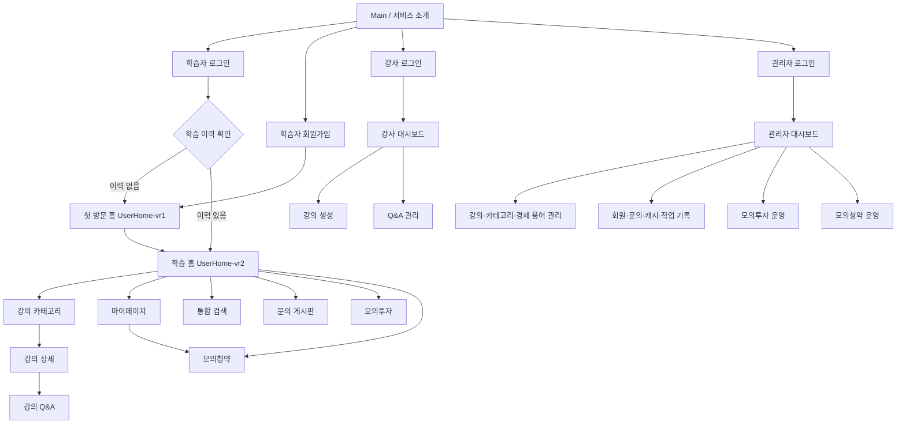
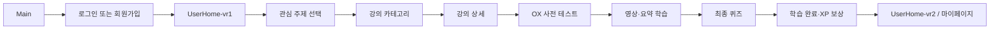
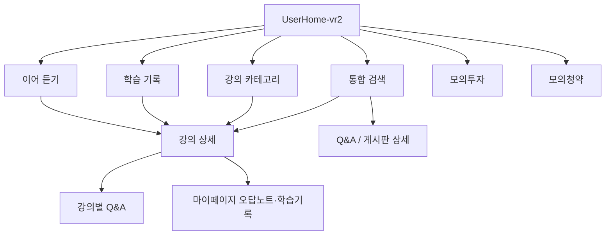
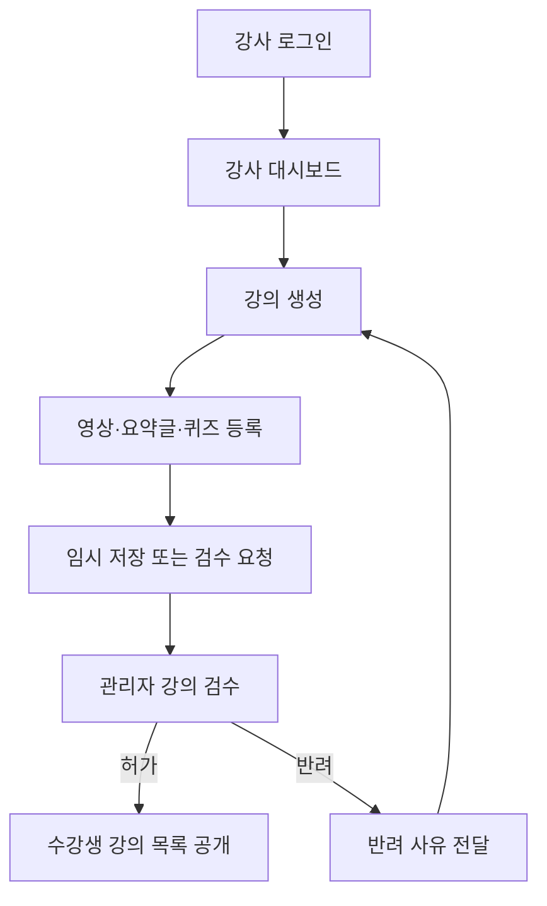
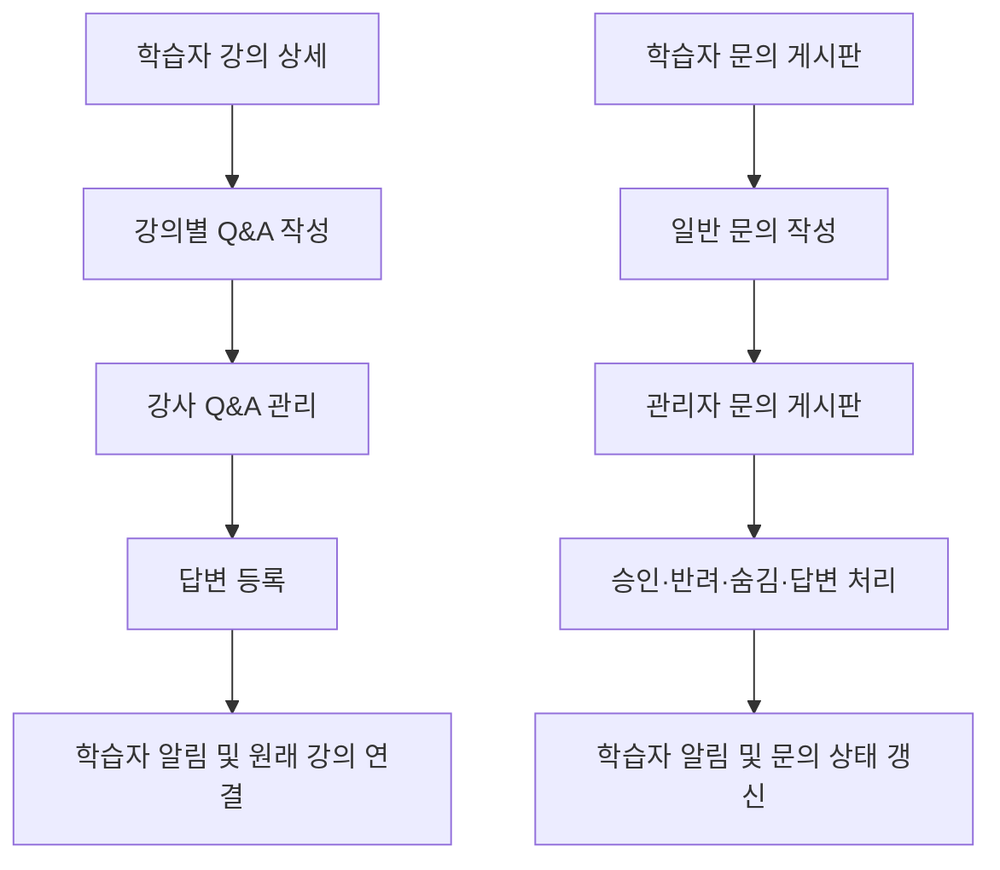

# 화면 설계

> 💡 **사용자가 마주할 인터페이스와 상호작용을 설계하는 페이지입니다.** 
>
> 프론트엔드 개발자는 해당 문서를 통해 컴포넌트 구조를 설계하고, 백엔드 개발자는 필요한 API 데이터를 예측할 수 있습니다. 
>
> - **참고**
>     - **정보 구조도:**
>         - 전체 페이지/화면 목록 정의
>         - 네비게이션 메뉴 구조도 설계
>     - **와이어프레임/스토리보드:** 각 페이지의 레이아웃과 버튼, 입력 창 등 배치
>     - **인터랙션 가이드:** 버튼 클릭시 이동 경로, 마우스 오버 효과, 로딩 애니메이션 노출 시점
>     - **디자인 시스템 정의:** 색상 팔레트, 타이포그래피, 여백 규칙, 통일화된 스타일 등
>     - ⚠️ **반응형 디자인에 따른 레이아웃 변화 또한 포함할 것**

# 정리

## 화면 설계 및 페이지 이동 흐름

### 1. 사용자 페이지

| 화면 이동 경로 | 화면 설명 |
| --- | --- |
| `Main → UserLogin` | 메인 페이지에서 로그인 버튼을 누르면 로그인 페이지로 이동한다. |
| `Main → UserSignup` | 메인 페이지에서 회원가입 버튼을 누르면 회원가입 페이지로 이동한다. |
| `UserSignup → UserHome-vr1` | 회원가입 완료 후 첫 방문 사용자 홈으로 이동한다. |
| `UserLogin → UserHome-vr1 / UserHome-vr2` | 로그인 후 학습 이력에 따라 첫 방문 또는 기존 사용자 홈으로 이동한다. |
| `UserHome → UserLectureCategory` | 홈에서 돈 굴리기 또는 부동산 카테고리를 선택하면 해당 강의 목록으로 이동한다. |
| `UserLectureCategory → UserLectureDetail` | 강의 목록에서 원하는 강의를 선택하면 해당 강의의 상세 학습 페이지로 이동한다. |
| `UserLectureDetail → UserMyPage` | 강의에서 작성한 Q&A는 마이페이지에서 확인할 수 있으며, 원래 강의로 다시 이동할 수 있다. |
| `UserHome → UserSearch` | 상단 검색창에서 검색하면 강의, Q&A, 게시판별 검색 결과를 확인할 수 있다. |
| `UserSearch → UserLectureDetail / UserInquiry` | 검색 결과를 선택하면 해당 강의 또는 게시판 화면으로 이동한다. |
| `UserHome → UserMyPage` | 프로필을 선택하면 학습 기록, 스크랩, 오답노트, Q&A 등을 확인할 수 있는 마이페이지로 이동한다. |
| `UserHome → UserInquiry` | 문의 메뉴를 선택하면 문의 목록을 조회하고 새로운 문의를 작성할 수 있다. |
| `UserHome → UserDemoTrading` | 모의투자 메뉴를 선택하면 시즌별 모의투자 및 거래 화면으로 이동한다. |
| `UserHome → UserDemoHousingSubscription` | 모의청약 메뉴를 선택하면 청약 공고 조회, 가점 계산 및 모의 신청 화면으로 이동한다. |

### 2. 강사 페이지

| 화면 이동 경로 | 화면 설명 |
| --- | --- |
| `InstructorLogin → InstructorDashboard` | 강사 로그인 성공 시 강사 대시보드로 이동한다. |
| `InstructorLogin → InstructorSignup` | 강사 로그인 화면에서 회원가입을 선택하면 강사 회원가입 페이지로 이동한다. |
| `InstructorDashboard → InstructorCourseCreate` | 대시보드에서 강의 등록을 선택하면 강의 생성 페이지로 이동한다. |
| `InstructorCourseCreate → InstructorDashboard` | 강의 작성 후 임시 저장 또는 검수 요청을 완료하면 대시보드로 돌아간다. |
| `InstructorDashboard → Q&A 관리` | 대시보드의 Q&A 탭에서 학습자가 작성한 질문을 조회하고 답변할 수 있다. |

### 3. 관리자 페이지

| 화면 이동 경로 | 화면 설명 |
| --- | --- |
| `AdminLogin → AdminDashboard` | 관리자 로그인 성공 시 관리자 대시보드로 이동한다. |
| `AdminDashboard → 강의 검수` | 등록된 강의를 확인하고 승인 또는 반려할 수 있다. |
| `AdminDashboard → 카테고리 관리` | 강의 상위 카테고리와 하위 주제를 조회하고 관리할 수 있다. |
| `AdminDashboard → 공개 강의 관리` | 승인된 강의 목록을 조회하고 관리할 수 있다. |
| `AdminDashboard → 경제 용어 관리` | 오늘의 경제단어 및 관련 학습 데이터를 관리할 수 있다. |
| `AdminDashboard → 회원 관리` | 가입된 학습자와 강사 정보를 조회하고 관리할 수 있다. |
| `AdminDashboard → 문의 게시판` | 학습자가 작성한 문의를 조회하고 답변할 수 있다. |
| `AdminDashboard → AdminTradingManagement` | 모의투자 시즌, 종목, 가격, 뉴스 및 랭킹을 관리할 수 있다. |
| `AdminDashboard → AdminHousingManagement` | 모의청약 공고, 신청 현황 및 당첨 결과를 관리할 수 있다. |

### 4. 공통 화면 이동 규칙

- 로그인 후 사용자, 강사, 관리자 권한에 따라 각 역할에 맞는 홈 화면으로 이동한다.
- 상단 검색창은 공통으로 제공하며 검색 결과는 강의, Q&A, 게시판으로 구분하여 표시한다.
- 각 상세 화면은 해당 콘텐츠의 고유 ID를 기준으로 연결한다.
- 마이페이지, 강의 상세, 문의 게시판 등에서 이전 화면으로 돌아갈 수 있도록 한다.
- 관리자가 승인한 강의만 학습자 강의 목록에 노출되도록 한다.

---

## 1. 서비스 개요

### 1.1 서비스 정의

**Money Beetle(머니비틀)**은 사회초년생과 금융 입문자가 월급 관리, 저축, 투자, 주거 및 청약 지식을 단계적으로 학습하고, 실제 돈을 사용하기 전에 가상 캐시로 금융 활동을 연습할 수 있도록 돕는 금융 교육 LMS이다.

### 1.2 핵심 목표

1. 경제·금융 지식이 부족한 초보자가 기본 개념부터 순서대로 학습할 수 있도록 한다.
2. 영상, 요약글, 사전 퀴즈, 최종 퀴즈를 연결해 학습 내용을 확인할 수 있도록 한다.
3. XP, 레벨, 칭호, 출석, 캐시 등의 성장 요소로 학습 지속성을 높인다.
4. 모의투자와 모의청약을 통해 금융 의사결정 과정을 안전하게 연습하도록 한다.
5. 학습자, 강사, 관리자의 역할을 구분해 콘텐츠 제작·검수·운영 흐름을 제공한다.

### 1.3 서비스 이용 원칙

- 투자와 청약 기능은 **교육용 시뮬레이션**이다. 실제 금융 거래, 실제 청약 신청, 실제 주택 계약 및 결제를 제공하지 않는다.
- 모의투자 종목과 가격, 뉴스, 경쟁자 및 수익률은 가상 데이터다.
- 모의청약의 가점·자격 판정 및 당첨 결과는 교육을 위한 임시 시뮬레이션이며 현실의 청약 자격이나 당첨을 보장하지 않는다.
- 사용자에게 공개되는 강의는 강사 작성 후 관리자 검수를 거친 콘텐츠를 기준으로 한다.

### 1.4 주요 사용자

| 사용자 | 주요 목적 | 주요 기능 |
| --- | --- | --- |
| 학습자 | 금융 지식 학습 및 가상 실습 | 강의 수강, 퀴즈, Q&A, 경제 용어, 출석·레벨, 모의투자, 모의청약 |
| 강사 | 강의 및 학습 자료 제작, 학습자 질문 답변 | 강의 생성·수정, 영상·요약글·퀴즈 등록, Q&A 답변, 프로필 관리 |
| 관리자 | 서비스 콘텐츠와 회원 및 실습 운영 | 강의 검수, 카테고리·용어·캐시 관리, 회원·게시판 관리, 모의투자·청약 운영, 작업 기록 확인 |

---

## 2. 정보 구조도(IA)

### 2.1 전체 페이지 구성



### 2.2 사용자 내비게이션 메뉴

사용자 화면의 공통 헤더에는 햄버거 메뉴, 로고, 통합 검색, 오늘의 경제단어, 캐시 표시, 알림, 프로필이 배치된다. 햄버거 메뉴를 열면 다음 구조를 제공한다.

```
홈
강의
 ├─ 돈 굴리기(일부 화면의 분류명: 자본 증액)
 └─ 부동산
트레이닝
 ├─ 모의 투자 (Lv.8부터)
 └─ 모의 청약 (Lv.12부터)
내 학습
 ├─ 퀴즈 오답노트
 ├─ 강의 스크랩
 ├─ 시청기록 · 학습완료
 ├─ 문의 게시판
 └─ 마이페이지
```

**공통 헤더 동작**

- 로고: 사용자 홈으로 이동한다.
- 검색창: 강의·Q&A·게시판 통합 검색을 실행한다.
- 오늘의 경제단어: 오늘의 핵심 경제 용어 5개를 확인하는 팝업/패널을 연다.
- 캐시: 현재 보유 가상 캐시를 표시한다.
- 알림: 알림 패널을 열고 항목 선택 시 해당 화면으로 이동한다.
- 프로필: 마이페이지로 이동한다.
- 햄버거: 역할에 맞는 메뉴 Drawer를 열고, 바깥 영역 클릭 또는 메뉴 선택·Esc 입력으로 닫는다.

### 2.3 강사 내비게이션 메뉴

```
강사 센터
 ├─ 대시보드
 ├─ 강의 관리
 ├─ Q&A 관리
 └─ 마이페이지
```

강사 화면에는 수강생 화면으로 이동하는 링크가 제공된다. Q&A 관리는 별도 URL이 아닌 강사 대시보드 내부 탭/화면 상태로 구성된다.

### 2.4 관리자 내비게이션 메뉴

```
관리자 대시보드
 ├─ 강의 운영
 │   ├─ 카테고리 관리
 │   ├─ 강의 검수
 │   └─ 공개 강의 관리
 ├─ 홈 콘텐츠
 │   └─ 오늘의 경제 용어
 ├─ 트레이닝 운영
 │   ├─ 모의 투자
 │   └─ 모의 청약
 ├─ 성장·캐시
 │   ├─ 레벨·해금 (모의투자 운영 화면 사이드바에만 노출. 관리자 대시보드·모의청약 운영 화면 사이드바에는 없음)
 │   └─ 캐시 규칙·지급
 ├─ 회원·게시판
 │   ├─ 사용자·강사
 │   └─ 문의 게시판
 └─ 작업 기록
```

관리자 대시보드 내부 기능은 `AdminDashboard.dc.html?view=...` 형태로 전환한다. 모의투자와 모의청약은 전용 운영 화면으로 이동한다.

---

## 3. 페이지 목록 및 라우트 정의

현재 프로토타입은 `.dc.html` 파일 사이의 링크로 화면을 연결한다. 표의 논리 URL은 실제 서비스에서 사용할 경로이며, 서비스에서는 각 화면을 **Spring MVC Controller가 받아 Thymeleaf 템플릿(`templates/`)으로 응답**한다(서버 렌더링). 아직 모든 Controller가 구현된 것은 아니다.

| 구분 | 페이지 파일 | 논리 URL | 주요 목적 |
| --- | --- | --- | --- |
| 공통 | `Main.dc.html` | `/` | 서비스 소개 및 로그인·가입 진입 |
| 학습자 | `UserLogin.dc.html` | `/login` | 학습자 로그인 |
| 학습자 | `UserSignup.dc.html` | `/signup` | 학습자 회원가입 |
| 학습자 | `UserHome-vr1.dc.html` | `/user/home` (학습 이력 없음) | 신규 사용자의 첫 방문 홈 |
| 학습자 | `UserHome-vr2.dc.html` | `/user/home` (학습 이력 있음) | 기존 사용자의 학습 대시보드 |
| 학습자 | `UserLectureCategory.dc.html` | `/user/lectures?cat=money\|estate` | 강의 카테고리·소주제·목록 |
| 학습자 | `UserLectureDetail.dc.html` | `/user/lecture-detail` | 영상·요약·퀴즈·강의 Q&A |
| 학습자 | `UserMyPage.dc.html` | `/user/my-page` | 프로필·캐시·청약통장·학습 기록 |
| 학습자 | `UserInquiry.dc.html` | `/user/inquiry` | 서비스 문의 게시판 |
| 학습자 | `UserSearch.dc.html` | `/user/search?q=` | 강의·Q&A·게시판 통합 검색 |
| 학습자 | `UserDemoTrading.dc.html` | `/user/demo-trading` | 가상 주식 모의투자 |
| 학습자 | `UserDemoHousingSubscription.dc.html` | `/user/demo-housing-subscription` | 가상 청약·자격 계산·신청 내역 |
| 강사 | `InstructorLogin.dc.html` | `/instructor/login` | 강사 로그인 |
| 강사 | `InstructorSignup.dc.html` | `/instructor/signup` | 강사 가입 및 권한 승인 요청 |
| 강사 | `InstructorDashboard.dc.html` | `/instructor/dashboard` | 강의·퀴즈·요약글·Q&A 관리 |
| 강사 | `InstructorCourseCreate.dc.html` | `/instructor/course-create` | 강의 등록 및 검수 요청 |
| 관리자 | `AdminLogin.dc.html` | `/admin/login` | 관리자 로그인 |
| 관리자 | `AdminDashboard.dc.html` | `/admin/dashboard?view=...` | 강의·회원·콘텐츠·캐시 운영 |
| 관리자 | `AdminTradingManagement.dc.html` | `/admin/trading-management` | 모의투자 시즌·시세·뉴스·랭킹 운영 |
| 관리자 | `AdminHousingManagement.dc.html` | `/admin/housing-management` | 모의청약 공고·신청·결과 운영 |

`DemoTrading-code/`는 참고용 코드 복사본이며 서비스 페이지 목록에 포함하지 않는다.

---

## 4. 공통 레이아웃 및 컴포넌트

### 4.1 학습자 공통 헤더

| 컴포넌트 | 표시 정보 | 상호작용 |
| --- | --- | --- |
| 햄버거 버튼 | 메뉴 아이콘 | 사용자 Drawer 열기/닫기 |
| 브랜드 로고 | Money Beetle 로고 | 사용자 홈 이동 |
| 통합 검색 | 검색 아이콘, 검색어 입력 | 자동완성 표시, Enter/검색 버튼으로 검색 결과 이동 |
| 오늘의 경제단어 | 경제단어 진입 버튼 | 용어 5개 팝업 열기 |
| 캐시 표시 | 코인 아이콘, 보유 캐시 | 잔액 요약 표시 |
| 알림 | 종 아이콘, 미확인 표시 | 오른쪽 알림 패널 열기, 알림 선택 시 해당 화면 이동 |
| 프로필 | 프로필 이미지/이니셜, 닉네임 | 마이페이지 이동 |

### 4.2 공통 Drawer

- 역할별 메뉴 내용은 다르지만 열기·닫기 동작, 오버레이, 타이포그래피, 메뉴 간격을 공통화한다.
- Drawer가 열리면 배경 스크롤을 잠근다.
- Esc 키를 누르면 닫힌다.
- 메뉴를 선택하면 목적지로 이동하고 Drawer를 닫는다.
- 키보드 포커스 표시를 제공하고 닫기 후 메뉴 버튼으로 포커스를 복귀시킨다.
- 모션 감소 설정(`prefers-reduced-motion`)에서는 이동 애니메이션을 제거하거나 최소화한다.

### 4.3 공통 피드백 컴포넌트

| 컴포넌트 | 사용 목적 | 상태 |
| --- | --- | --- |
| Badge | 강의 상태, 역할, 공개 여부, 난이도 표시 | 학습 완료·학습 중·시작 전, 검수 중·허가·반려 등 |
| Progress Bar | 강의 진도, XP, 목표 진행률 | 0~100% 및 완료 상태 |
| Modal | 확인·취소가 필요한 주요 동작 | 열림, 확인, 취소 |
| Toast | 저장·오류·완료 등 짧은 피드백 | 성공, 안내, 오류 |
| Empty State | 결과 또는 콘텐츠가 없는 경우 | 안내 문구 및 다음 행동 링크 |
| Loading/Skeleton | 데이터 로딩 대기 | 로딩 중, 성공, 실패 |
| Tabs/Chips | 카테고리·목록 유형 전환 | 선택/비선택 |
| Search Result Card | 검색 결과 요약 | 콘텐츠 유형별 배지, 제목, 설명, 이동 링크 |

---

## 5. 페이지별 화면 설계 및 인터랙션

## 5.1 공통·인증 화면

### 5.1.1 Main — 서비스 소개

**목적**: 서비스 목적과 학습·실습의 가치를 설명하고 로그인 또는 회원가입으로 유도한다.

**주요 레이아웃**

1. 상단: 로고, 로그인, 회원가입.
2. 메인 히어로: `내 집 마련, 연습부터.` 메시지, 서비스 설명, 무료로 시작하기 버튼.
3. 성장 흐름: 배우기·모으기·연습하기를 통한 내 집 마련 학습 여정.
4. 하단 안내: 투자·청약은 가상 실습이며 실제 금융 거래가 아니라는 고지.

**인터랙션**

- 로그인 → `UserLogin.dc.html`
- 회원가입 → `UserSignup.dc.html`
- 무료로 시작하기 → `UserLogin.dc.html`
- 브랜드 로고 → Main 첫 화면

### 5.1.2 UserLogin — 학습자 로그인

**주요 구성**: 이메일, 비밀번호, 비밀번호 표시/숨김, 로그인 상태 유지, 로그인 버튼, 회원가입 링크, Google·카카오 간편 로그인 진입 UI.

**인터랙션 및 검증**

- 이메일 형식과 비밀번호 입력 여부를 검사한다.
- 비밀번호 표시 버튼으로 입력 타입을 전환한다.
- 로그인 상태 유지 체크를 제공한다.
- 로그인 성공 시 학습 이력에 따라 `UserHome-vr1` 또는 `UserHome-vr2`로 이동한다.
- 회원가입 링크 → UserSignup.
- 비밀번호 찾기는 현재 준비 중 상태로 표시한다.

**구현 주의**: Google·카카오 버튼은 현재 프로토타입 이동/화면 시연용이다. 실제 OAuth 인증 및 계정 연결은 백엔드·OAuth 설정이 필요하다.

### 5.1.3 UserSignup — 학습자 회원가입

**주요 구성**

- 단계형 회원가입: 이메일 및 비밀번호 → 약관 동의 → 닉네임 및 생년월일 등 기본 정보.
- 전체 동의와 필수/선택 항목별 동의.
- Google·카카오 동의 화면을 모사한 팝업 UI.
- 가입 완료 시 가상 캐시 지급 및 청약통장 자동 생성 안내.

**인터랙션**

- 이메일·비밀번호·비밀번호 확인·닉네임·생년월일 입력.
- 비밀번호는 8자 이상, 영문과 숫자를 함께 사용하는 조건을 안내한다.
- 필수 약관 동의 여부에 따라 다음 단계/가입 버튼 활성화를 제어한다.
- 가입 완료 → `UserHome-vr1.dc.html?route=1`.

### 5.1.4 InstructorLogin / InstructorSignup — 강사 인증

**강사 로그인**: 강사 계정 이메일과 비밀번호 입력, 비밀번호 표시, 로그인 유지, 로그인 버튼, 학생 로그인 이동 링크를 제공한다. 로그인 성공 → InstructorDashboard.

**강사 회원가입**: 이메일, 비밀번호, 강사명, 전문 분야, 약관 동의를 입력한다. 가입 후 관리자 승인 전까지 강사 권한이 활성화되지 않는다는 점을 안내한다. 가입 후 InstructorLogin으로 이동한다.

### 5.1.5 AdminLogin — 관리자 로그인

**주요 구성**: 관리자 이메일, 비밀번호, 오류/잠금 안내, 로그인 버튼, 보안 안내.

**인터랙션**

- 입력값 검사 후 관리자 대시보드로 이동한다.
- 반복 실패·접근 제한 상태를 사용자에게 안내한다.
- 실제 서비스에서는 서버 세션, 관리자 권한 확인, 로그인 시도 제한이 필요하다.

---

## 5.2 학습자 화면

### 5.2.1 UserHome-vr1 — 첫 방문 홈

**대상**: 학습 이력이 없는 신규 사용자.

**주요 레이아웃**

1. 공통 헤더 및 사용자 Drawer.
2. 환영 배너: 첫 방문 안내, 닉네임이 포함된 환영 문구, 서비스 소개, `내 학습 로드맵 만들기` CTA, 비틀 마스코트.
3. 관심 주제 선택: 돈 굴리기와 부동산 중 선택.
4. 선택 주제에 맞는 안내 문구 및 강의 카테고리 이동 CTA.
5. 지금 시작하기 좋은 강의: 추천 강의 카드 및 전체 보기.
6. 첫 방문 안내/오늘의 경제단어 팝업.

**인터랙션**

- 관심 주제 카드 선택 시 선택 상태를 강조하고 해당 주제 설명과 CTA를 표시한다.
- `내 학습 로드맵 만들기`는 주제 선택 영역으로 스크롤한다.
- 주제별 CTA 및 강의 카드 선택 → UserLectureCategory 또는 UserLectureDetail.
- 오늘의 경제단어 버튼 → 용어 팝업. `오늘 하루 보지 않기` 선택 상태를 브라우저에 저장한다.
- 수강 이력이 생긴 후 재방문하면 UserHome-vr2를 제공한다.
- 배너 하단의 세로선은 화면에 진입하는 구간에서 짧게 그려졌다가 사라지는 전환 모션으로 사용한다. 최종 화면에는 선이 남지 않는다.

### 5.2.2 UserHome-vr2 — 기존 사용자 홈

**대상**: 수강 또는 학습 기록이 있는 사용자.

**주요 레이아웃**

1. 공통 헤더 및 사용자 Drawer.
2. 오늘의 인사/성장 요약 영역.
3. 이어서 듣기: 최근 학습한 강의, 현재 영상 위치, 진행률, 이어보기 버튼.
4. 학습 기록: 완료·진행 중 콘텐츠 및 전체 보기.
5. 강의 카테고리: 돈 굴리기, 부동산 진입 카드.
6. 트레이닝 영역: 모의투자 시즌 요약과 모의청약 공고/청약통장 요약.
7. 레벨 잠금 상태일 경우 해금 조건과 학습 유도 안내.

**인터랙션**

- 이어보기 → 해당 강의 상세 페이지의 저장된 위치로 이동한다.
- 학습 기록의 항목 → 해당 강의 상세 또는 마이페이지 기록 탭으로 이동한다.
- 카테고리 카드 → 해당 카테고리로 필터링된 UserLectureCategory.
- 모의투자 → Lv.8 이상 진입, 미달 시 레벨 조건 안내 모달.
- 모의청약 → Lv.12 이상 신청·실습 기능 진입. 비해금 사용자는 제도·단지 정보 미리보기 및 학습 유도 안내를 볼 수 있다.
- 오늘의 경제단어 버튼 → 5개 용어 팝업.

### 5.2.3 UserLectureCategory — 강의 카테고리

**카테고리 구조**

| 상위 카테고리 | 소주제 |
| --- | --- |
| 돈 굴리기/자본 증액 | 월급 쪼개기, 예금·적금, 국내 주식, 미국 주식, ETF·분산 투자 |
| 부동산 | 청약, 전·월세, 대출 |

**주요 레이아웃**

1. 공통 헤더 및 Drawer.
2. 상위 카테고리 제목, 설명, 전체 학습 완료 수/전체 강의 수.
3. 소주제 칩: `전체` 및 각 소주제.
4. 검색/필터 결과 수.
5. 카드형 또는 목록형 강의 목록 전환.
6. 강의 카드: 강의 제목, 소주제, 강사, 영상 수, 퀴즈 수, 학습 상태, 진행률, 기준일(정책/제도 관련 콘텐츠).
7. 콘텐츠가 없는 소주제의 빈 상태 안내.

**인터랙션**

- 상위 탭: 돈 굴리기/부동산을 전환한다. 상위 탭에 별도의 `전체 강의` 탭을 추가하지 않는다.
- 소주제 칩: 첫 항목은 `전체`. 선택한 소주제에 해당하는 강의만 필터링한다. 페이지 내 단순 스크롤 이동으로 처리하지 않는다.
- 카드/목록 전환: 보기 방식을 바꾸고 브라우저 저장소에 선택 상태를 저장해 카테고리 전환 후에도 유지한다.
- 검색어 입력: 제목·강사·소주제에 대해 현재 목록을 필터링한다.
- 강의 카드 클릭 → UserLectureDetail에 카테고리·소주제·강의 식별 정보를 전달한다.
- 빈 소주제(예: 현재 강의가 등록되지 않은 전·월세/대출)는 임의 콘텐츠를 만들지 않고 `아직 등록된 강의가 없어요. 새로운 강의가 등록되면 알려드릴게요.` 안내를 표시한다.

### 5.2.4 UserLectureDetail — 강의 상세 및 학습

**목적**: 강의 영상, 요약글, 사전 테스트, 최종 퀴즈, Q&A를 하나의 학습 흐름으로 제공한다.

**주요 레이아웃**

1. 상단 경로: 홈/카테고리/소주제/강의 제목.
2. 강의 제목, 강사, 정보 기준일 및 출처(해당 콘텐츠에 한함).
3. 전체 진도율 및 학습 완료 상태.
4. 강의 목차 사이드 영역: 영상/학습 항목, 완료 표시, 현재 위치.
5. 중앙 학습 영역: 영상 플레이어, 영상 제목·시간·재생 속도, 이전/다음 이동.
6. 콘텐츠 탭: 영상 요약글, 강의 문의.
7. 사전 OX 테스트: 5문제.
8. 최종 퀴즈: 4지선다형 문제, 진행 상태, 제출 및 결과.
9. 완료/오답 결과: 점수, 해설, 재도전, 다음 학습 이동.

**학습 진행 규칙**

- 영상 시청 전 OX 5문제에 답하고 `정답 확인`을 눌러야 영상이 열린다.
- OX 테스트는 학습 진입용이며 오답이 XP·점수·오답노트에 불이익을 주지 않고 재응시할 수 있다.
- 영상은 재생 완료 시 시청 완료 처리하고 마지막 시청 위치를 기록한다.
- 모든 영상을 시청한 후 최종 4지선다 퀴즈가 열린다.
- 최종 퀴즈는 70점 이상 통과를 학습 완료 기준으로 한다.
- 오답은 오답노트에 저장되고 해설을 표시한다.
- 학습 완료 보상은 최초 통과 시 한 번만 지급한다.
- 강의 문의는 현재 강의에 연결된 Q&A로 저장한다.

**강의 Q&A 규칙**

- 강의 상세에서 작성한 질문은 현재 강의 ID에 자동 연결한다. 별도의 강의 선택 UI를 추가하지 않는다.
- 질문 작성 제한은 제목 50자, 내용 1,000자, 하루 10개 기준으로 안내한다.
- 작성자, 해당 강의 강사, 관리자에게 공개되는 강의별 문의 흐름이다.
- 마이페이지 Q&A 목록에 표시할 때 원래 강의 ID와 제목을 유지하고 `해당 강의 보러 가기` 버튼을 제공한다.
- 강의 연결 정보가 없는 기존 질문은 임의로 연결하지 않고 버튼을 표시하지 않는다.

### 5.2.5 UserMyPage — 마이페이지

**주요 영역 및 탭**

| 탭/영역 | 표시 내용 | 주요 액션 |
| --- | --- | --- |
| 프로필 요약 | 프로필 이미지, 닉네임, 이메일, 로그인 방식, 레벨·칭호, XP, 캐시, 연속 출석, 수상 내역 | 프로필 정보 확인·변경 |
| 개인정보/계정 | 닉네임, 생년월일, 비밀번호, 계정 상태 | 정보 저장, 비밀번호 변경, 탈퇴 |
| 캐시 내역 | 보유 캐시, 월별 적립/사용 요약, 거래 내역 | 적립·사용 내역 확인 |
| 청약통장 | 잔액, 누적 납입금액, 인정금액, 회차, 납입 내역 | 납입 금액 입력 및 납입 |
| 스크랩 | 저장한 강의 목록 | 강의 보기, 스크랩 해제 |
| 오답노트 | 미극복/극복 완료 문제, 내 답, 정답, 해설 | 다시 풀기, 극복 처리 |
| 시청기록 | 최근 시청 및 학습 완료 강의 | 강의 보기/이어보기 |
| Q&A·문의 | 강의별 Q&A와 문의 게시판 작성 글 | 원래 강의로 이동, 문의 게시판 이동 |

**인터랙션**

- 탭 선택 시 해당 정보 영역으로 전환한다. `#tab-account`, `#tab-housing`, `#tab-scrap`, `#tab-wrong`, `#tab-history`, `#tab-qna` 해시 경로를 지원한다.
- 청약통장 납입은 금액 입력 후 납입 예상 결과를 확인하고 실행한다.
- 납입 시 보유 캐시, 잔액, 누적 납입금액, 인정금액, 회차 및 이력이 함께 갱신되어야 한다.
- 모의청약 페이지와 동일한 청약통장 저장소를 사용한다.
- Q&A 항목의 강의 연결 정보가 있으면 해당 강의 상세로 이동한다.

### 5.2.6 UserInquiry — 문의 게시판

**주요 레이아웃**

1. 게시판 제목과 이용 안내.
2. `문의 작성` 버튼 및 새 문의 폼.
3. 분류 선택: 강의, 학습·퀴즈, 모의 투자, 모의 청약, 계정·캐시, 기타.
4. 공개/비공개 설정.
5. 제목과 내용 입력, 글자 수 표시.
6. 문의 목록: 상태·제목·작성일·분류.
7. 상세 펼침: 문의 본문, 관리자 답변, 댓글, 삭제 기능.

**입력 및 상태 규칙**

- 제목 최대 50자, 내용 최대 1,000자.
- 하루 최대 작성 수 10개.
- 공개글/비공개글을 선택할 수 있다.
- 상태는 관리자 처리 전, 답변 대기, 답변 완료 등의 상태를 구분해 표시한다.
- 비공개글은 작성자와 운영 권한이 있는 역할만 접근하도록 서버에서 검증해야 한다.

**인터랙션**

- 문의 작성 → 분류·공개 설정·제목·내용 입력 → 등록.
- 목록 항목 클릭 → 상세 펼침/접힘.
- 답변 또는 댓글 확인.
- 작성자는 본인 문의 삭제를 요청할 수 있다(실제 서비스에서는 삭제 정책과 이력 보존 규칙 적용).
- 알림의 문의 답변 항목 선택 → 해당 문의 상세로 이동.

**구분 주의**: 강의 상세 안의 강의별 Q&A와 전체 문의 게시판은 목적과 공개 범위가 다르므로 별도 데이터 유형/화면 상태로 관리한다.

### 5.2.7 UserSearch — 통합 검색

**검색 대상**

- 강의: 강의명, 설명, 카테고리, 소주제, 강사.
- Q&A: 질문 제목 및 본문, 연결된 강의 정보.
- 게시판: 문의 제목 및 본문, 분류, 공개 상태.

**주요 레이아웃**

1. 검색어 입력창 및 검색 결과 제목.
2. 전체 결과 수.
3. 전체/강의/Q&A/게시판 유형 필터와 각 유형별 결과 수.
4. 전체 화면에서는 유형별 섹션을 분리해 결과 카드 표시.
5. 각 섹션은 일부 결과를 먼저 보여주고 더 보기 동작을 제공한다.
6. 검색어와 일치한 부분을 강조 표시한다.
7. 결과 없음 상태에서는 검색어 수정 안내를 표시한다.

**인터랙션**

- 공통 헤더 검색창에서 Enter 또는 검색 버튼 → `/user/search?q=검색어`.
- 검색창 자동완성에서 결과를 선택하면 해당 콘텐츠 상세로 이동한다.
- 유형 필터를 선택하면 해당 유형 결과만 표시한다.
- 강의 결과 → 해당 강의 상세.
- 강의에 연결된 Q&A 결과 → 질문을 작성한 원래 강의 상세.
- 일반 게시판 결과 → 해당 문의 게시글 상세.
- 비공개 글은 권한이 있는 사용자에게만 결과를 노출해야 한다.

**현재 프로토타입 참고**: `mb-search.js`에서 강의·Q&A·게시판 색인을 구성한다. 실제 서비스에서는 색인 구성 함수를 검색 API 호출로 교체한다.

### 5.2.8 UserDemoTrading — 모의투자

**목적**: 가상 주식 시장에서 매수·매도 의사결정을 연습하고 투자 결과를 확인한다.

**주요 화면 요소**

- 시즌 소개/참가 화면: 시즌 기간, 턴 수, 시작 자금, 이월금, 참가 조건.
- 시즌 진행 화면: 현재 턴, 남은 시간, 시즌 진행 상태, 남은 현금, 총자산/순자산, 수익률.
- 종목 탐색: 전체 30개 가상 종목, 분야별 분류, 인기 종목, 종목 검색.
- 종목 상세: 현재 턴 가격, 전 턴 대비 변동, 가격 차트, 회사 소개, 매출 구성, 이번 턴 관련 뉴스.
- 주문 패널: 매수/매도, 보유 수량, 주문 수량, 주문 가능 금액, 매매 이유.
- 보유 종목/거래 내역: 평가금액, 평가손익, 수량, 평균 단가, 체결 가격, 매매 이유.
- 시즌 랭킹: 순자산 및 수익률 기준 순위.
- 상태별 안내: 참가 전, 진행 중, 휴장, 턴 전환/정산 중, 종료, 참가 마감, 시즌 없음.

**주요 규칙**

- 한 시즌은 14일, 12턴으로 구성한다.
- 가상 기업 종목을 사용하며 시세는 턴 단위로 고정된다.
- 같은 턴 안의 거래는 동일한 가격을 사용한다.
- 매매 시 매매 이유를 선택한다.
- 수수료와 세금은 부과하지 않는 시뮬레이션이다.
- 시즌 참가 금액은 참가 시 확정되며 시즌 중 임의 변경하지 않는다.
- 시즌 종료 후 순자산·수익률 랭킹과 정산 정보를 공개한다.

**인터랙션**

- 종목 선택 → 종목 상세/차트/회사 정보 확인.
- 매수/매도 탭 → 수량 및 매매 이유 선택 → 주문 검토 → 거래 실행.
- 보유 수량/현금이 부족한 경우 오류 안내.
- 시즌 진행 상태에 따라 거래 가능 여부를 제어한다.
- 종목 검색/분야 필터/거래 내역/랭킹 보기 전환.

### 5.2.9 UserDemoHousingSubscription — 모의청약

**목적**: 공공·민간 청약의 기본 개념을 배우고 가상 단지에 신청해 자격·가점·결과를 확인한다.

**주요 레이아웃 및 기능**

1. 상단 안내: 모의청약 및 실제 청약이 아니라는 고지.
2. 회원 레벨, 보유 캐시, 청약통장 잔액·인정 회차.
3. Lv.12 미만인 경우 잠금 안내, 해금까지 필요한 XP, 학습/청약통장 유도 CTA.
4. 청약 유형 선택: 공공/민간 설명 카드.
5. 청약통장 현황과 마이페이지 이동.
6. 모집 중인 청약 단지 카드: 단지명, 지역, 전용면적, 가상 분양가, 공급 세대, 접수 마감.
7. 청약 캘린더: 날짜별 공고·접수·발표 일정.
8. 단지 목록 및 필터: 공공/민간, 지역, 모집 상태, 전용면적.
9. 단지 상세: 공급 정보, 일정, 조건, 신청 가능 여부.
10. 자격 및 가점 계산: 무주택 여부, 부양가족 수 등 가상 조건, 항목별 점수와 예상 총점.
11. 신청 내용 확인 및 최종 신청.
12. 내 청약 신청 내역: 접수번호, 신청 당시 레벨·가상 정보·가점, 발표일.
13. 결과 화면: 당첨/예비/탈락 등 결과와 기준 설명.

**인터랙션**

- 공공/민간 유형 카드 → 유형이 지정된 단지 목록.
- 캘린더 날짜 선택 → 해당 날짜의 일정 목록.
- 필터 변경 → 단지 목록 갱신. 필터 초기화 → 기본값 복귀.
- 단지 상세보기 → 단지 상세 영역.
- 자격 확인하고 신청하기 → 가상 자격 및 가점 계산.
- 무주택 여부/부양가족 수 등 허용된 입력을 조정 → 가점 및 자격 결과 갱신.
- 신청 내용 확인 → 최종 확인 모달 → 신청 완료 및 접수번호 발급.
- 결과 발표 전에는 결과를 노출하지 않고, 발표 후 결과 확인을 허용한다.
- 청약통장 납입하기 → 마이페이지 청약통장 탭 또는 해당 납입 화면으로 이동한다.

**가상 혼인 상태**: 혼인 여부·신혼부부 여부는 실제 회원 정보가 아니라 레벨로 자동 설정되며 사용자가 직접 바꿀 수 없다(Lv.12~16은 미혼, Lv.17~20은 신혼부부). 세부 가점 기준과 혼인·신혼부부 우대 조건은 아직 확정되지 않았음을 화면에 안내한다. 레벨별 칭호는 Lv.1~3 텐트, 4~7 원룸, 8~11 투룸, 12~16 아파트, 17~20 내 집이며 `mb-config.js`의 `tiers`로 관리한다.

**정책 주의**: 모의청약의 가점 기준과 혼인/신혼부부 조건은 임시 시뮬레이션으로 표기한다. 현실 청약 기준과 혼동되지 않도록 화면에 고지를 유지한다.

---

## 5.3 강사 화면

### 5.3.1 InstructorDashboard — 강사 대시보드

**주요 영역**

- 현황 카드: 등록 강의, 검수 상태, 학습자 질문 등.
- 최근 등록 콘텐츠: 강의/퀴즈/요약글 상태와 수정 진입.
- 최근 질문: 학습자, 연결 강의, 작성일, 답변 상태.
- 강의 관리: 강의 목록, 카테고리, 난이도, 공개 상태, 수정/삭제.
- 강의 생성/퀴즈 생성/요약글 작성 진입 버튼.
- Q&A 관리 탭: 질문 목록, 상세 내용, 강사 답변, 답변 수정/삭제.
- 마이페이지: 프로필 정보, 전문 분야, 계정 및 비밀번호 관리.

**인터랙션**

- 강의 생성 → InstructorCourseCreate 또는 대시보드 내 강의 작성 화면.
- 강의 수정/삭제 → 선택한 강의 편집 또는 확인 모달.
- 퀴즈 생성 → 퀴즈 제목 및 연결 강의 선택 → 문제/보기/정답/해설 입력 → 저장.
- 요약글 작성 → 제목, 대표 이미지, 본문, 관련 강의 연결 → 임시 저장 또는 게시.
- Q&A 선택 → 질문 상세 → 답변 작성/수정/삭제.
- 답변을 등록하면 학습자 알림 생성이 필요하다.

### 5.3.2 InstructorCourseCreate — 강의 생성

**단계형 등록 화면**

| 단계 | 항목 | 입력/처리 |
| --- | --- | --- |
| 1. 분류 | 카테고리, 소주제 | 관리자가 등록한 분류 선택 |
| 2. 강의 정보 | 제목, 소개, 썸네일, 정책 정보 기준일·출처 | 수강생에게 노출할 기본 정보 입력 |
| 3. 영상과 요약글 | 영상 1~3개, 영상 제목·길이·파일 또는 URL, 영상별 요약글 | 영상마다 복습용 요약을 연결 |
| 4. 사전 테스트 | OX 5문제 | 문제·정답·해설 파일 업로드 또는 등록 |
| 5. 최종 퀴즈 | 4지선다 5~15문제 | 문제·보기 4개·정답 번호·해설 입력 |
| 6. 검수 요청 | 임시 저장, 검수 요청 | 검수 요청 후 관리자 확인 대기 |

**인터랙션 및 제한**

- 필수 항목 미입력 시 저장/검수 요청을 제한하고 오류를 표시한다.
- 영상은 최소 1개, 최대 3개.
- 영상마다 요약글을 작성한다.
- OX 테스트는 5문제, 최종 퀴즈는 5~15문제를 기준으로 한다.
- 영상 업로드 또는 영상 URL 입력을 제공한다.
- PDF 학습 자료는 선택 항목이다.
- 강의 목차 순서는 위/아래 버튼으로 변경한다.
- 임시 저장은 작성 중 상태로 보관한다.
- 검수 요청 후에는 관리자 처리 전까지 강의 수정이 제한되는 상태를 표시한다.
- 관리자 허가 후에만 수강생 강의 목록에 공개한다.

---

## 5.4 관리자 화면

### 5.4.1 AdminDashboard — 통합 관리자 대시보드

**대시보드 화면**

- 처리할 일 요약: 검수 대기, 문의 대기, 청약 발표 등 운영상 확인이 필요한 항목.
- 최근 작업 기록.
- 주요 관리 기능으로 이동하는 카드/링크.

**하위 메뉴 및 화면 기능**

| view 값 | 화면 | 주요 기능 |
| --- | --- | --- |
| `dash` | 관리자 대시보드 | 처리할 일, 최근 작업, 주요 메뉴 |
| `categories` | 카테고리 관리 | 상위 카테고리와 소주제 추가·수정·삭제 |
| `review` | 강의 검수 | 강의 구성 확인, 허가/반려, 반려 사유 작성 |
| `courses` | 공개 강의 관리 | 공개 강의 조회, 비공개 전환, 삭제 제한 확인 |
| `terms` | 오늘의 경제 용어 | 용어 사전 등록·수정·삭제, 날짜별 5개 지정 |
| `training` | 트레이닝 운영 안내 | 모의투자·모의청약 전용 운영 화면 이동 |
| `invest` | 모의투자 안내 | 모의투자 운영 화면 이동 |
| `sub` | 모의청약 안내 | 모의청약 운영 화면 이동 |
| `levels` | 레벨·해금 | 레벨 칭호(Lv.1~3 텐트, 4~7 원룸, 8~11 투룸, 12~16 아파트, 17~20 내 집)와 모의투자·모의청약 해금 레벨 관리. 사이드바에는 모의투자 운영 화면(`AdminTradingManagement`)에서만 `?view=levels` 링크로 노출되고, 관리자 대시보드·모의청약 운영 화면 사이드바에는 메뉴가 없음 |
| `cash` | 캐시 규칙·지급 | 활동별 지급 규칙 설정, 회원 캐시 수동 지급·회수 |
| `users` | 사용자·강사 | 닉네임/이메일 검색, 계정 상태, 강사 권한 부여·회수, 탈퇴 처리 |
| `board` | 문의 게시판 | 문의 목록, 승인/반려/숨김/삭제, 신고 의심 분류 |
| `log` | 작업 기록 | 관리자 작업 이력 조회 |

**핵심 인터랙션**

- 좌측 사이드바 그룹 접기/펼치기.
- 메뉴 클릭 시 `view`에 해당하는 관리자 화면으로 전환.
- 강의 검수에서 허가 시 공개 상태로 변경, 반려 시 사유 입력을 요구한다.
- 학습 이력이 존재하는 강의는 삭제보다 비공개 전환을 우선한다.
- 경제 용어는 사전 데이터와 날짜별 홈 노출 목록을 구분해 관리한다.
- 캐시 수동 지급/회수는 회원, 금액, 사유를 입력하고 확인 모달을 거친다.
- 회원 탈퇴·권한 변경·문의 처리 등 주요 작업은 확인 모달과 작업 기록을 남긴다.

### 5.4.2 AdminTradingManagement — 모의투자 운영

**전용 운영 메뉴**

- 대시보드: 진행 시즌, 현재 턴, 참가자 수, 오늘 주문 수, 다음 턴 진행 정보.
- 시즌 관리: 시즌 생성, 시작일, 상태, 이월 비율 및 이월 상한, 참여 해금 레벨.
- 턴 관리: 턴별 일정·진행 상태·휴장·정산 처리.
- 종목 관리: 종목명, 분야, 시작 가격, 기업 정보.
- 가격 관리: 턴별 가격 및 변동률 입력, CSV 업로드/다운로드, 되돌리기/저장.
- 뉴스 관리: 턴별 뉴스 등록, 본문, 관련 분야·종목, 관리자 메모.
- 참가자 관리: 레벨, 투자 가능 금액, 순자산, 수익률, 보유 종목 및 거래 내역 확인.
- 랭킹 관리: 순자산·수익률 기준 랭킹, 동점 처리, 랭킹 공개.
- 캐시/정산: 지급·회수, 정산 및 시즌 보상 처리.
- 작업 기록: 운영자 작업 로그.

**인터랙션**

- 상단 메뉴 버튼으로 운영 하위 화면 전환.
- 시즌/턴/종목/뉴스 데이터 입력 후 저장.
- 가격은 턴 기준으로 관리하며, 필요한 경우 CSV로 일괄 반영한다.
- 턴 진행 및 시즌 정산·랭킹 공개는 확인 절차를 둔다.
- 참가자 상세에서는 거래 이유와 보유 현황을 확인한다.

### 5.4.3 AdminHousingManagement — 모의청약 운영

**주요 기능**

- 청약 단지/공고 등록: 단지명, 공공·민간 유형, 지역, 세부 위치, 전용면적, 가상 분양가, 공급 세대 수, 게시일, 접수 마감일, 발표일, 이미지.
- 공고 목록: 유형·상태 필터, 공고 수정, 숨김/공개, 삭제.
- 신청 현황: 공고별 실제 체험 회원 신청 기록과 가상 경쟁자 수를 구분해 표시.
- 신청자 관리: 접수번호, 회원, 신청 단지, 유형, 레벨, 가상 혼인 상태, 납입 회차·인정금액, 가점, 신청일, 상태.
- 결과 관리: 모집 마감 후 결과 산정, 검토, 결과 발표.
- 문의·회원·강의 검수·경제 용어·작업 기록 등 운영 메뉴 접근.

**인터랙션 및 검증 규칙**

- 공고 등록/수정 후 목록과 사용자 모의청약 화면에 반영되어야 한다.
- 신청자가 있는 공고는 청약 유형과 공급 세대 수를 변경하지 못하도록 제한한다.
- 신청자가 있는 공고는 삭제하지 않고 비공개 전환을 사용한다.
- 모집 마감 전 결과 산정을 제한한다.
- 결과 산정 후에는 재산정을 제한한다.
- 결과 산정 후 관리자 검토를 거쳐 발표한다.
- 결과 발표 후에는 발표 결과를 변경할 수 없도록 한다.
- 가상 경쟁자는 회원 신청 목록과 구분해 안내한다.

---

## 6. 주요 사용자 흐름

### 6.1 신규 학습자 흐름



### 6.2 기존 학습자 흐름



### 6.3 강사 콘텐츠 등록 및 검수 흐름



### 6.4 문의 처리 흐름



---

## 7. 인터랙션 및 상태 가이드

### 7.1 공통 상호작용 규칙

| 요소 | 기본 동작 | 상태/피드백 |
| --- | --- | --- |
| 링크/카드 | 클릭 시 관련 상세 화면으로 이동 | Hover 시 배경·테두리 강조, 키보드 포커스 제공 |
| 주요 버튼 | 작업 실행 또는 다음 단계 이동 | 처리 중 비활성화, 성공 Toast, 실패 메시지 |
| 탭/칩 | 해당 영역 또는 콘텐츠 필터 변경 | 선택 상태를 색상/굵기/배경으로 표현 |
| 검색 | 입력·Enter·검색 아이콘 | 자동완성, 결과 수, 유형 분류, 결과 없음 안내 |
| Drawer | 햄버거 클릭으로 열기 | 오버레이, 배경 스크롤 잠금, Esc 닫기 |
| Modal | 확인이 필요한 작업 전 표시 | 확인/취소, 위험 작업은 강조 및 재확인 |
| 입력 폼 | 유효성 검사 후 저장 | 필수값·글자 수·범위 오류를 입력 근처 표시 |
| Toast | 비동기 처리 결과 안내 | 일정 시간 후 자동 닫힘, 중요 오류는 인라인 안내 병행 |
| Loading | API 대기 중 표시 | Skeleton 또는 로딩 문구, 중복 제출 방지 |

### 7.2 주요 애니메이션

- Drawer: 좌우 슬라이드 및 배경 오버레이.
- 알림 패널: 우측에서 슬라이드 인/아웃.
- Toast: 화면 우측 하단에서 진입 후 자동 사라짐.
- 신규 홈(UserHome-vr1): 배너와 다음 콘텐츠 사이의 가는 수직선이 아래로 그려졌다가 사라지는 짧은 전환 효과. 선의 최종 상태는 화면에 남지 않는다.
- 강의 진행률: 학습 기록에 맞춰 진행 바 갱신.
- 모션 감소 설정이 켜져 있으면 불필요한 이동·전환 애니메이션을 제거하거나 즉시 상태로 표시한다.

### 7.3 오류 및 빈 상태

- 검색 결과 없음: 검색어 수정 안내.
- 강의 미등록 소주제: 강의가 아직 등록되지 않았다는 안내.
- 학습 잠금: 필요한 레벨과 다음 행동(학습하기) 제공.
- 로딩 실패: 재시도 동작과 원인 안내.
- 저장 실패: 입력값을 유지하고 오류 위치 표시.
- 신청 조건 미충족: 부족한 조건을 항목별로 안내.
- 중복 청약 신청: 이미 신청한 공고임을 알리고 기존 신청 내역으로 이동.
- 권한 부족: 접근이 제한된 이유와 허용된 경로를 안내한다.

---

## 8. 디자인 시스템

### 8.1 컬러 팔레트

| 역할 | 색상 코드 | 사용처 |
| --- | --- | --- |
| 페이지 배경 | `#F7FAF3` | 사용자·금융 실습 화면의 기본 배경 |
| 기본 표면 | `#FFFFFF` | 카드, 모달, 입력 영역 |
| 시그니처 라임 | `#9FE870` | 주요 버튼, 선택 상태, 진행률, 강조 |
| 연한 그린 | `#EAF7D8` | 보조 배경, 선택 카드, 부드러운 강조 |
| 밝은 그린 | `#B9EF8E` | 보조 포인트, 카드 상단 영역 |
| 딥 올리브 | `#263B1A` | 제목, 본문 강조, 주요 CTA, 아이콘 |
| 보조 텍스트 | `#687161` | 설명, 메타 정보, 비활성 텍스트 |
| 기본 테두리 | `#D5E1CC` | 카드 테두리, 구분선, 입력 테두리 |
| 골드 포인트 | `#F2C14E` | 보상, 코인, 목표/성취 포인트에 제한적으로 사용 |
| 상승 표시 | `#D93A44` | 모의투자 수익/상승 표시 |
| 하락 표시 | `#2F6FDB` | 모의투자 손실/하락 표시 |

검색 결과 유형 배지는 강의(라임), Q&A(연한 청록), 게시판(연한 베이지)로 구분한다.

### 8.2 타이포그래피

- 기본 서체: **Pretendard**.
- 제목: 굵기 700~800, 딥 올리브 사용.
- 본문: 굵기 400~500, 줄 간격을 넉넉하게 설정.
- 보조 정보: 12~14px 기준.
- 버튼/메뉴: 14~16px, 굵기 600 전후.
- 숫자(캐시·XP·수익률·진도)는 정렬이 흐트러지지 않도록 숫자 폭과 천 단위 구분을 일관되게 사용한다.

### 8.3 여백·크기·모서리

| 항목 | 기준 |
| --- | --- |
| 기본 간격 단위 | 4px 기반, 주 사용 단위 8 / 12 / 16 / 24 / 32px |
| 카드 내부 패딩 | 16~24px |
| 섹션 간격 | 24~40px |
| 기본 카드 모서리 | 16px 전후 |
| 버튼 모서리 | 일반 버튼 10~14px, Pill 버튼 999px |
| 입력 높이 | 데스크톱 기준 약 44~52px, 모바일 터치 영역 최소 44px 권장 |
| 테두리 | 1px, `#D5E1CC` 중심 |
| 그림자 | 낮은 농도로 제한. 카드 정보 가독성을 우선 |

### 8.4 아이콘 및 그래픽 사용

- Money Beetle 마스코트와 로고를 브랜드의 대표 그래픽으로 사용한다.
- 돈 굴리기: 동전, 저금통, 지갑 등 금융 학습을 연상시키는 단순 아이콘.
- 부동산: 집, 열쇠, 건물 등 주거 관련 아이콘.
- XP/보상: 코인, 작은 반짝임, 배지 등을 제한적으로 사용한다.
- 업적/등급: 육각형·메달·리본 형태의 간결한 배지.
- 배경 장식은 유기적인 도형을 낮은 대비로 사용하되, 본문·수치·버튼과 겹치지 않도록 한다.
- 모든 카드에 장식을 반복하지 않고 중요한 영역에만 적용한다.
- SVG 또는 CSS 기반 그래픽을 우선 사용하고, 서로 다른 일러스트 스타일을 혼용하지 않는다.

### 8.5 디자인 일관성 규칙

- 모든 사용자 페이지에서 헤더, Drawer, 검색창, 알림 패널, 버튼, 카드 상태 표시를 통일한다.
- 기능 유형이 다른 화면(학습, 모의투자, 모의청약, 관리자)에서도 색상과 타이포그래피는 유지하되, 콘텐츠 정보 구조에 따라 카드·표·차트 구성은 달리할 수 있다.
- 어두운 범용 핀테크 템플릿으로 전체 분위기를 바꾸지 않는다. 밝고 친근한 교육 서비스 인상을 유지한다.
- 주요 버튼은 한 화면에서 우선순위를 명확히 하고, 보조 버튼은 외곽선 또는 텍스트형으로 구분한다.

---

## 9. 반응형 디자인 명세

> 아래는 프론트엔드 구현 시 적용할 공통 반응형 기준이다. 모의투자 화면(`new1/index.css`)에는 1200px, 1100px, 1000px, 900px, 700px, 420px 구간의 세부 대응 코드가 포함되어 있다. 나머지 `.dc.html` 화면은 실제 배포 전 아래 규칙에 따라 화면별 검증이 필요하다.
> 

### 9.1 브레이크포인트

| 구분 | 화면 폭 | 기본 원칙 |
| --- | --- | --- |
| 데스크톱 | 1200px 이상 | 좌우 여백 확보, 2~3열 카드, 상세 페이지 분할 레이아웃 |
| 태블릿 | 768~1199px | 카드 2열 또는 1열로 전환, 사이드 영역을 하단으로 이동 |
| 모바일 | 421~767px | 주요 콘텐츠 1열, 탭 가로 스크롤, 버튼 터치 영역 확대 |
| 작은 모바일 | 420px 이하 | 텍스트 줄바꿈 우선, 패딩 축소, 표 가로 스크롤 및 단순화 |

### 9.2 공통 헤더 및 메뉴

- 데스크톱: 로고·검색창·경제단어·캐시·알림·프로필을 한 줄로 배치한다.
- 태블릿: 검색창이 줄어들 수 있도록 하고, 중요 액션은 아이콘 중심으로 표시한다.
- 모바일: 햄버거와 로고를 우선 노출하고 검색은 가로 폭에 맞춰 축소하거나 검색 전용 입력 영역으로 전환한다. 캐시·경제단어 등 보조 항목은 아이콘/축약형을 사용한다.
- Drawer는 화면 전체 높이를 사용하고, 콘텐츠가 많으면 내부 스크롤을 허용한다.

### 9.3 홈 및 강의 카테고리

- 데스크톱: 홈 추천 강의 및 카테고리를 2열 이상으로 배치할 수 있다.
- 태블릿: 2열을 유지하되 카드 폭이 부족하면 1열로 전환한다.
- 모바일: 카드와 콘텐츠를 1열로 쌓는다. 환영 배너는 텍스트 우선, 마스코트는 보조 위치로 재배치한다.
- 소주제 칩은 줄바꿈 또는 가로 스크롤로 제공한다.
- 카드/목록 전환 컨트롤은 화면 폭이 좁아져도 접근 가능하도록 유지한다.

### 9.4 강의 상세

- 데스크톱: 강의 목차와 학습 콘텐츠를 좌우 분할한다.
- 태블릿: 목차를 접을 수 있는 상단 패널/드롭다운으로 전환하고 콘텐츠를 넓게 사용한다.
- 모바일: 목차를 접이식으로 제공하고 영상·요약·Q&A·퀴즈를 세로 순서로 배치한다. 퀴즈 보기와 제출 버튼은 터치하기 쉽게 배치한다.

### 9.5 마이페이지·문의·검색

- 마이페이지: 데스크톱은 프로필/탭/상세 정보를 구분하고, 모바일은 프로필 요약 아래 탭을 가로 스크롤 또는 드롭다운으로 제공한다.
- 문의 게시판: 목록과 상세를 세로로 배치하고 폼은 화면 폭에 맞춰 1열로 제공한다.
- 통합 검색: 유형 필터는 모바일에서 가로 스크롤을 허용한다. 결과 카드는 제목·설명·유형 배지를 세로로 정렬한다.

### 9.6 모의투자·모의청약

- 모의투자: 데스크톱의 차트/주문/보유 정보 분할 레이아웃은 태블릿에서 1열로 전환한다. 모바일은 종목 상세와 주문 패널을 세로로 배치하고 거래 이유 칩 및 수량 조절 버튼의 터치 영역을 확보한다.
- 모의청약: 단지 카드와 청약 유형 카드는 모바일에서 1열로 전환한다. 캘린더는 날짜 셀의 최소 터치 영역을 확보하고, 상세/자격 계산/신청 내역은 단계형 세로 흐름으로 제공한다.

### 9.7 강사·관리자 화면

- 강사: 데스크톱에서는 대시보드 요약과 편집 폼을 분리할 수 있다. 모바일에서는 강의 생성 단계를 세로로 쌓고, 저장/검수 요청 버튼을 하단에서 쉽게 접근하도록 한다.
- 관리자: 데스크톱의 좌측 사이드바는 태블릿 이하에서 상단 메뉴 또는 접이식 메뉴로 전환한다. 표는 열을 무리하게 줄이지 말고 가로 스크롤 또는 카드형 행으로 표시한다.
- 위험 작업 모달은 작은 화면에서 화면 폭을 넘지 않도록 최대 폭을 제한하고 버튼을 세로로 배치할 수 있다.

### 9.8 접근성·입력 편의

- 터치 가능한 주요 요소는 최소 44×44px의 클릭 영역을 권장한다.
- 색상만으로 상태를 구분하지 않고 텍스트/아이콘을 함께 제공한다.
- 입력 오류는 필드 근처에 텍스트로 안내한다.
- 키보드 포커스가 명확히 보이도록 한다.
- 모션 감소 설정을 지원한다.

---

## 10. 화면(템플릿) 구성 및 데이터 구조

화면은 Thymeleaf 서버 렌더링이다. Controller가 DTO를 `Model`에 담아 View 이름을 돌려주면 템플릿이 HTML을 만든다. 공통 영역(헤더·사이드바·알림)은 `fragments`로 나누어 모든 화면이 함께 쓴다.

### 10.1 템플릿 구조

팀 프로젝트(`moneybeetle/src/main/resources/templates`)의 구조를 따른다. 도메인별 폴더 아래에 화면 파일을 두고, 반복되는 영역은 `fragments`에 둔다.

```
templates
├─ index.html                       Main (서비스 소개)
├─ auth/            login-select · login · instructor-login · admin-login
├─ member/          signup · instructor-signup · mypage
├─ home/            home (UserHome-vr1·vr2) · search
├─ course/          category · detail
├─ inquiry/         inquiry
├─ trading/         trading                  (UserDemoTrading)
├─ housing/         housing                  (UserDemoHousingSubscription)
├─ instructor/      dashboard · course-create
├─ admin/           dashboard · trading · housing
├─ error/           403 · 404 · 500
└─ fragments/
   ├─ layout/       header · sidebar · notice      (공통 헤더, Drawer 메뉴, 알림)
   ├─ mypage/       settings · learning · growth   (마이페이지 탭)
   └─ admin/        courses · members · growth     (관리자 대시보드 탭)
```

- 정적 파일은 `static/css`, `static/js`, `static/images`에 둔다. 프로토타입의 `mb-*.js`(Drawer·알림·검색·사이드바)는 `static/js`로 옮긴다.
- 마이페이지와 관리자 대시보드는 틀(템플릿)과 탭 내용(fragment)을 나누어, 탭마다 담당자가 따로 수정할 수 있다.
- 사용자·강사·관리자 화면의 공통 헤더·Drawer는 같은 fragment를 쓰고 역할에 따라 메뉴만 달라진다(`sec:authorize`).

### 10.2 화면에 전달되는 주요 데이터 (Model)

| 데이터 | 사용 화면 | 서버가 넘기는 주요 값 |
| --- | --- | --- |
| 사용자 계정 | 로그인, 홈, 마이페이지, 투자/청약 | userId, 닉네임, 이메일, 가입일, 역할, 계정 상태 |
| 성장 정보 | 홈, 마이페이지, 트레이닝 | XP, 레벨, 칭호, 연속 출석, 배지, 캐시 |
| 강의 분류 | 강의 카테고리, 강사, 관리자 | 상위 카테고리, 소주제, 노출 순서, 활성 여부 |
| 강의 | 카테고리, 상세, 강사, 관리자 | 제목, 설명, 썸네일, 강사, 난이도, 영상, 요약, 상태, 기준일/출처 |
| 학습 기록 | 홈, 강의 상세, 마이페이지 | 영상별 재생 위치, 시청 완료, 최종 퀴즈 점수, 완료일, XP 지급 여부 |
| 퀴즈/오답 | 강의 상세, 마이페이지, 강사 | 문제, 보기, 정답, 해설, 사용자 답, 채점 결과, 극복 상태 |
| Q&A | 강의 상세, 마이페이지, 강사 | 질문 ID, 강의 ID, 작성자, 제목, 본문, 상태, 답변, 날짜 |
| 문의 게시글 | 문의 게시판, 관리자 | 문의 ID, 분류, 공개 여부, 작성자, 제목, 본문, 상태, 답변, 댓글 |
| 경제 용어 | 홈, 관리자 | 용어, 설명, 노출 날짜, 노출 순서 |
| 알림 | 공통 헤더, 사용자 | 알림 ID, 유형, 제목, 본문, 생성 시각, 읽음 여부, 이동 경로 |
| 모의투자 | 사용자·관리자 투자 화면 | 시즌, 턴, 종목, 가격, 뉴스, 주문, 보유, 순자산, 수익률, 랭킹 |
| 모의청약 | 사용자·관리자 청약 화면 | 단지, 공고, 청약통장, 납입, 신청, 자격 스냅샷, 가점, 가상 경쟁자, 결과 |
| 작업 기록 | 관리자 | 관리자 ID, 작업 종류, 대상 ID, 변경 전/후, 처리 시각, 사유 |

### 10.3 화면과 API

화면 안에서 JavaScript(`fetch`)가 부르는 JSON API는 **API 명세서**(`/api/v1/**`)를 따른다. 화면 이동과 폼 제출은 Controller가 처리하고, 쓰기 요청 뒤에는 redirect(PRG)로 화면을 다시 불러온다. 이 문서에 있던 API 예측 목록은 API 명세서로 대체되었다.

### 10.4 백엔드에서 보장해야 하는 핵심 관계

- 강의 Q&A는 `lecture_id`를 반드시 보유해야 하며, 질문 상세/마이페이지/검색에서 같은 강의로 돌아갈 수 있어야 한다.
- 강의 검수는 `draft → review_pending → approved/rejected`와 같은 상태 흐름을 가져야 한다. 허가되지 않은 콘텐츠는 학습자 공개 목록에 노출하지 않는다.
- 학습 완료 보상은 중복 지급되지 않도록 `rewarded_at` 또는 별도 지급 이력으로 관리한다.
- 사용자 캐시·XP는 거래 내역/증감 사유를 남기는 원장 형태로 관리한다.
- 모의청약 신청 시 당시 레벨·청약통장·가상 자격·가점을 신청 스냅샷으로 저장한다. 이후 계정 상태가 바뀌어도 신청 당시 정보가 변경되지 않아야 한다.
- 모의투자 주문은 시즌 ID, 턴 ID, 종목 ID, 거래 방향, 수량, 체결 가격, 매매 이유를 저장한다.
- 관리자의 강의 승인/반려, 문의 처리, 캐시 조정, 결과 발표 등 주요 작업은 감사 로그를 남긴다.

---

## 11. 현재 프로토타입 데이터 및 연동 범위

### 11.1 현재 확인된 브라우저 저장소/목업 사용

| 영역 | 현재 구현 방식 | 실제 서비스 전 필요한 작업 |
| --- | --- | --- |
| 강의 진도 | 일부 페이지에서 `mb-lecture-progress` 사용 | 사용자 계정 기준 서버 저장 및 화면 간 일관된 조회 |
| 강의 카드 보기 방식 | `mb-lecture-view` 저장 | 계정별 설정 저장 여부 결정 |
| 강의 Q&A | `mb-my-qna` 등 브라우저 저장/샘플 데이터 | 강사·학습자·관리자 공용 API로 통합 |
| 일반 문의 | `mb-inquiry-v1` 로컬 저장 | 공개/비공개 권한 및 답변·댓글 서버 연동 |
| 통합 검색 | `mb-search.js`의 로컬 색인/시드 데이터 | 검색 API 및 권한별 검색 결과 필터링 |
| 알림 | `mb-notify.js`의 샘플 알림 및 읽음 상태 | 서버 알림 생성·조회·읽음 처리 |
| 모의청약 | `housing/store.js` / `MBHousing` 저장소 | 서버 DB, 트랜잭션, 중복 신청·결과 잠금 처리 |
| 모의투자 | `mb-inv-sync` 중심의 브라우저 데이터 | 서버 주문 기록·시세 스냅샷·랭킹 계산 |
| 강사 강의/퀴즈 | 강사 페이지의 목업 데이터 및 `mb-course-draft` | 강의·영상·퀴즈 API와 관리자 검수 연결 |
| 관리자 운영 데이터 | 관리자 화면별 별도 목업/로컬 상태 | 공통 DB와 역할별 API로 통합 |
| 인증/역할 | 화면 시연 및 브라우저 저장소 기반 | 서버 세션/JWT, RBAC, 권한 검증 |

### 11.2 프로토타입에서 실제 서비스로 넘어갈 때의 우선순위

1. **인증과 권한**: 학습자·강사·관리자 역할을 서버에서 검증한다. 브라우저의 역할 미리보기 값은 보안 경계로 사용하지 않는다.
2. **강의 데이터 통합**: 강사 등록 → 관리자 검수 → 학습자 공개 → 학습 기록 저장을 동일한 강의 ID로 연결한다.
3. **Q&A/문의 통합**: 강의별 질문과 일반 문의를 구분하되 작성자·강사·관리자가 공통 데이터에 접근하도록 한다.
4. **성장/캐시 통합**: XP, 레벨, 캐시, 출석, 보상 지급을 하나의 사용자 계정과 원장으로 관리한다.
5. **모의투자/모의청약 서버화**: 시즌·턴·시세·신청·정산 등 중요한 결과를 서버에서 계산하고 저장한다.
6. **검색/알림 서버화**: 권한을 고려한 검색과 실제 이벤트에 기반한 알림을 제공한다.
7. **감사 로그/예외 처리**: 관리자 조작, 삭제·숨김·권한 변경 등 운영 이벤트를 추적한다.

---

## 12. 정책 및 문구 확정이 필요한 항목

현재 구현 파일 사이에 일부 정책·표시값이 서로 다르므로 실제 서비스 개발 전에 팀에서 확정해야 한다.

| 항목 | 현재 코드에서 확인된 차이 | 확정 필요 사항 |
| --- | --- | --- |
| 상위 카테고리 명칭 | 일부 화면은 `돈 굴리기`, 일부는 `자본 증액` | 사용자 노출 명칭 하나로 통일 |
| 출석 보상 | `mb-config.js`는 5일 연속 이후 1,000캐시, 일부 마이페이지 로직은 100캐시로 계산 | 보상 시작일·금액·연속 출석 초기화 규칙 확정 |
| 청약통장 납입 | `mb-config.js`/`housing/store.js`는 1회 20,000~500,000캐시, 일 인정금액 최대 250,000캐시로 구현. 일부 홈 문구는 1회 1,000캐시로 표시 | 최소/최대 납입액, 인정 한도, 하루 납입 횟수 및 홈 안내 문구 통일 |
| 레벨/XP | 중앙 설정은 레벨당 150XP, 최대 Lv.20, 모의투자 Lv.8·모의청약 Lv.12 해금. `levels` 관리 화면은 모의투자 운영 화면 사이드바에서만 진입 가능하고 관리자 대시보드·모의청약 운영 사이드바에는 없음 | 최종 레벨표·레벨업 보상·학습 XP 지급 규칙 및 관리자 진입 경로 확정 |
| 청약 가점 | 공공·민간 점수 및 혼인/신혼부부 조건이 임시 시뮬레이션 | 현실 제도와 구분되는 교육용 규칙 및 고지 문구 확정 |
| 캐시/XP 연동 | 화면/기능별 브라우저 저장소 사용으로 일부 잔액·진도 통합이 미완료 | 사용자 기준 단일 원장 및 조회 규칙 확정 |
| Q&A와 문의 | 강의별 Q&A와 일반 문의 게시판이 별도 저장·화면 구조 | 공개 범위, 관리자 접근, 강사 답변 권한 및 검색 노출 정책 확정 |

---

## 13. 개발 및 검수 체크리스트

### 화면/라우팅

- [ ]  20개 페이지 파일의 실제 진입 경로를 확인한다.
- [ ]  사용자·강사·관리자 Drawer의 메뉴와 목적지가 일치한다.
- [ ]  검색 결과 및 카드 클릭 시 올바른 상세 화면으로 이동한다.
- [ ]  UserHome-vr1과 UserHome-vr2의 진입 조건이 구분된다.
- [ ]  강의 목록의 상위 카테고리/소주제 필터가 실제 결과를 필터링한다.

### 학습 기능

- [ ]  OX 사전 테스트를 완료하기 전 영상이 잠겨 있는가?
- [ ]  영상 재생 위치와 시청 완료 상태가 저장되는가?
- [ ]  전체 영상 완료 전 최종 퀴즈가 잠겨 있는가?
- [ ]  최종 퀴즈 70점 이상일 때 완료 처리되는가?
- [ ]  XP 보상 중복 지급이 방지되는가?
- [ ]  오답노트·스크랩·시청기록이 마이페이지와 홈에 일관되게 표시되는가?
- [ ]  강의 Q&A가 정확한 강의 ID와 연결되는가?

### 검색/커뮤니티

- [ ]  강의·Q&A·게시판 검색 결과가 유형별로 분리되는가?
- [ ]  검색 결과의 이동 링크가 실제 항목과 일치하는가?
- [ ]  비공개 문의가 권한 없는 사용자에게 노출되지 않는가?
- [ ]  강의별 Q&A와 일반 문의가 혼동되지 않는가?
- [ ]  관리자/강사 답변 후 알림이 생성되는가?

### 실습/운영

- [ ]  모의투자 시즌·턴 상태에 따라 거래 가능 여부가 제어되는가?
- [ ]  거래 가격과 거래 내역이 턴 기준으로 저장되는가?
- [ ]  청약 신청 중복 및 모집 기간 제한이 작동하는가?
- [ ]  청약 신청 당시 조건이 스냅샷으로 보존되는가?
- [ ]  결과 산정과 발표 순서가 지켜지는가?
- [ ]  관리자 작업이 로그로 기록되는가?

### 디자인/반응형/접근성

- [ ]  공통 색상·타이포그래피·버튼·카드 스타일이 통일되는가?
- [ ]  1200px 이상, 태블릿, 767px 이하, 420px 이하에서 레이아웃이 깨지지 않는가?
- [ ]  테이블·캘린더·차트·모달이 작은 화면에서 사용 가능한가?
- [ ]  키보드 포커스와 폼 오류 메시지가 명확한가?
- [ ]  모션 감소 설정에서 애니메이션이 적절히 줄어드는가?

---

## 14. 구현 범위 요약

머니비틀은 **학습자 LMS를 중심으로 강사 콘텐츠 제작·검수 흐름과 관리자 운영 도구, 가상 금융 실습 기능을 연결한 서비스**다. 사용자에게는 학습 진도와 성장 상태가 일관되게 보여야 하며, 강사·관리자에게는 동일한 강의·질문·회원 데이터를 역할에 맞게 관리할 수 있는 구조가 필요하다.

현재 최종 ZIP은 주요 화면과 프로토타입 상호작용을 확인할 수 있는 프론트엔드 산출물이다. 다만 인증, 역할 권한, 강의 검수 데이터 공유, Q&A/문의 통합, XP·캐시 통합, 운영 로그 및 실제 검색 API는 서버 연동 단계에서 완성해야 한다.

**개발 기준 원칙**: 기존 머니비틀의 밝고 친근한 디자인과 페이지 구조를 유지하면서, 화면별 기능과 데이터 흐름을 공통 규칙으로 연결한다. 새로운 기능을 추가할 때도 사용자 학습 흐름과 실제 구현 가능성을 우선한다.
